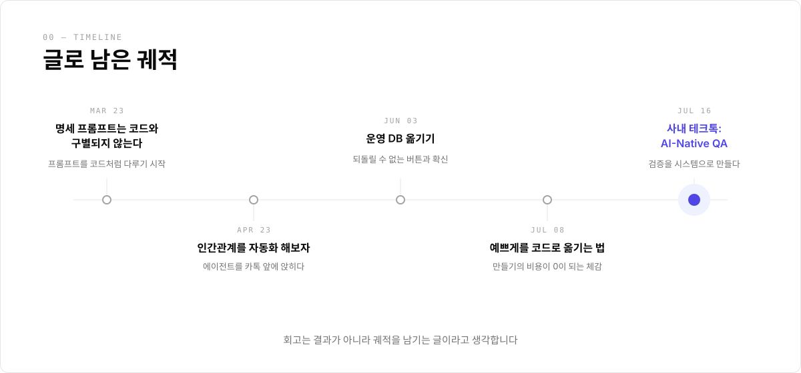
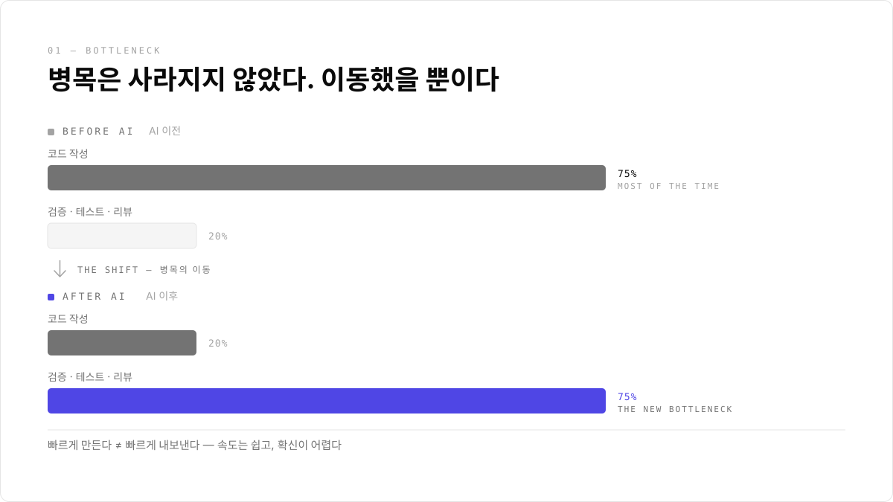
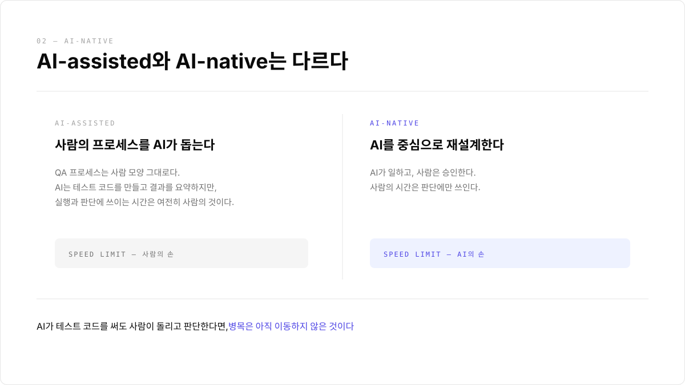
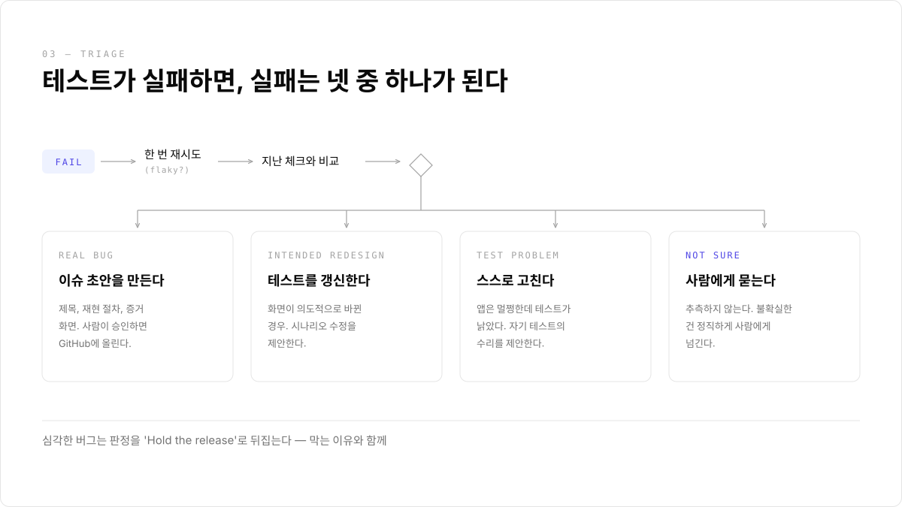
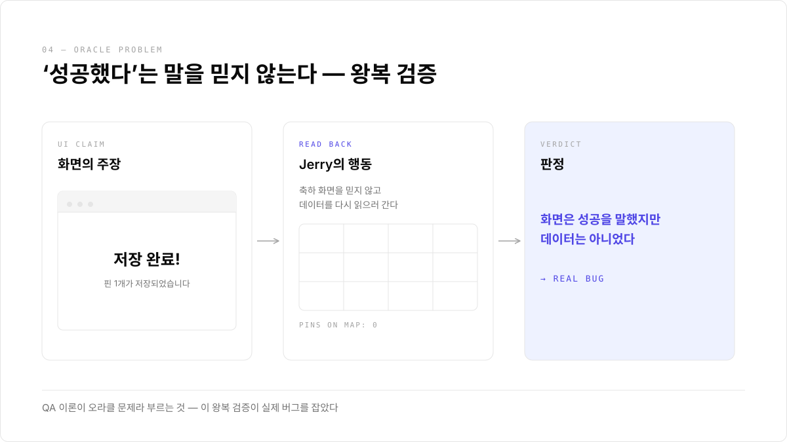
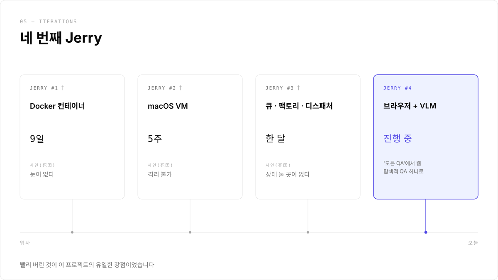
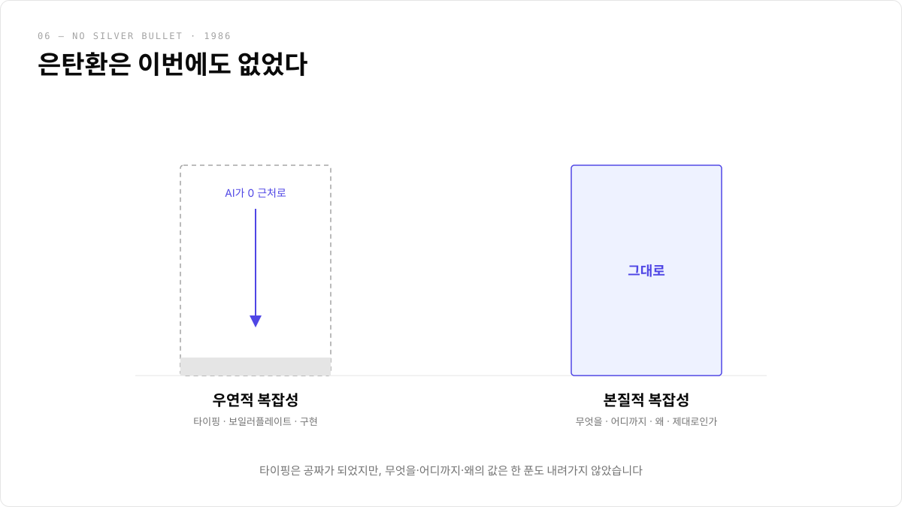

**<2026.01~2026.07 인턴 회고>**

## 2학년 마치고 인턴 지원

## "내가 못하는 게 없을 것 같은데?"

대학 2학년을 마치고 입사했습니다. 첫 출근 날 제 생각은 솔직히 이랬습니다.

**"내가 못하는 게 없을 것 같은데?"**

무섭지 않았습니다. AI를 마음껏 쓸 수 있는 회사였으니까요. 팀은 소위 AX 조직이었습니다. AI로 일하는 방식 자체를 다시 짜는, Team Topologies식으로 말하면 enabling 팀. 직무명은 AI Native Software Engineer였습니다.

명함에는 그렇게 적혀 있는데 그게 무슨 일인지는 저도 몰랐습니다. 그때 제가 혼자 내린 잠정 답은 "AI한테 뭘 시킬지 정하고 그 결과를 판단하는 사람" 정도였습니다. 지금 보면 이 답은 틀렸습니다. 어떻게 틀렸는지는 마지막에 쓰겠습니다.

6개월, 커밋 1,144개. 첫날의 그 생각은 정확히 절반만 맞았습니다. 어느 절반이 맞았는지부터 쓰겠습니다.

## 맞았던 절반 — 만들지 못하는 건 정말 없었다

3월에는 에이전트를 제어하는 명세 프롬프트를 코드처럼 리뷰하고 버전 관리하는 워크플로를 만들었습니다. 4월에는 카톡 답장을 에이전트한테 넘겨봤습니다. 6월에는 운영 DB를 통째로 옮겼고, 7월에는 운영 중인 서비스의 카드뉴스 제작을 자동화했습니다. "예쁘게"라는 요구사항까지 코드가 되는 걸 보면서, 만드는 쪽 비용이 0으로 수렴하는 걸 매일 체감했습니다.

여기에 뒤에서 길게 이야기할 QA 에이전트 하나가 더 붙습니다. 6개월 내내 그것만 붙잡고 있었던 건 아니고, 여러 개 중에 제일 오래 붙잡았던 하나입니다. 다만 배운 걸 가장 많이 뱉어낸 것도 그거였습니다. 대부분 아픈 쪽으로요.

## 그리고 옆자리

돌아보면 만들기가 싸졌다는 것만으로 이 6개월이 설명되지는 않습니다. 나머지 절반은 옆자리에 있었습니다.

개발을 잘하는 사람은 어디에나 있지만, 개발을 좋아하는 사람이 이렇게 몰려 있는 곳은 처음이었습니다. 새로 나온 걸 주말에 먼저 만져보고 월요일에 떠드는 사람들, 남의 코드에 진지하게 화내는 사람들, "그거 그렇게 하면 안 되지 않아요?"를 인턴한테도 똑같이 하는 사람들. 스물한 살짜리가 사흘 만에 갈아엎겠다고 해도 아무도 안 말리는 대신, 왜 갈아엎는지는 반드시 물어보는 곳이었습니다.

<!-- ▼ 여기에 구체적인 장면 하나가 들어가면 이 섹션이 산다. 기억나는 리뷰 코멘트 한 줄, 복도에서 붙었던 논쟁, 훔쳐온 남의 습관 같은 것. -->

제가 배운 것 중 절반은 그 사람들한테서 왔습니다. 이건 뒤에서 다시 이야기할 텐데, 결국 이 글의 결론과도 이어집니다.

## 틀렸던 절반이 드러나기 시작한 지점

반년을 지나면서 이상한 비대칭이 또렷해졌습니다. **만드는 쪽은 프롬프트 한 번이 됐는데, 검증만 사람 손가락 속도로 남아 있었습니다.**

암달의 법칙 그대로입니다. 검증이 파이프라인에서 차지하던 비중이 얼마였든, 만들기만 무한히 빨라지면 전체 속도는 안 빨라진 검증이 정합니다. 만들기가 AI 속도여도 확인이 손 속도면 조직은 손 속도로 움직입니다. 그게 눈에 보이니까 그냥 두기가 싫었습니다. 그래서 QA를 하는 AI를 만들었습니다. 이름은 Jerry입니다.

## 가장 오래 붙잡았던 하나

Jerry는 도구보다 팀에 채용하는 QA 엔지니어에 가깝게 설계했습니다. 감성이 아니라 인터페이스 문제입니다. 도구는 설정을 요구하고 동료는 목표를 받아들입니다. 사용자가 셀렉터랑 시나리오 문법을 배워야 하는 순간 검증 비용은 다시 사람에게 돌아오고, 병목은 그대로입니다.

그래서 주는 건 사이트 주소 한 줄입니다. 시나리오도 스크립트도 미리 안 씁니다. Jerry는 화면을 직접 보고, 눌러보면서 돌아다닙니다. Selenium이나 Playwright는 화면을 보는 게 아니라 DOM 셀렉터로 요소를 집는데, 셀렉터는 구현의 좌표지 의미의 좌표가 아니라서 리팩토링 한 번에 우수수 깨졌습니다. AI가 사람처럼 화면을 보게 되면서, 다음에 뭘 확인할지를 직전 관찰이 정하는 탐색적 테스팅이 기계 쪽으로 넘어왔습니다. velog를 맡겼더니 한 바퀴 돌아본 뒤에 사용자 페르소나까지 혼자 지어내더군요. "자신의 생각을 글로 남기고 싶은, 멋있어지고 싶은 개발자"라고요.

여기서 용어를 하나 갈라야 합니다. QA의 계보를 그리면 사람 QA → 자동화 QA → AI-assisted QA → AI-native QA인데, AI-assisted가 함정입니다. AI가 스크립트를 대신 써줘도 남는 건 pass·fail뿐이고, 실행하고 판단하는 시간은 여전히 사람 겁니다. 병목 안의 잡무를 빠르게 만드는 것과, 병목 자체를 직렬에서 빼내는 건 다릅니다. 프로세스를 사람 모양 그대로 두고 AI만 얹으면 겉보기엔 "우리도 AI 씁니다"인데 조직 속도는 그대로입니다.

제일 공들인 건 기능이 아니라 실패 처리였습니다. 자동화된 QA가 죽는 이유 1위는 버그를 못 잡아서가 아니라 시끄러워서입니다. 경보 정밀도가 무너지면 사람들은 알람을 끄고, 꺼진 알람은 없는 알람입니다. 그래서 FAIL이 나오면 한 번 재시도하고, 지난 체크와 비교한 다음, 진짜 버그 · 의도된 리디자인 · 테스트 자신의 문제 · 불확실 넷 중 하나로 분류합니다. 같은 서비스에서 Jerry는 "새로고침하면 JS 에러와 함께 화면이 검게 죽는다"는 앱의 버그와, "캔버스가 너무 빠른 클릭을 무시했다"는 자기 테스트의 한계를 다른 칸에 넣었습니다. 후자를 버그라고 소리쳤으면 늑대 소년이 됐겠죠. 그리고 넷째 칸, 추측하지 않고 사람한테 넘기는 칸이 있어야 나머지 셋을 믿을 수 있습니다.

반대 방향도 봤습니다. 사내 앱 pin-log가 "준비 완료! 1곳의 여행이 지도에 담겼어요"라는 축하 화면을 띄웠는데, Jerry는 그 화면 뒤 콘솔에서 401 두 건을 읽어냈습니다. 그 "1곳"은 저장에 성공한 수가 아니라 담으려던 후보의 수였고, 지도에 핀은 0개였습니다. UI의 성공 메시지는 판정 기준이 아니라 검증 대상입니다.

사실 이 의심은 6월에 손으로 먼저 해봤습니다. 운영 DB를 옮기면서 복원이 됐는지를 행 수로 세지 않고, 전체 행의 해시를 떠서 양쪽을 맞췄던 적이 있습니다. 시스템이 "됐다"고 말하는 것과 실제로 된 것은 다른 사건이라는 걸 그때 몸으로 배웠고, Jerry의 왕복 검증은 그 의심을 코드로 옮긴 것뿐입니다.

판정을 다 해놓고도 마지막 승인과 반려는 제가 하게 남겨뒀습니다. 겸손해서가 아닙니다. 한번은 Jerry한테 Jerry를 검사시켰는데, "됐습니다"라고 쓴 리포트를 Jerry가 직접 찍은 스크린샷이 반증하고 있었습니다. 만든 쪽과 검사하는 쪽이 같으면 틀린 게 맞은 것과 똑같은 얼굴을 합니다. 그럼 다른 인스턴스한테 시키면 되지 않냐는 반론이 자연스러운데, 여기엔 1986년에 나온 반례가 있습니다. Knight와 Leveson은 같은 명세로 따로 개발한 프로그램들이 통계적으로 유의미하게 **같은 입력에서 같이** 틀린다는 걸 보였습니다. 어려운 부분은 모두에게 어렵습니다. 같은 모델에서 나온 두 인스턴스라면 더 심하겠죠. 그래서 지표도 속도가 아니라 무수정 승인율, 그러니까 사람이 안 고치고 그냥 승인하는 비율로 잡았습니다. 게이트는 그대로 두고 리뷰만 가벼워지는 쪽으로요.

한 라운드가 끝나면 남는 건 초록불이 아니라 파일입니다. 기법, 기억, 결정이 전부 YAML로 쌓입니다. 구글 로그인 하나에 사흘이 들어갔습니다. 크로미움은 자동화 신호를 들키는 순간 차단당했고, 파이어폭스에 설정 세 개를 조합하고서야 통과했습니다. 그 조합이 실측 날짜와 함께 `google-login-headless-stealth.yaml`에 박혀 있어서, 다음 서비스는 사흘이 아니라 거기서 시작합니다. 기존 자동화 QA와의 차이를 하나만 꼽으라면 이겁니다. "내일은 오늘보다 나은가"에 예라고 답할 수 있는 구조인지.

여기까지가 살아남은 넷째의 모습입니다. 이제 죽은 셋 이야기를 하겠습니다.

## 폐기한 셋의 사인

첫 번째는 Docker 컨테이너 기반이었고 9일 만에 버렸습니다. 사인은 "눈이 없다". 화면을 못 보는 QA는 결국 셀렉터 자동화의 재탕이었습니다.

두 번째는 macOS VM 기반으로 5주를 썼습니다. 클릭 한 사이클을 10초에서 620ms까지 조였는데, 그렇게 조여놔도 macOS는 화면을 세션당 하나만 줬습니다. 사인은 "격리 불가".

세 번째는 큐와 팩토리와 디스패처를 갖춘, 제대로 된 아키텍처였습니다. 한 달을 만들고 **한 커밋으로 지웠습니다.** 사인은 "상태 둘 곳이 없다".

네 번째가 지금의 브라우저 + VLM 구성이고, "모든 QA"라는 야심을 웹 탐색적 QA 하나로 좁히고 나서야 살아남았습니다.

빨리 버린 게 이 프로젝트의 유일한 강점이었습니다. 자랑처럼 썼지만 반성문에 가깝습니다. 왜 반성문인지는 사인 셋을 나란히 놓고 나서야 보였습니다.

## 새로운 벽이 하나도 없었습니다

6개월치 벽을 정리하다가 좀 놀랐습니다. 제가 부딪힌 벽 중에 AI 시대에 새로 생긴 게 하나도 없었습니다. 전부 수십 년 전부터 소프트웨어 공학 교과서에 있던 문제였고, 개발 생명주기의 각 단계에서 정확히 한 번씩 넘어졌습니다.

**요구사항의 벽.** 무엇을 만들 것인가. QA를 만들겠다면서 "제대로 검증됐다"의 "제대로"가 뭔지는 아무도, 저 포함해서, 정의하지 못했습니다. 지나고 보니 이건 오라클 문제의 다른 얼굴입니다. 실행 결과가 옳은지 판정해줄 기준을 어디서 구할 거냐는 질문 말입니다. 정답의 정의가 없는데 정답 판정기를 만들겠다고 덤빈 셈이죠.

**스코프의 벽.** 어디까지 만들 것인가. 만드는 비용이 0이 되니까 "그건 비싸서 안 돼요"라는 거절의 언어가 사라졌고, 거절할 이유가 없어지자 전부 넣었습니다. "모든 QA를 대체한다"는 스코프는 그렇게 태어났습니다.

**설계의 벽.** YAGNI. 세 번째의 큐, 팩토리, 디스패처. 병렬 워커도 비동기 분리도 "곧 필요해질 것"이었는데 그 곧은 끝내 안 왔습니다. 그 한 달 동안 QA는 하나도 안 늘었고, 저는 큐의 레이스 컨디션이랑 캐시 버그만 잡고 있었습니다. 제일 아픈 건 설계할 때는 그게 YAGNI인 줄 전혀 몰랐다는 겁니다. YAGNI는 사후에만 보입니다.

**검증의 벽.** 80%는 하루면 됐고, 남은 기간 전부가 20%였습니다.

## 은탄환은 이번에도 없었다

이 "새로운 벽이 없다"는 관찰에도 이름이 있습니다. 1986년, Fred Brooks의 No Silver Bullet. 소프트웨어의 어려움은 표현(우연적 복잡성)이 아니라 개념 구조(본질적 복잡성)에 있어서, 표현을 아무리 싸게 만들어도 본질은 남는다는 이야기입니다.

타이핑과 보일러플레이트는 정말 0 근처가 됐습니다. 무엇을, 어디까지, 왜 만들 것인가의 값은 한 푼도 안 내려갔습니다. AI는 은탄환의 가장 강력한 후보였는데, 죽인 건 늑대 인간의 옷이었지 늑대 인간이 아니었습니다. 40년 된 문장을 6개월 동안 몸으로 재검증한 셈입니다.

## "그건 일주일짜리 작업인데"가 사실은 저를 막아주고 있었습니다

네 번을 갈아엎고 나서야 보인 게 있습니다.

예전엔 만드는 데 비용이 들었습니다. "그건 일주일짜리 작업인데"라는 말이 사람을 멈춰 세웠고, 우리는 그 멈춘 자리에서 무엇을, 어디까지, 왜 만들지를 정하게 됐습니다. 비용이 곧 강제된 설계 시간이었던 겁니다. AI가 그 비용을 지우니까 멈춤도 같이 사라졌습니다.

저는 6개월 동안 멈춘 적이 없습니다. 프롬프트 한 번이면 다음 버전이 나오니까, 생각하는 대신 만들었습니다. 세 번의 갈아엎기는 무엇을·어디까지·왜를 건너뛴 값이었습니다.

돌아보면 제대로 멈췄던 순간은 딱 한 번입니다. 6월, `aws rds delete-db-instance --skip-final-snapshot` 앞에서 엔터를 못 누르고 앉아 있던 순간. 그 명령어가 저를 세운 건 되돌릴 수 없다는 비용이 아직 남아 있는 영역이었기 때문입니다. 그리고 공교롭게도 그 멈춤 안에서 한 일, 해시 검증하고 통과 조건 정의한 것이 이 인턴십에서 가장 단단한 작업이었습니다.

그래서 지금 생각은 이렇습니다. 만드는 비용이 사람을 멈춰주던 시대는 끝났으니 **멈춤을 스스로 설계해야 합니다.** 문제 문장을 먼저 쓰는 것, "제대로"의 정의를 먼저 합의하는 것, 스코프에 거절의 언어를 되살리는 것. 예전엔 비용이 공짜로 해주던 일을 이제 규율이 대신해야 합니다.

## 그래서 AI Native Software Engineer는 무슨 일을 하는 사람인가

첫 출근 날의 제 답은 "AI한테 뭘 시킬지 정하고 결과를 판단하는 사람"이었습니다. 지금 보면 이건 직무 정의가 아닙니다. 시키고 판단하는 건 AI 쓰는 사람이면 누구나 합니다. 그게 직업이 되려면 시키는 사람이 백 명이어도 결과가 같아야 하는데, 실제로는 전혀 안 그렇죠.

6개월 동안 제가 실제로 만든 걸 다시 세어봤습니다. 명세 프롬프트를 코드처럼 리뷰하고 버전 관리하게 만든 것. 실패를 넷으로 가르는 규칙을 세운 것. 성공 메시지를 못 믿게 만들고 데이터로 다시 확인하게 한 것. 사흘치 삽질을 YAML에 박아서 다음 사람이 거기서 시작하게 한 것. 결과물처럼 보이지만 전부 **AI가 일할 환경**입니다. 컨텍스트를 어디에 둘지, 무엇으로 결과를 판정할지, 실패를 어디에 쌓을지. 제가 만든 건 산출물이 아니라 그 산출물이 나오는 자리였습니다.

그리고 이건 옆자리에서 배운 것과 같은 이야기입니다. 제가 이 6개월 동안 평소보다 잘한 게 있다면 제 실력이 갑자기 늘어서가 아니라, 사흘 만에 갈아엎어도 되지만 왜 갈아엎는지는 반드시 물어보는 사람들 사이에 있었기 때문입니다. 사람도 환경에서 잘합니다. AI도 그렇더군요. 좋은 모델을 데려다 놓는 것보다, 그 모델이 무엇을 보고 무엇으로 확인받는지를 정해주는 쪽이 결과를 훨씬 크게 바꿨습니다.

그래서 지금의 답은 이겁니다. AI가 일을 잘할 수 있는 환경을 만드는 사람. 앞으로 이 직무가 하는 일은 점점 그쪽으로 수렴하지 않을까 싶습니다. 프롬프트를 잘 쓰는 능력이 아니라, 판정 기준과 기억과 게이트를 어디에 놓을지 정하는 능력 쪽으로요.

## 배운 것들

**멈춤은 이제 공짜가 아니다.** "만드는 건 싸졌고 검증이 병목이다"라는 문제 문장 한 줄을 잡고 나니 기능 목록이 알아서 정리됐습니다. 뒤집으면, 그 한 줄을 잡기 전에 갈아엎은 세 번이 문장 없이 만든 값이었습니다. 뭘 만들지 모르겠으면 기능을 더 적을 게 아니라 문제 문장이 아직 없는 겁니다.

**검증의 독립성은 다른 검사자가 아니라 다른 표면에서 나온다.** 같은 모델을 두 번 돌리는 건 독립 검증이 아닙니다. 코드가 아니라 실행된 화면을, 주장이 아니라 데이터를 봐야 상관이 끊어집니다. 리뷰를 하나 더 붙일까 고민될 때마다 이 질문으로 돌아옵니다. 이건 다른 표면을 보는가, 같은 표면을 두 번 보는가.

**빨리 버리는 능력이 설계 감각을 대신하지는 못한다.** "빨리 버린 게 유일한 강점"은 세 번 잘못 설계했다는 말과 같은 말입니다. 버리는 비용을 낮게 유지하는 건 안전망이지 조준경이 아닙니다. 다만 YAGNI가 사후에만 보이는 이상, 안전망 없이 조준만 잘하겠다는 것도 오만이라는 걸 같이 배웠습니다.

**보여주기가 설명하기를 이긴다.** 두 발표 다 반응이 온 건 아키텍처 설명이 아니라 Jerry가 일하는 화면 넉 장이었습니다. 가능하다는 걸 본 적 없는 사람한테 필요한 건 설득이 아니라 시연입니다.

## 남은 아쉬움

검증기를 검증한 실험, 그러니까 결함을 몰래 심고 블라인드로 분류시켜서 거짓 경보 0건을 확인한 실험의 표본이 3입니다. 결함 분류 체계를 세우고 층화 주입해서 반복 실행의 판정 분산과 사람 라벨과의 일치도까지 재는 평가 하네스가 다음 할 일입니다. 검증을 파는 시스템은 자기 자신이 제일 엄격하게 검증받아야 하니까요.

그리고 기록을 미룬 것. 넘어진 것들은 넘어지는 그 순간에 적었어야 했습니다. 회고를 몰아 쓰면 아쉬움도 몰아서 옵니다.

## 마치며

첫날의 그 생각은 절반은 맞았습니다.

만들지 못하는 것은 없었습니다. 풀지 못하는 것이 있었을 뿐입니다. 이 둘의 차이를 아는 데 6개월과 커밋 1,144개와 폐기한 Jerry 셋이 들었습니다. 만드는 게 쉬웠고, **그래서** 푸는 게 어려웠습니다. 만들기가 쉬워진 만큼, 무엇을 왜 제대로 만들 것인가라는 오래된 질문이 숨을 곳 없이 드러났으니까요.

다음 발표에서도 제일 조용한 슬라이드는 아마 폐기한 것들의 목록일 겁니다. 그 목록이 짧아지길 바라지는 않습니다. 더 일찍 나오면 좋겠습니다.

그리고 그 목록을 스물한 살한테도 진지하게 물어봐 준 사람들 덕분에 이 6개월이 재미있었습니다. 감사했습니다.
