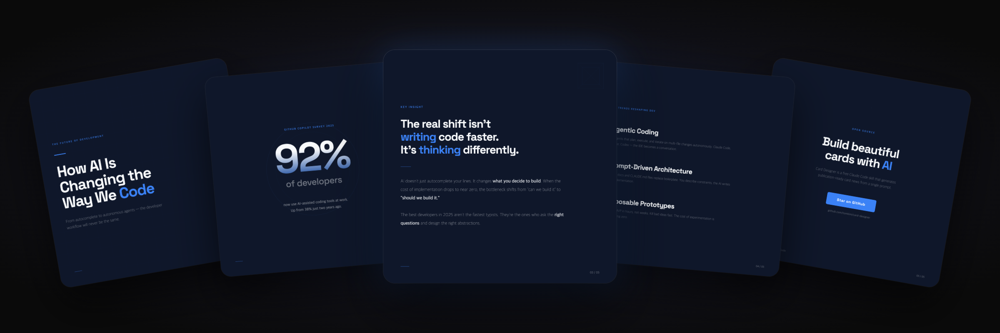
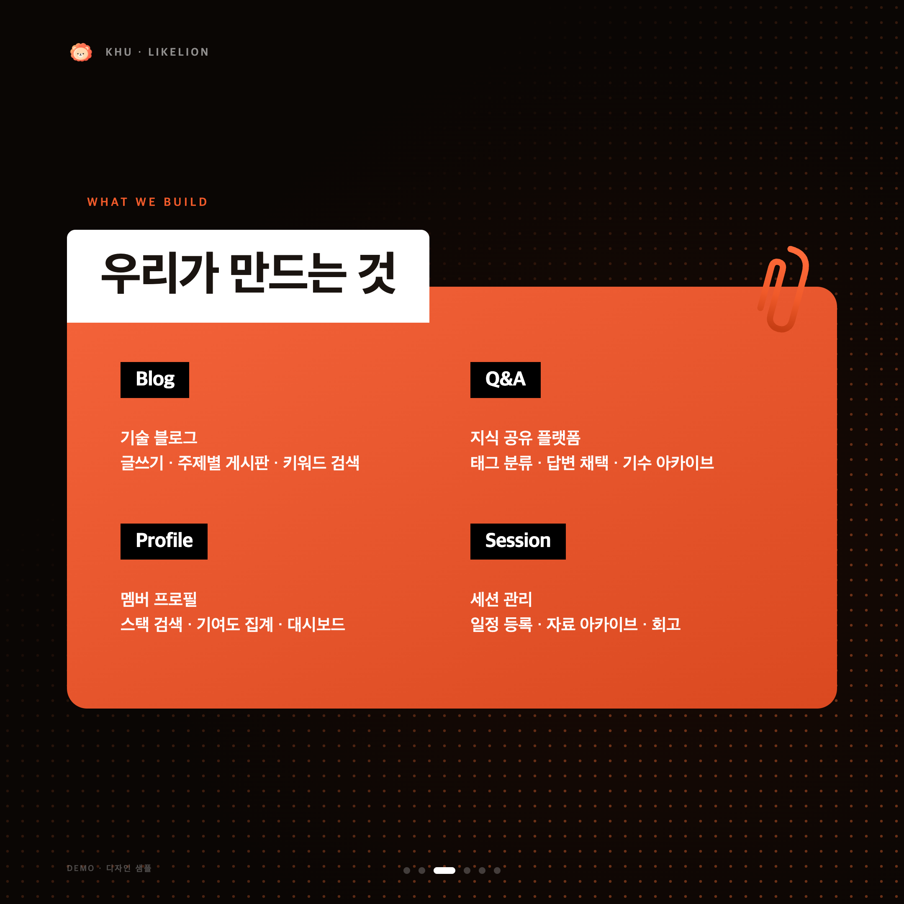

운영 중인 서비스의 인스타그램에 올릴 카드뉴스를 매번 손으로 만드는 게 번거로워서 AI로 자동화하고 싶었습니다.

저는 클로드의 역량을 꽤 낙관적으로 평가하는 편이라 "이 정도는 금방 되겠지" 하고 주말에 가볍게 시작했는데, 결국 몇 주가 걸렸습니다.

그 과정에서 "AI한테 일을 시킨다는 게 대체 뭘까"를 다시 생각하게 됐습니다. 그 이야기를 해보겠습니다.

## 카드뉴스, 생각보다 까다롭습니다

만들어 보기 전엔 저도 "이미지 몇 장 뽑으면 되겠지" 생각했습니다. 착각이었습니다.

카드뉴스는 대개 한 장으로 끝나지 않습니다. 표지 한 장, 본문 몇 장, 마지막 CTA 한 장으로 이어지는 시리즈입니다. 이 전부가 "같은 브랜드"처럼 보여야 합니다. 슬라이드마다 강조 색이 미묘하게 다르거나 로고 위치가 3px씩만 어긋나도 사람 눈은 그 미세한 차이를 귀신같이 잡아냅니다. 그리고 "대충 만들었네" 하고 넘어갑니다.

그러니까 진짜 목표는 예쁜 이미지 한 장을 만드는 게 아니었습니다. 끝까지 일관된 시리즈를 만드는 것이었습니다. 이건 한참 뒤에야 깨달았습니다.

## 1차 시도: 이미지를 통째로 뽑기

처음엔 가장 단순한 방법으로 갔습니다. 이미지 생성 모델에 프롬프트를 던지고 완성된 PNG를 그대로 받는 방식입니다. 2026년이니 이 정도는 당연히 될 거라 생각했습니다.

그런데 AI 이미지 생성 경험이 많지 않았던 탓인지, 예상보다 훨씬 못 미치는 디자인이 나왔습니다.

정확히는 텍스트가 망가졌습니다. 카드뉴스는 결국 타이포그래피인데, 카피 한 줄이 들어가야 할 자리에 철자가 뭉개진 글자가 나왔습니다. 한글은 더 심했습니다. "지원하세요"가 "지윈허세오" 비슷한 뭔가가 됐습니다. 짧은 단어는 그럭저럭 버텼지만, 문장이 되는 순간 무너졌습니다.

처음엔 제 프롬프트가 문제인 줄 알고 문구를 고쳐보기도 했지만 소용없었습니다. 나중에 찾아보니 모델 구조 자체에서 오는 한계였습니다.

Diffusion 계열 이미지 모델이 "읽을 수 있는 글자"를 잘 못 그린다는 건 학계에서도 이미 알려진 한계입니다. 이 모델의 텍스트 인코더는 글의 "의미"를 해석하도록 학습됐을 뿐, 획 하나하나의 정밀함을 담도록 만들어지지 않았습니다. 그래서 글자 수가 늘수록 정확도가 떨어집니다. 대략 20자를 넘기면 못 믿는다는 연구도 있습니다([Visual Text Processing 리뷰, arXiv 2025](https://arxiv.org/pdf/2504.21682)). 자음·모음을 조합하는 한글은 사정이 더 나쁩니다.

결국 원래 글자를 못 그리는 도구에 글자가 전부인 작업을 시킨 셈이었습니다. 프롬프트를 백 번 고쳐서 될 일이 아니었습니다.

## 방향 전환: 그림 말고, 문서

그래서 관점을 하나 바꿨습니다.

카드뉴스를 "그림"이라고 보면 이미지 생성이 맞습니다. 그런데 뜯어보면 카드뉴스는 사실 잘 배치된 문서에 가깝습니다. 제목, 본문, 강조 박스, 로고, 배경 모두 브라우저가 매일 픽셀 단위로 정확하게 그려내는 것들입니다.

그래서 AI에게 그림을 그리게 하는 대신 HTML/CSS를 짜게 하고, 그걸 헤드리스 브라우저로 PNG로 구워내는 방식을 떠올렸습니다. Puppeteer로 `.slide` 요소만 2배 크기로 스크린샷을 떠서 2160×2160 레티나 PNG로 뽑는 구조입니다.

여기서 결정적인 차이가 하나 있습니다. 이미지 생성은 확률적이라 같은 프롬프트도 매번 다른 결과를 냅니다. 반면 HTML 렌더링은 결정론적입니다. 같은 코드는 언제나 같은 픽셀을 냅니다. 글자는 폰트가 그리므로 뭉개질 일이 없고, 브랜드 색도 `#F05A2A`라고 쓰면 그 색 그대로 나옵니다. 로고는 원본 SVG를 그대로 넣으면 끝입니다.

글자 문제는 이걸로 완전히 사라졌습니다.

## 그런데... 안 예뻤습니다

그렇게 첫 시리즈가 빌드 통과, 렌더 통과를 거쳐 PNG 7장으로 깔끔하게 나왔습니다. 설레는 마음으로 열어봤습니다.

7장이 다 똑같았습니다. 다크 배경 왼쪽에 글자, 다음 장도 다크 배경 왼쪽에 글자, 그다음도 마찬가지였습니다. 오른쪽은 매번 휑하게 비어 있었습니다. 아무리 넘겨도 뭐가 달라졌는지 눈에 잘 들어오지 않았습니다. 인스타에 올릴 카드뉴스라기보다 그냥 다크 테마 터미널 출력 같았습니다.

이건 글자 깨짐보다 더 골치 아팠습니다. 글자 문제는 도구를 바꾸니 풀렸지만, 이건 아무리 생각해도 도구 문제가 아닌 것 같았습니다.

그래서 규칙을 써주기 시작했습니다. 폰트는 최소 몇 px, 강조는 굵게, 여백은 화면의 몇 %, 슬라이드마다 레이아웃을 바꿔라. 디자인 원칙을 프롬프트에 문단째로 박아넣었습니다.

그래도 지루했습니다. "예쁘게 만들어"가 코드로 도무지 번역되지 않았습니다. 규칙을 촘촘히 쓸수록 AI는 그 규칙을 딱 만족시키는 선에서만 움직였을 뿐 보기 좋게 만들지는 않았습니다. 여기서 며칠을 날렸습니다. 그런데 그 며칠 덕분에 이 프로젝트에서 유일하게 건진 걸 배웠습니다.

## AI는 디자인을 압니다. 우리 브랜드를 모를 뿐이었습니다

지루한 카드가 나온 건 모델이 멍청해서가 아니었습니다. Opus든 다른 모델이든, 요즘 모델은 좋은 카드와 나쁜 카드를 충분히 구별합니다. 문제는 "우리 브랜드에서 예쁘다는 게 뭔지"가 컨텍스트에 없었다는 점이었습니다. 그건 오직 제 머릿속에만 있었습니다.

여기까지는 사실 요즘 흔히 하는 얘기입니다. 모델보다 컨텍스트가 병목이라는 말입니다. 제가 진짜로 막힌 건 그다음이었습니다.

그 컨텍스트를 저조차 넣기 전엔 몰랐습니다.

이론상으로는 간단합니다. 제 머릿속 판단 기준을 문서로 옮겨 적으면 됩니다. 그런데 막상 앉아서 "우리 브랜드 디자인 규칙"을 적으려니 손이 안 나갔습니다. 색은 오렌지, 배경은 다크. 여기까지는 술술 나옵니다. 그런데 "그래서 강조는 어떻게 하는데?" 하고 스스로 물으면 대답을 못 했습니다. 저는 강조하는 법을 분명히 알고 있었지만, 미리 말로는 꺼내지 못했던 겁니다.

이게 언제 튀어나왔냐면, 지루한 카드를 눈으로 보고 나서였습니다. "아, 강조는 검정 박스에 흰 글씨지. 오렌지로 강조하면 배경이랑 싸우니까 안 되잖아." 이 규칙은 원래 제 안에 있었습니다. 그런데 망한 결과물을 마주치기 전엔 그런 게 있는 줄도 몰랐습니다. 넣어야 할 맥락은 미리 정리된 목록으로 존재하지 않았습니다. 뭔가 잘못된 걸 봤을 때 그제야 하나씩 튀어나왔습니다.

## "예쁘게"를 파일로 굳히기

그래서 온보딩을 "결과물 보고 반응하는" 사이클로 다시 짰습니다. 카드를 뽑고 → 어디가 별로인지 반응하고 → 그 반응을 규칙으로 받아 적습니다. 이 규칙들이 브랜드별 폴더에 파일로 차곡차곡 쌓입니다.

그 핵심이 `idioms.json`입니다. "이 브랜드는 강조를, 리스트를, 큰 숫자를 구체적으로 이렇게 표현한다"를 기계가 읽을 수 있게 적어둔 파일입니다. 실제로 들어간 강조 규칙은 이렇게 생겼습니다.

```json
"emphasis": {
  "type": "inline-highlight",
  "css": ".emph { background:#000; color:#fff; padding:4px 14px; font-weight:800; }",
  "rationale": "검정 박스 + 흰 텍스트. 사자 로고의 검정 눈/코와 시각적으로 호응.",
  "enforcement": "default",
  "usageBudget": { "perSlide": 1, "perSeries": 3 },
  "contextFit": "키워드 1-2개 강조가 필요한 slide에만. 큰 숫자가 주인공인 slide에선 생략."
}
```

여기서 `rationale`가 중요합니다. "검정 박스"라는 결과만 적는 게 아니라 "왜 검정인지"(로고의 눈·코와 호응)까지 같이 적습니다. 그래야 AI가 새 슬라이드에서 규칙을 기계적으로 복붙하지 않고 맥락에 맞게 응용합니다.

그리고 `usageBudget`과 `contextFit`이 있습니다. 이게 바로 아까 "7장이 다 똑같은" 문제의 실제 해법이었습니다. 규칙만 던져주면 AI는 그 규칙을 모든 슬라이드에 발라버립니다. "폴더 카드 컨테이너 예쁘다"고 하면 일곱 장을 전부 폴더 카드로 만들어버립니다. 그럼 그게 벽지가 됩니다. 그래서 표현마다 "시리즈당 최대 3번", "팀·파트 분류 같은 categorical 콘텐츠에만, 단일 인용구엔 금지" 같은 예산과 조건을 같이 박았습니다. 규칙과 규율을 한 세트로 준 셈입니다.

흥미로운 흔적도 하나 있습니다. 8개 표현 중 "성공·축하 느낌"을 담당하는 idiom은 처음에 일부러 `null`로 비워뒀습니다. 로그에는 이렇게 적혀 있습니다. `success-feel: TBD, 첫 실제 시리즈에서 정한다`. 축하 표현이 언젠가 필요할 거라는 건 알았지만, 진짜로 축하할 슬라이드가 오기 전에는 그게 어떻게 생겨야 할지 정하기 어려웠습니다. 맥락은 필요해지는 시점에야 채워졌습니다.

이렇게 쌓인 규칙으로 다시 뽑은 detail 슬라이드는 이런 모습입니다. 흰 탭과 오렌지 바디의 폴더 카드 안에 검정 라벨 박스로 항목을 나누고, 우상단에는 시그니처 클립을 꽂았습니다.



똑같이 "왼쪽 텍스트 + 오른쪽 여백"에서 출발했습니다. 이번엔 오른쪽 여백이 시그니처 오브젝트로 채워지고, 밋밋하던 강조가 로고와 호응하는 검정 박스로 바뀌었습니다. 프롬프트를 더 잘 써서라기보다는 참조할 파일이 생겼기 때문입니다.

## 그래서, 생성이 아니라 축적입니다

이 파일들은 대화를 거듭할수록 두꺼워집니다. `taste-profile.json`에는 값마다 confidence 점수가 붙어 있습니다. 처음엔 색·여백이 0.6~0.7이었다가, 시리즈를 몇 번 뽑고 나면 0.9로 올라갑니다. 여기서 축적은 비유적인 표현이 아닙니다. 문자 그대로 이 숫자가 오르는 과정을 가리킵니다. 피드백("여백 더", "이 색 좋다")이 일정 이상 쌓이면 자동 적용되는 규칙으로 승격되고, 두 번 반박당하면 다시 강등됩니다.

그래서 열 번째 카드뉴스는 첫 번째와 알아보기 어려울 정도로 달라집니다. 모델 성능이 좋아진 결과라기보다, 모델이 참조하는 맥락이 그만큼 두꺼워진 결과입니다. 그리고 이 맥락 파일은 도구가 아니라 사용자 폴더에 남습니다. 색이나 폰트 같은 표면적인 값은 스크린샷 한 장이면 5분 만에 베낄 수 있지만, 수십 번의 반응 사이클로 쌓인 `idioms.json`은 그렇게 훔칠 수 없습니다.

## 아직 못 푼 것들

물론 자랑만 할 일은 아닙니다. 지금도 confidence가 낮은 쪽에서는 AI가 엉뚱하게 응용합니다. 규율(budget/contextFit)을 너무 빡세게 걸면 이번엔 매번 똑같아지고, 느슨하게 풀면 다시 벽지가 됩니다. 이 사이의 균형은 아직도 감으로 잡고 있습니다.

AI에게 일을 시킬 때 제 몫의 절반은 이거였습니다. "머릿속엔 있는데 아직 말로 못 꺼낸 판단 기준"을 망한 결과물을 미끼 삼아 계속 끄집어내서 파일로 굳히는 일입니다. (나중에 알고 보니 "우리는 말할 수 있는 것보다 더 많이 안다"는 이 상태를 부르는 말이 따로 있었습니다. 암묵지라고 부른다고 합니다.)

모델의 성능은 이미 충분하다고 봅니다. 정작 병목은 대개 사람 머릿속에 있는 경우가 많았습니다.

* * *

_전체 코드는 [github.com/xhae123/card-designer](https://github.com/xhae123/card-designer)에 있습니다._
