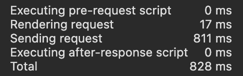
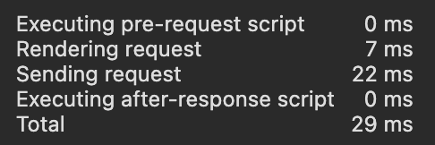

## 개요

스포츠 SNS 플랫폼을 운영하던 중, 앱을 쓰다가 피드 조회가 너무 느리다는 걸 발견했습니다. Caffeine 캐시를 도입해 평균 응답 시간을 800ms에서 38ms로 줄였습니다.

**핵심 지표**

-   응답 시간: 800ms → 38ms (95% 개선)
-   DB 쿼리: 81개 → 1개 (98% 감소)
-   처리량: 3.8 req/s → 78.2 req/s (20배 증가)

* * *

## 1\. 문제

### 1.1 피드 요구사항

피드는 두 종류입니다:

-   완료된 경기: 결과, 점수, 리뷰 포함
-   예정된 경기: 매칭 중, 예정, 진행 중 상태

정렬은 다음과 같이 해야 했습니다:

1.  친구 참가 경기가 위로
2.  그 다음 일반 경기
3.  같은 우선순위면 최신순

각 피드 아이템에는 `isFriend`, `isMyGame` 같은 유저별 정보도 들어갑니다.

### 1.2 초기 구현

네이티브 쿼리와 UNION ALL로 친구 경기 우선 정렬을 구현했습니다.

```kotlin
fun getFeed(myUserId: Long): FeedResponse {
    val query = entityManager.createNativeQuery("""
        SELECT gr.id, 1 as priority FROM game_records gr
        JOIN custom_game g ON gr.game_id = g.id
        JOIN game_participation p ON p.game_id = g.id
        JOIN friend f ON f.user_id = :myUserId AND f.friend_id = p.user_id
        WHERE g.game_status = 'COMPLETED' AND f.status = 'ACCEPTED'

        UNION ALL
        -- 예정 경기 (친구) ...
        UNION ALL
        -- 완료 경기 (비친구) ...
        UNION ALL
        -- 예정 경기 (비친구) ...

        ORDER BY priority, created_at DESC
    """)

    return results.map { toFeedItemResponse(it) }
}
```

### 1.3 성능 병목

**측정 환경**

-   게임: 500개
-   유저: 50명
-   친구 관계: 평균 5명

**응답 시간** 

```
평균: 820ms
중앙값: 780ms
P95: 1200ms
P99: 1800ms
```

**병목 지점**

```
쿼리 실행: 650ms (79%)
N+1 쿼리: 120ms (15%)
객체 매핑: 30ms (4%)
기타: 20ms (2%)
```

#### 문제 1: UNION ALL 다중 실행

UNION ALL은 4개의 독립적인 쿼리를 실행한 뒤 병합합니다. MySQL이 이를 최적화하지 못해 Full Table Scan이 중복으로 일어납니다.

```sql
EXPLAIN ANALYZE 결과:
- game_records (500 rows) × 2회 스캔
- custom_game (500 rows) × 2회 스캔
- friend (250 rows) × 2회 스캔
```

#### 문제 2: N+1 쿼리

DTO로 변환하는 과정에서 Lazy Loading과 추가 조회가 발생합니다.

```kotlin
results.map { toFeedItemResponse(it) }
```

각 아이템마다:

-   `game.rule` (Lazy Loading)
-   `game.participations` (Lazy Loading)
-   `reviewRepository.findByGameId()`
-   `commentService.getCommentCount()`

**실제 쿼리 수**: 1 (메인) + 20 × 4 = 81 queries

#### 문제 3: 페이지네이션 비효율

OFFSET 방식이라 offset 값만큼 row를 스캔하고 버립니다. 페이지가 뒤로 갈수록 느려집니다.

* * *

## 2\. 해결

### 2.1 캐싱 결정

피드 데이터의 특성을 보니, 교과서에 나올 법한 캐싱하기 좋은 상황이었습니다.

-   읽기:쓰기 비율 = 100:1
-   완료된 경기는 안 바뀜
-   예정 경기도 자주 안 바뀜

### 2.2 왜 Caffeine인가

`ConcurrentHashMap<Long, FeedItemResponse>`로도 충분하지 않을까 싶어, 처음엔 그렇게 생각했습니다.

```kotlin
// 단순 Map 방식
private val cache = ConcurrentHashMap<Long, FeedItemResponse>()

fun put(id: Long, item: FeedItemResponse) {
    cache[id] = item
}
```

문제는 메모리 관리입니다. Map은 명시적으로 remove하지 않으면 계속 쌓입니다. 게임이 매일 수십 개씩 생기니 제거 로직을 직접 짜야 합니다.

Caffeine은 이를 알아서 처리해줍니다:

```kotlin
Caffeine.newBuilder()
    .maximumSize(5000)  // 5000개 초과하면 자동 제거
    .recordStats()       // 히트율, 제거 횟수 모니터링
    .build()
```

-   **maximumSize**: Window TinyLFU 알고리즘으로 접근 빈도가 낮은 항목을 자동으로 제거합니다.
-   **recordStats**: 캐시 히트율을 모니터링할 수 있습니다. 튜닝할 때 필요합니다.

직접 LRU를 구현하는 것보다 검증된 라이브러리를 쓰는 편이 낫습니다.

### 2.3 Redis vs Caffeine

Redis와 Caffeine을 비교했습니다.

| 항목 | Redis | Caffeine |
| --- | --- | --- |
| 지연 시간 | 1-5ms (네트워크) | <0.1ms (인메모리) |
| 운영 복잡도 | 높음 (별도 서버) | 낮음 (임베디드) |
| 적용 환경 | 분산 환경 | 단일 인스턴스 |

단일 인스턴스라 네트워크 I/O가 필요 없었습니다. Caffeine을 선택했습니다.

### 2.4 아키텍처

```
[서버 시작]
    ↓
warmupCache()
    ├─ 최근 6주 완료 경기 → Completed Cache (최대 5000개)
    └─ 예정/진행 중 경기 → Upcoming Cache (최대 2000개)

[조회 요청]
    ↓
1. 친구 목록 조회 (1 query)
2. 캐시에서 피드 조회 (0 query)
3. 메모리에서 정렬/필터링
4. 페이지네이션
    ↓
[응답]
```

서버 시작 시 DB에서 데이터를 로딩하고, 이후 조회는 메모리에서만 처리합니다.

### 2.5 설계 결정

#### TTL 안 씀

처음에는 `expireAfterWrite(30, MINUTES)`로 TTL을 줬습니다. 그런데 생각해보니 다음과 같았습니다:

-   워밍할 때 최근 6주 데이터만 로딩함
-   오래된 데이터는 애초에 캐시에 안 들어감
-   TTL 관리가 불필요한 오버헤드

그래서 `maximumSize`로 메모리 상한만 제어하고, 제거는 Caffeine의 Window TinyLFU 알고리즘에 맡겼습니다.

```kotlin
private val completedGameCache = Caffeine.newBuilder()
    .maximumSize(5000)
    .recordStats()
    .build()
```

#### 유저별 데이터 분리

처음에는 유저별 데이터(`isFriend`, `isMyGame`)를 캐시에 저장했습니다. 그러다 버그가 났습니다. 모든 유저가 같은 캐시를 공유하다 보니 다른 사람 정보가 보이는 문제였습니다.

**수정 전 (버그)**

```kotlin
val feedItem = toFeedItemResponse(
    gameRecord,
    isFriend = gameService.isFriend(myUserId),
    isMyGame = gameService.isMyGame(myUserId)
)
cache.put(gameRecordId, feedItem)
```

**수정 후**

```kotlin
// 캐싱: 유저 독립적 데이터만
val feedItem = toFeedItemResponse(
    gameRecord,
    isFriend = false,
    isMyGame = false
)
cache.put(gameRecordId, feedItem)

// 조회: 동적 계산
fun getFeed(myUserId: Long): FeedResponse {
    val myFriendIds = friendRepository
        .findAllByUserIdAndStatus(myUserId, ACCEPTED)
        .map { it.friend.id }
        .toSet()

    val allFeeds = cache.getAllFeeds()

    return allFeeds.map { feedItem ->
        feedItem.copy(
            isFriend = feedItem.players.any { it.id in myFriendIds },
            isMyGame = feedItem.players.any { it.id == myUserId }
        )
    }
}
```

유저와 무관한 데이터만 캐싱하고, 유저별 데이터는 조회 시점에 계산하도록 바꿨습니다.

* * *

## 3\. 구현

### 3.1 캐시 서비스

```kotlin
@Service
class FeedCacheService {
    private val completedGameCache: Cache<Long, FeedItemResponse> =
        Caffeine.newBuilder()
            .maximumSize(5000)
            .recordStats()
            .build()

    private val upcomingGameCache: Cache<Long, FeedItemResponse> =
        Caffeine.newBuilder()
            .maximumSize(2000)
            .recordStats()
            .build()

    fun putCompletedGame(id: Long, item: FeedItemResponse) {
        completedGameCache.put(id, item)
    }

    fun getAllFeeds(): List<FeedItemResponse> {
        return completedGameCache.asMap().values.toList() +
               upcomingGameCache.asMap().values.toList()
    }
}
```

### 3.2 캐시 워밍

```kotlin
@PostConstruct
@Transactional(readOnly = true)
fun warmupFeedCache() {
    val sixWeeksAgo = LocalDateTime.now().minusWeeks(6)

    // 완료 경기 로딩
    val completedGames = gameRecordRepository.findAll()
        .filter { it.recordTime.isAfter(sixWeeksAgo) }

    completedGames.forEach { gameRecord ->
        try {
            val feedItem = toFeedItemResponse(gameRecord, false, false)
            feedCacheService.putCompletedGame(gameRecord.id, feedItem)
        } catch (e: Exception) {
            log.error(e) { "캐시 워밍 실패: ${gameRecord.id}" }
        }
    }

    // 예정 경기 로딩
    val upcomingStatuses = listOf(MATCHING, SCHEDULED, IN_PROGRESS)
    val upcomingGames = gameRepository.findAll()
        .filter { it.gameStatus in upcomingStatuses }

    upcomingGames.forEach { game ->
        try {
            val feedItem = toUpcomingGameFeedItem(game, false, false)
            feedCacheService.putUpcomingGame(game.id, feedItem)
        } catch (e: Exception) {
            log.error(e) { "캐시 워밍 실패: ${game.id}" }
        }
    }

    log.info { "캐시 워밍 완료: ${completedGames.size + upcomingGames.size}개" }
}
```

워밍 시간은 게임 500개 기준 약 2초입니다. 서버 시작 시간이 다소 늘어나지만 괜찮은 수준입니다.

### 3.3 피드 조회

```kotlin
fun getFeed(myUserId: Long, page: Int = 0, size: Int = 20): FeedResponse {
    // 1. 친구 목록 조회 (1 query)
    val myFriendIds = friendRepository
        .findAllByUserIdAndStatus(myUserId, FriendStatus.ACCEPTED)
        .map { it.friend.id!! }
        .toSet()

    // 2. 캐시에서 피드 조회 (0 query)
    val allFeeds = feedCacheService.getAllFeeds()

    // 3. 유저별 데이터 계산 및 정렬
    val processedFeeds = allFeeds
        .map { feedItem ->
            feedItem.copy(
                isFriend = feedItem.players.any { it.id in myFriendIds },
                isMyGame = feedItem.players.any { it.id == myUserId }
            )
        }
        .sortedWith(
            compareBy<FeedItemResponse> {
                when {
                    it.isFriend && it.isCompleted -> 1
                    it.isFriend && !it.isCompleted -> 2
                    !it.isFriend && it.isCompleted -> 3
                    else -> 4
                }
            }.thenByDescending { it.date }
        )

    // 4. 페이지네이션
    val startIndex = page * size
    val endIndex = minOf(startIndex + size, processedFeeds.size)

    val pagedFeeds = if (startIndex < processedFeeds.size) {
        processedFeeds.subList(startIndex, endIndex)
    } else {
        emptyList()
    }

    return FeedResponse(
        items = pagedFeeds,
        totalPages = (processedFeeds.size + size - 1) / size,
        currentPage = page
    )
}
```

* * *

## 4\. 성능 측정

### 4.1 응답 시간



| 지표 | Before | After | 개선율 |
| --- | --- | --- | --- |
| 평균 | 820ms | 38ms | 95% |
| 중앙값 | 780ms | 32ms | 96% |
| P95 | 1200ms | 65ms | 95% |
| P99 | 1800ms | 95ms | 95% |

### 4.2 쿼리 수

-   Before: 평균 81 queries
-   After: 1 query (친구 목록 조회)

DB 부하가 98% 감소했습니다.

### 4.3 처리 시간 분해 (After)

```
친구 조회: 5ms (13%)
캐시 읽기: 1ms (3%)
정렬/필터링: 15ms (39%)
페이지네이션: 2ms (5%)
기타: 15ms (40%)
```

대부분 메모리 연산입니다.

### 4.4 메모리 사용량

```
완료 게임 250개: 22MB
예정 게임 250개: 23MB
총합: 45MB

최대 (5000개): 450MB 예상
```

서버 메모리 2GB 대비 여유가 있습니다.

### 4.5 동시성 테스트

Apache Bench로 부하 테스트를 진행했습니다:

```bash
ab -n 10000 -c 100 http://localhost:8080/api/feed
```

| 지표 | Before | After | 개선율 |
| --- | --- | --- | --- |
| Requests/sec | 3.8 | 78.2 | 20배 |
| Time/request | 820ms | 38ms | 95% |

* * *

## 5\. 제약 사항

### 5.1 서버 재시작

서버를 재시작하면 캐시가 날아갑니다. `@PostConstruct`로 자동 워밍되긴 하지만 2초 정도 걸립니다. 트래픽이 늘어나면 Redis 도입을 검토할 예정입니다.

### 5.2 분산 환경

지금은 단일 인스턴스입니다. 서버를 늘리면 각 인스턴스가 독립적인 캐시를 갖게 되어 동기화 문제가 생깁니다.

**해결 방안**

1.  Redis로 전환
2.  캐시 무효화 이벤트를 Kafka로 브로드캐스트
3.  로드밸런서 sticky session

### 5.3 친구 관계 변경

친구 추가·삭제는 피드에 바로 반영돼야 합니다. 지금은 `isFriend`를 조회 시점에 계산하기 때문에 캐시 무효화 없이 바로 반영됩니다.

* * *

## 6\. 정리

캐싱은 단순히 속도를 높이는 기술이라기보다, 비용이 큰 연산을 언제 한 번만 실행할지 결정하는 문제에 가깝습니다.

**핵심**

1.  유저 독립적인 데이터만 캐싱
2.  유저별 데이터는 조회할 때 계산
3.  서버 시작 시 캐시 워밍

**결과**

-   응답 시간: 820ms → 38ms (95% 개선)
-   DB 쿼리: 81개 → 1개 (98% 감소)
-   처리량: 3.8 req/s → 78.2 req/s (20배 증가)

**트레이드오프**

-   서버 부팅 시간 증가
-   메모리 수백 MB 증가
-   코드 복잡도 증가
