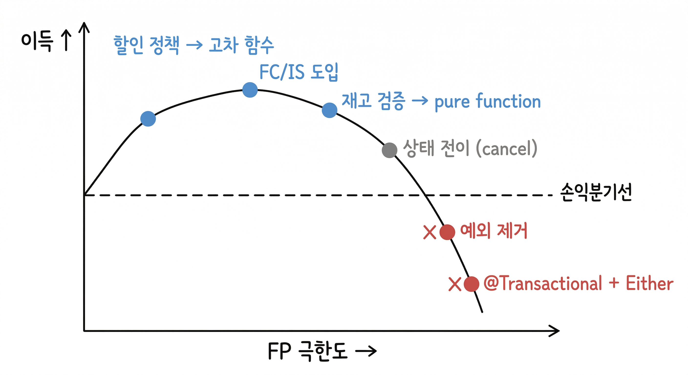

## 0. 익숙한 코드에서 시작한다
 
코틀린과 스프링으로 주문 서비스를 만들면 대체로 이런 모양이 나옵니다.
 
```kotlin
@Transactional
fun create(request: OrderRequest): OrderResponse {
    val order = GoodsOrder()
    for (itemRequest in request.items) {
        val goods = goodsService.getGoods(itemRequest.goodsId)
        goods.decreaseStock(itemRequest.quantity)
        val subtotal = goods.calculateTotalPrice(itemRequest.quantity)
        val discount = discountService.calculateDiscount(goods, quantity, subtotal)
        val orderItem = OrderItem(
            goods = goods,
            quantity = itemRequest.quantity,
            unitPrice = goods.price,
            subtotal = subtotal,
            discountAmount = discount
        )
        order.addItem(orderItem)
    }
    order.calculatePrices()
    return OrderResponse.from(orderRepository.save(order))
}
```
 
동작합니다. 잘 동작합니다. 그런데 뜯어보면 side effect가 여기저기 숨어 있습니다.
 
`decreaseStock()`부터 보겠습니다. 상태를 변경하는 side effect가 있는데, 시그니처에는 드러나지 않습니다.
 
```kotlin
fun decreaseStock(quantity: Int) {
    if (stock < quantity) throw OutOfStockException(...)
    stock -= quantity
}
```
 
반환 타입이 `Unit`입니다. 이 메서드가 `Goods`의 `stock` 필드를 바꾼다는 건 구현을 열어봐야 알 수 있습니다. `cancel()`은 더 심합니다. `GoodsOrder`의 메서드인데 `Goods`의 재고까지 바꿉니다.
 
```kotlin
fun cancel() {
    changeStatus(OrderStatus.CANCELLED)
    items.forEach { it.goods.increaseStock(it.quantity) }
}
```
 
다음으로, 한 `for`문 안에 DB 조회, 재고 검증, 가격 계산, 할인 계산, 상태 변경이 전부 섞여 있습니다. 비즈니스 로직만 따로 테스트하려면 이렇게 됩니다.
 
```kotlin
val goodsService = mock<GoodsService>()
val discountService = mock<DiscountService>()
val orderRepository = mock<OrderRepository>()
whenever(goodsService.getGoods(1L)).thenReturn(goods)
whenever(discountService.calculateDiscount(any(), any(), any())).thenReturn(1000)
whenever(orderRepository.save(any())).thenAnswer { it.arguments[0] }
```
 
mock 3개를 세팅하고 나서야 테스트를 시작할 수 있습니다. 검증하고 싶었던 건 "10,000원짜리 상품 2개 주문하면 20,000원인가?" 이 한 가지뿐인데 말입니다.
 
마지막으로, `decreaseStock()`이 재고 부족 시 예외를 던집니다. 그런데 재고 부족이 정말 "예외적 상황"일까요. 주문 서비스에서 재고 부족은 충분히 예상 가능한 비즈니스 결과입니다.
 
이 문제들이 실무에서 왜 중요한지 짚어 보겠습니다. 숨겨진 side effect는 코드 리뷰에서 잡기 어렵고, 새 팀원이 `cancel()`을 호출하면서 재고가 바뀌는 걸 모르면 버그로 이어집니다. IO와 계산의 혼합은 테스트 작성 비용을 높이고, mock 세팅에 쏟는 시간이 쌓이면 "테스트를 안 쓰는 게 빠르다"는 유혹으로 연결됩니다.
 
예외 기반 에러 처리는 시그니처에 실패 가능성이 드러나지 않아서, 호출자가 예외를 핸들링하지 않은 채 프로덕션에 나가고 나서야 장애로 발견되는 경우가 생깁니다. 개별로 보면 사소하지만, 서비스가 커지면서 이런 것들이 누적되면 개발 속도와 안정성 모두에 영향을 줍니다.
 
* * *
 
이런 불편함이 쌓이면 결국 FP를 검토하게 됩니다. immutable data, pure function, typed error handling. 위의 문제들을 정확히 겨냥하는 도구처럼 보입니다.
 
직접 해봤습니다. 코틀린/스프링 주문 서비스에 FP를 극한까지 밀어넣었습니다. JPA 엔티티를 `data class`로 바꿨고, 예외를 `sealed class`로 대체했고, 할인 정책을 고차 함수로 전환했고, Arrow의 `Either`까지 도입했습니다. 이 글에서는 위에서 본 관례적인 코드를 **1회차**, FP를 밀어넣은 코드를 **2회차**라고 부르겠습니다.
 
결론부터 말하면 되는 것과 안 되는 것이 있었습니다. 흥미로운 건, "안 되는 것"의 이유가 두 종류였다는 점입니다.
 
하나는 도구의 한계입니다. JPA가 `val`을 거부하는 것, `@Transactional`이 `Either`를 모르는 것. 이건 다른 도구를 쓰면 사라집니다.
 
다른 하나는 문제 자체의 본성입니다. 변경을 추적하려면 상태가 필요하다는 것, encapsulation을 풀면 안전망이 약해진다는 것. 이건 어떤 도구를 써도 남습니다.
 
Fred Brooks가 1986년에 쓴 "No Silver Bullet"에서는 전자를 우연적 복잡성(accidental complexity), 후자를 본질적 복잡성(essential complexity)이라고 부릅니다. 이 구분이 실무에서 중요한 이유는 대응이 완전히 다르기 때문입니다.
 
우연적 벽은 선택의 문제입니다. 도구를 바꾸든, 관례를 존중하고 돌아가든 할 수 있습니다. 본질적 벽은 타협의 문제입니다. 완벽한 해결이 없으므로, 트레이드오프를 의식적으로 설계해야 합니다.
 
이 글은 코틀린/스프링 주문 서비스에 FP를 극한까지 밀어넣으면서 만난 벽들을, 하나하나 "이건 본질인가 우연인가"로 판별한 기록입니다.
 
## 1. JPA 엔티티를 immutable로 만들 수 있을까? — 우연적 벽
 
mutable state가 side effect의 근원이라면, 가장 직관적인 해결책은 immutable로 만드는 것입니다. 코틀린에는 `data class`와 `val`이라는 훌륭한 도구가 있으니, JPA 엔티티에 그대로 적용해보기로 했습니다.
 
```kotlin
// Before: 가변 엔티티
@Entity
class GoodsOrder(
    @OneToMany(mappedBy = "order", cascade = [CascadeType.ALL])
    var items: MutableList<OrderItem> = mutableListOf(),
 
    @Enumerated(EnumType.STRING)
    var status: OrderStatus = OrderStatus.PENDING,
 
    var totalPrice: Int = 0,
    var totalDiscount: Int = 0,
    var finalPrice: Int = 0,
 
    @Id @GeneratedValue(strategy = GenerationType.IDENTITY)
    var id: Long = 0
) {
    fun addItem(item: OrderItem) {
        items.add(item)
        item.order = this
    }
 
    fun changeStatus(newStatus: OrderStatus) {
        if (!status.canTransitionTo(newStatus)) throw InvalidStatusException(...)
        this.status = newStatus
    }
}
```
 
```kotlin
// After: 불변 엔티티 시도
@Entity
data class GoodsOrder(
    @OneToMany(mappedBy = "order", cascade = [CascadeType.ALL])
    val items: List<OrderItem> = emptyList(),
 
    @Enumerated(EnumType.STRING)
    val status: OrderStatus = OrderStatus.PENDING,
 
    val totalPrice: Int = 0,
    val totalDiscount: Int = 0,
    val finalPrice: Int = 0,
 
    @Id @GeneratedValue(strategy = GenerationType.IDENTITY)
    val id: Long = 0
)
 
// 상태 변경은 copy()로 새 객체 반환
fun GoodsOrder.withItem(item: OrderItem): GoodsOrder =
    copy(items = items + item)
 
fun GoodsOrder.withStatus(newStatus: OrderStatus): GoodsOrder =
    copy(status = newStatus)
```
 
`var`가 `val`로 바뀌고, 상태 변경 메서드가 사라졌습니다. `order.withItem(item).withCalculatedPrices()`처럼 체이닝으로 의도를 표현할 수 있게 됐습니다. 상태 변경 순서에 대한 고민도 없습니다. 컴파일도 통과합니다. 앱도 뜹니다. INSERT도 됩니다.
 
그런데 UPDATE가 안 됩니다.
 
```kotlin
val updated = order.withStatus(OrderStatus.CONFIRMED)
orderRepository.save(updated)
// DB를 확인하면: status = PENDING. 안 바뀌었다.
// 예외? 없다. 에러 로그? 없다. 그냥 조용히 무시된다.
```
 
컬렉션은 더 심합니다.
 
```kotlin
val order = orderRepository.findById(1L).get()
println(order.items.size)
// 출력: 0
// 실제로는 아이템 3개를 넣었다. 500 에러도 안 난다. 정상 응답에 빈 배열이 온다.
```
 
컴파일 에러가 아니라 runtime silent failure입니다. 이게 단순한 "안 됨"보다 훨씬 위험한 이유는, 테스트 없이는 발견할 수 없기 때문입니다. 프로덕션에서 "주문했는데 상태가 안 바뀌어요" 이슈로 처음 발견될 수 있습니다.
 
### 왜 이런 일이 벌어지는가
 
Hibernate의 작동 원리 네 가지가 동시에 깨집니다.
 
dirty checking: Hibernate는 트랜잭션이 끝날 때 엔티티 필드의 변경을 감지해서 UPDATE를 만듭니다. `val`이면 필드가 바뀔 수 없으니 Hibernate가 "변경 없음"으로 판단합니다. UPDATE 쿼리 자체가 나가지 않습니다.
 
copy()와 영속성 컨텍스트: `copy()`는 새 JVM 인스턴스를 만듭니다. Hibernate가 관리하고 있던 원래 인스턴스와는 완전히 별개의 객체입니다. `save()`를 호출해도 Hibernate는 이걸 "기존 엔티티의 갱신"이 아니라 "새 엔티티의 삽입"으로 처리하려 합니다.
 
PersistentBag: `@OneToMany`로 선언된 컬렉션은 Hibernate가 자체 구현체인 `PersistentBag`으로 교체합니다. 이 교체가 setter를 통해 일어나는데, `val`이면 setter가 없습니다. 결과적으로 Hibernate의 컬렉션이 주입되지 못하고, 생성자에서 설정한 `emptyList()`가 그대로 남습니다.
 
data class의 equals/hashCode: `data class`는 모든 프로퍼티를 기반으로 `equals()`와 `hashCode()`를 생성합니다. JPA는 엔티티의 동일성을 id 기반으로 관리하는데, status 하나만 바뀌어도 `equals()`가 false를 반환하면서 Hibernate의 1차 캐시 관리가 무너집니다.
 
### 그런데 왜 컴파일은 되는가?
 
코틀린의 `kotlin("plugin.jpa")`가 no-arg constructor를 자동 생성하고, `kotlin("plugin.spring")`이 `open` 키워드를 자동으로 붙여줍니다. JPA가 요구하는 두 가지 조건이 컴파일 시점에 조용히 충족되기 때문에, `data class` + `val` 엔티티가 아무 경고 없이 빌드됩니다.
 
플러그인이 "이건 JPA 엔티티인데 `data class`로 선언하면 위험합니다" 같은 경고를 줄 수 있었을 텐데, 그런 경고는 없습니다. 컴파일이 되니까 동작할 거라고 생각하는 건 자연스러운 일입니다.
 
### 판정: 우연적 복잡성
 
이 벽은 JPA/Hibernate의 설계 선택에서 비롯됩니다.
 
immutable collection을 지원하는 ORM은 존재합니다. Exposed나 jOOQ에서는 `val`과 `data class`를 자연스럽게 쓸 수 있습니다. Hibernate가 setter 기반으로 상태를 관리하는 건 Java 초기부터 이어져 온 설계 방식이지, 영속성이 반드시 이렇게 동작해야 하는 건 아닙니다.
 
다만, 여기에는 본질적 성분이 하나 섞여 있습니다. "변경을 추적하려면 상태가 있어야 한다"는 원리 자체는 도구에 독립적입니다. dirty checking이라는 구체적 방식은 우연적이지만, 변경 추적이 가변성을 전제한다는 점은 본질적입니다. 이 구분은 섹션 4에서 다시 다룹니다.
 
## 2. 벽을 돌아가다 — 도메인 모델 분리
 
JPA 엔티티를 immutable로 만들 수 없다면, 발상을 바꿔야 합니다. 엔티티 자체에 FP를 적용하는 대신, FP를 위한 별도의 모델을 만들고 비즈니스 로직을 그쪽으로 옮기는 것입니다.
 
JPA 엔티티는 그대로 둡니다. `var`, `class`, `MutableList`. Hibernate가 원하는 대로 둡니다. 대신 비즈니스 계산에 필요한 데이터만 뽑아서 불변 모델을 만듭니다.
 
```kotlin
/** 불변 도메인 모델 — JPA를 모른다 */
data class GoodsSnapshot(
    val id: Long,
    val name: String,
    val price: Int,
    val stock: Int,
    val categoryDiscountRate: Int
)
```
 
이 모델로 계산하는 pure function을 만듭니다. DB를 모르고, Spring을 모르고, 예외를 던지지 않습니다.
 
```kotlin
/** Functional Core — pure function. 입력 → 출력만. */
object OrderCalculator {
    fun calculate(
        inputs: List<OrderItemInput>,
        goodsMap: Map<Long, GoodsSnapshot>,
        discountPolicy: (GoodsSnapshot, Int, Int) -> Int
    ): OrderResult {
        val aggregated = inputs.groupBy { it.goodsId }
            .map { (goodsId, group) -> OrderItemInput(goodsId, group.sumOf { it.quantity }) }
 
        for (input in aggregated) {
            val goods = goodsMap[input.goodsId]
                ?: return OrderResult.Failed(listOf(OrderError.GoodsNotFound(input.goodsId)))
 
            if (goods.stock < input.quantity)
                return OrderResult.Failed(listOf(OrderError.OutOfStock(goods.id, goods.stock, input.quantity)))
 
            val subtotal = goods.price * input.quantity
            val discount = discountPolicy(goods, input.quantity, subtotal)
            // ... 결과 조립
        }
        // ... 결과 조립 생략
        return OrderResult.Success(OrderCalculation(items, totalPrice, totalDiscount, finalPrice, stockDeductions))
    }
}
```
 
에러는 예외가 아니라 `sealed class`로 반환합니다.
 
```kotlin
sealed class OrderError {
    data class OutOfStock(val goodsId: Long, val available: Int, val requested: Int) : OrderError()
    data class GoodsNotFound(val goodsId: Long) : OrderError()
}
 
sealed class OrderResult {
    data class Success(val calculation: OrderCalculation) : OrderResult()
    data class Failed(val errors: List<OrderError>) : OrderResult()
}
```
 
서비스는 IO만 담당합니다. DB에서 엔티티를 꺼내고, 스냅샷으로 변환하고, Core를 호출하고, 결과에 따라 엔티티를 조립해서 저장합니다.
 
```kotlin
/** Imperative Shell — IO 조율만 */
@Transactional
fun create(request: OrderRequest): OrderResponse {
    // 1. IO: DB에서 상품 조회
    val goodsEntities = request.items.map { it.goodsId }.distinct()
        .associateWith { goodsService.getGoods(it) }
 
    // 2. 변환: JPA 엔티티 → 불변 스냅샷
    val snapshots = goodsEntities.mapValues { (_, g) -> g.toSnapshot() }
 
    // 3. Core 호출: pure computation (DB 모름, 예외 안 던짐)
    val inputs = request.items.map { OrderItemInput(it.goodsId, it.quantity) }
    val result = OrderCalculator.calculate(inputs, snapshots, discountPolicy)
 
    // 4. 결과 처리: 실패면 예외, 성공이면 엔티티 조립 + 저장
    return when (result) {
        is OrderResult.Failed -> throw result.errors.first().toException()
        is OrderResult.Success -> {
            val calc = result.calculation
            for (deduction in calc.stockDeductions) {
                goodsEntities[deduction.goodsId]!!.applyStockDeduction(deduction.quantity)
            }
            val order = GoodsOrder()
            for (itemCalc in calc.items) {
                order.addItem(OrderItem(
                    goods = goodsEntities[itemCalc.goodsId]!!,
                    quantity = itemCalc.quantity,
                    unitPrice = itemCalc.unitPrice,
                    subtotal = itemCalc.subtotal,
                    discountAmount = itemCalc.discountAmount
                ))
            }
            order.totalPrice = calc.totalPrice
            order.totalDiscount = calc.totalDiscount
            order.finalPrice = calc.finalPrice
            OrderResponse.from(orderRepository.save(order))
        }
    }
}
```
 
이 구조에는 이름이 있습니다. Gary Bernhardt가 2012년 "Boundaries" 강연에서 발표한 Functional Core / Imperative Shell 패턴입니다. pure function으로 계산하는 Core와, IO를 orchestrate하는 Shell을 분리합니다.
 

 
### 이 구조에서 테스트는 어떻게 달라지는가
 
이 전환에서 가장 체감이 큰 부분입니다.
 
```kotlin
// Before: mock 3개
val goodsService = mock<GoodsService>()
val discountService = mock<DiscountService>()
val orderRepository = mock<OrderRepository>()
whenever(goodsService.getGoods(1L)).thenReturn(goods)
whenever(discountService.calculateDiscount(any(), any(), any())).thenReturn(1000)
whenever(orderRepository.save(any())).thenAnswer { it.arguments[0] }
val service = OrderService(orderRepository, goodsService, discountService)
// 이제야 테스트를 시작할 수 있다
 
 
// After: mock 0개
val result = OrderCalculator.calculate(
    inputs = listOf(OrderItemInput(1L, 2)),
    goodsMap = mapOf(1L to GoodsSnapshot(1L, "티셔츠", 10000, 5, 10)),
    discountPolicy = { _, _, subtotal -> (subtotal * 0.10).toInt() }
)
assert(result is OrderResult.Success)
assertEquals(18000, (result as OrderResult.Success).calculation.finalPrice)
// 끝. DB 없다. 스프링 컨텍스트 없다. mock 없다.
```
 
DB가 필요 없으니 테스트가 밀리초 단위로 돌아갑니다. 같은 입력이면 항상 같은 출력이 나오니 결과가 결정적입니다. "이 테스트가 왜 실패했지"라는 고민이 사라집니다. 입력만 보면 됩니다.
 
### 대가: Shell이 뚱뚱해졌다
 
1회차 `create()`는 15줄이었습니다. FC/IS를 적용한 후 35줄이 됐습니다. 매핑 코드(엔티티 → 스냅샷, Core 결과 → 엔티티)가 늘어난 것입니다.
 
그런데 이 "늘어난 코드"를 자세히 보면, 상당 부분이 1회차에서 암묵적이었던 것의 명시화입니다.
 
예를 들어, 같은 상품이 여러 번 들어올 때의 수량 합산. 1회차에서는 JPA 1차 캐시의 인스턴스 동일성에 의존해서 우연히 동작하고 있었습니다. 2회차에서는 Core가 `groupBy`로 명시적으로 합산합니다. 코드 한 줄이 늘었지만, JPA 구현의 내부 동작에 의존하지 않게 됐습니다.
 
순수 매핑 코드(toSnapshot, 엔티티 조립)는 진짜 새로운 overhead입니다. 모델을 분리하면 반드시 따라오는 비용입니다. 이 비용이 Core의 테스트 용이성을 상쇄하는가는 프로젝트 규모에 따라 다릅니다. 비즈니스 로직이 복잡할수록 Core의 이득이 커지고, 매핑의 비용은 일정하니, 규모가 커질수록 이득이 압도합니다.
 
FC/IS 구조가 잡혔으니, 이제 Core에 넣을 수 있는 비즈니스 로직을 더 찾아볼 차례입니다. 재고 검증과 할인 정책, 이 두 곳에서 FP 전환이 어떤 마찰을 일으키는지, 그리고 그 벽이 본질인지 우연인지를 확인합니다.
 
## 3. Pure function의 영역을 넓히다
 
### 3-1. 재고 검증 — 본질적 긴장: encapsulation vs composition
 
1회차 코드에서 재고 차감은 `Goods` 엔티티의 메서드였습니다.
 
```kotlin
class Goods {
    fun decreaseStock(quantity: Int) {
        if (stock < quantity) throw OutOfStockException(
            "재고가 부족합니다. 현재 재고: $stock, 요청 수량: $quantity"
        )
        stock -= quantity
    }
}
```
 
이 메서드는 두 가지 일을 합니다. validation(재고가 충분한가)과 execution(재고를 줄여라). OOP 관점에서는 자연스럽습니다. 객체가 자기 invariant(stock >= 0)를 스스로 지키는 것이니까요.
 
그런데 2회차에서는 이미 Core(`OrderCalculator`)에서 재고 검증을 하고 있습니다. Shell에서 `decreaseStock()`을 호출하면 같은 검증이 두 번 실행됩니다. 게다가 Core는 `sealed class`로 에러를 반환하는데, `decreaseStock()`은 예외를 던집니다. 패턴이 충돌합니다.
 
검증과 실행을 분리했습니다.
 
```kotlin
// Core: pure function. Int 두 개 넣으면 결과 나온다.
fun validateStock(stock: Int, quantity: Int): StockValidation =
    if (stock >= quantity) StockValidation.Sufficient
    else StockValidation.Insufficient(available = stock, requested = quantity)
 
// 엔티티: 검증 없이 차감만. Core가 검증을 보장한다.
class Goods {
    fun applyStockDeduction(quantity: Int) {
        stock -= quantity
    }
}
```
 
`validateStock(10, 3)`은 `StockValidation.Sufficient`를 반환합니다. mock이 필요 없습니다. DB도 필요 없습니다. 함수 하나를 호출하면 끝입니다.
 
side effect도 해소됐습니다. `Goods` 엔티티에서 `OutOfStockException` import가 사라졌습니다. 도메인 엔티티가 Spring의 HTTP 예외(`HttpStatus`를 참조하는 `BusinessException`)에 의존하던 문제가 끊어진 것입니다.
 
그러나 여기에는 트레이드오프가 있습니다. `applyStockDeduction()`은 검증 없이 재고를 차감합니다. 누군가 Core를 거치지 않고 이 메서드를 직접 호출하면 음수 재고가 될 수 있습니다. 1회차의 `decreaseStock()`은 그 자체로 안전했습니다. 호출자가 누구든 재고 부족이면 예외가 터졌습니다.
 
판정: 본질적 복잡성입니다.
 
도구의 문제가 아닙니다. encapsulation(객체가 자기를 방어)과 composition(검증과 실행을 분리해서 조합)은 어떤 언어, 어떤 프레임워크에서든 존재하는 설계 trade-off입니다. encapsulation을 풀면 유연해지지만 방어막이 약해집니다. composition을 하면 테스트가 쉬워지지만 convention에 의존하게 됩니다. FC/IS에서는 "Shell이 항상 Core를 먼저 호출하고, Core의 결과에 따라서만 실행한다"는 플로우 자체를 방어막으로 삼습니다. 컴파일러가 강제하지는 않지만, 코드 리뷰에서 잡을 수 있는 수준입니다.
 
### 3-2. 할인 정책 — 우연적 벽만 있는 곳
 
재고 검증에서 본질적 긴장을 경험한 직후, 할인 정책을 전환했습니다. 대비가 극명했습니다.
 
1회차의 할인 정책은 전략 패턴(Strategy Pattern)으로 구현되어 있었습니다.
 
```kotlin
interface DiscountPolicy {
    fun calculate(goods: Goods, quantity: Int, subtotal: Int): Int
}
 
@Component
class QuantityDiscountPolicy : DiscountPolicy {
    override fun calculate(goods: Goods, quantity: Int, subtotal: Int): Int =
        if (quantity >= 3) (subtotal * 0.10).toInt() else 0
}
 
@Component
class CategoryDiscountPolicy : DiscountPolicy {
    override fun calculate(goods: Goods, quantity: Int, subtotal: Int): Int {
        if (goods.category.discountRate <= 0) return 0
        return (subtotal * goods.category.discountRate / 100.0).toInt()
    }
}
 
@Service
class DiscountService(private val policies: List<DiscountPolicy>) {
    fun calculateDiscount(goods: Goods, quantity: Int, subtotal: Int): Int =
        policies.maxOfOrNull { it.calculate(goods, quantity, subtotal) } ?: 0
}
```
 
인터페이스 1개, 구현체 2개, 서비스 1개. 파일 2개. 클래스 4개입니다.
 
그런데 `DiscountPolicy` 인터페이스를 보면, 메서드가 하나입니다. `calculate()` 하나. 이건 본질적으로 함수 타입 `(Goods, Int, Int) -> Int`과 같습니다.
 
```kotlin
typealias DiscountPolicy = (GoodsSnapshot, Int, Int) -> Int
 
val quantityDiscount: DiscountPolicy = { _, quantity, subtotal ->
    if (quantity >= 3) (subtotal * 0.10).toInt() else 0
}
 
val categoryDiscount: DiscountPolicy = { goods, _, subtotal ->
    if (goods.categoryDiscountRate <= 0) 0
    else (subtotal * goods.categoryDiscountRate / 100.0).toInt()
}
 
fun bestDiscount(policies: List<DiscountPolicy>): DiscountPolicy =
    { goods, quantity, subtotal ->
        policies.maxOfOrNull { it(goods, quantity, subtotal) } ?: 0
    }
 
val defaultDiscountPolicy = bestDiscount(listOf(quantityDiscount, categoryDiscount))
```
 
클래스 4개가 함수 3개 + 고차 함수 1개가 됐습니다. 파일 2개가 1개가 됐습니다. `@Component`와 `@Service`가 사라졌습니다. `Goods` 엔티티에 대한 의존도 사라졌습니다. `GoodsSnapshot`을 받으니 Core에서 직접 쓸 수 있습니다.
 
Shell에 있던 어색한 브릿지 코드도 사라졌습니다. 1회차에서는 `DiscountService`가 `Goods` 엔티티를 받는데 Core는 `GoodsSnapshot`을 쓰기 때문에, Shell에서 함수 타입으로 래핑하는 변환 코드가 필요했습니다. 할인 정책 자체가 `GoodsSnapshot` 기반이 되면서 브릿지가 불필요해졌습니다.
 
이 전환에서 마찰이 거의 없었던 이유는 단순합니다. 할인 정책에는 IO가 없습니다. DB를 읽지 않습니다. state를 변경하지 않습니다. 입력(상품 정보, 수량, 소계)을 받아서 출력(할인 금액)을 반환할 뿐입니다. 본질적으로 pure computation이니, pure function으로 표현하는 데 아무 저항이 없습니다.
 
판정: 우연적 복잡성입니다.
 
SAM(Single Abstract Method) 인터페이스를 interface + class + DI로 구현한 건 Spring의 convention에서 비롯된 것입니다. Strategy Pattern의 본질은 "behavior를 교체 가능하게 만든다"이고, 이건 function type으로도 동일하게 달성할 수 있습니다. OOP에서는 interface로, FP에서는 function type으로. 둘 다 "behavior를 값으로 다루기"라는 같은 본질에 도달하는 서로 다른 경로입니다.
 
단, 정책이 DB에서 할인율을 읽어야 한다면 이야기가 달라집니다. IO가 필요해지면 pure function이 깨지고, Shell에서 값을 미리 조회해서 Core에 주입하는 구조가 필요해집니다. 현재 구현에서는 할인율이 하드코딩이라 문제가 없지만, 이건 운이 좋은 케이스입니다.
 
### 두 전환의 대비에서 보이는 패턴
 
재고 검증은 본질적 긴장이 있었습니다. 할인 정책은 벽이 없었습니다. 차이가 뭘까요.
 
이 로직에 IO가 있는가, 라는 질문입니다. 할인 정책은 IO가 없는 pure computation이라 마찰이 없었습니다. 재고는 검증까지는 pure하지만 차감이 상태 변경(IO)이라, 분리하는 순간 encapsulation과의 긴장이 생겼습니다.
 
IO의 유무가 FP 전환의 난이도를 결정합니다. IO가 없으면 벽이 없습니다. IO가 있으면 분리가 필요하고, 분리하면 본질적 트레이드오프를 마주하게 됩니다. 이것이 섹션 3의 핵심 발견입니다.
 
## 4. 벽에 부딪히다 — 본질과 우연이 동시에 오는 구간
 
섹션 3까지는 자연스러운 개선의 영역이었습니다. 코틀린 기본 기능만으로, 스프링과 싸우지 않으면서 FP를 적용할 수 있었습니다. 여기서부터 달라집니다.
 
### 4-1. cancel()은 왜 Core로 빠지지 않는가 — 본질적 벽
 
`create()`는 FC/IS로 깔끔하게 분리됐습니다. 그러면 `cancel()`도 같은 방식으로 할 수 있을까요.
 
1회차의 `cancel()`은 이렇게 생겼습니다.
 
```kotlin
fun cancel() {
    changeStatus(OrderStatus.CANCELLED)
    items.forEach { it.goods.increaseStock(it.quantity) }
}
```
 
상태 전이 검증은 pure function으로 뺄 수 있었습니다.
 
```kotlin
fun validateStatusTransition(from: OrderStatus, to: OrderStatus): StatusTransitionResult =
    if (from.canTransitionTo(to)) StatusTransitionResult.Allowed(from, to)
    else StatusTransitionResult.Denied(from, to)
```
 
`validateStatusTransition(PENDING, CANCELLED)`은 pure function입니다. mock도 DB도 필요 없습니다. 여기까지는 괜찮습니다.
 
문제는 재고 복원(`items.forEach { it.goods.increaseStock(it.quantity) }`)입니다. 이걸 Core에서 "명령서"로 만들어보려 했습니다. `CancelCommand`, `StockRestoration`, `OrderItemSnapshot` 3개의 타입과 `buildStockRestorations` 함수를 만들었습니다.
 
그리고 전부 지웠습니다.
 
만들어도 Shell에서 결국 JPA 엔티티(`items.forEach { it.goods }`)로 실행해야 하니, 명령서가 중간에 낀 번역 비용만 추가하는 셈이었습니다. Core가 "goodsId 1번의 재고를 2개 복원하라"는 명령서를 만들어도, Shell은 그 명령서를 해체해서 다시 JPA 관계 그래프를 탐색해야 합니다. YAGNI 위반입니다.
 
`create()`와 `cancel()`의 결정적 차이는 다음과 같습니다.
 

 
판정: 본질적 복잡성입니다.
 
이건 JPA 때문이 아닙니다. Exposed를 쓰든, jOOQ를 쓰든, "이미 영속화된 데이터를 조작하는 유스케이스"에서는 pure function이 할 수 있는 게 검증뿐이고, 실행은 필연적으로 상태 변경입니다. 섹션 1에서 예고했던 본질적 성분, "변경을 추적하려면 상태가 있어야 한다"는 원리가 여기서 구체적으로 드러납니다. dirty checking이라는 구체적 방식은 우연적이지만, "이미 있는 것을 바꾸는 행위 자체가 상태 변경을 전제한다"는 것은 본질적입니다.
 
새로 만드는 것은 FP에 유리하고, 이미 있는 것을 바꾸는 것은 OOP에 유리합니다. 이건 도구의 문제가 아니라 도메인의 본성입니다.
 
cancel()에서 본질적 벽을 확인한 뒤, 다른 방향으로 FP를 밀어봤습니다. 이번에는 에러 처리, 예외를 완전히 제거하면 어떻게 되는지 살펴봤습니다.
 
### 4-2. 예외를 제거하면 무엇을 잃는가 — 우연적 벽의 집중포화
 
Core는 `sealed class`로 에러를 반환하지만, Shell(서비스)에서 다시 예외로 변환해서 `@ControllerAdvice`에 맡기고 있었습니다. 이 변환을 제거해보기로 했습니다. 서비스가 `Either<OrderError, OrderResponse>`를 반환하고, 컨트롤러에서 직접 HTTP 매핑을 하는 구조입니다.
 
```kotlin
// Before: 서비스가 예외를 던지고, @ControllerAdvice가 글로벌 핸들링
@RestController
class OrderController {
    @PostMapping @ResponseStatus(HttpStatus.CREATED)
    fun create(@RequestBody request: OrderRequest): OrderResponse {
        return orderService.create(request)  // 한 줄
    }
}
 
// After: 서비스가 Either 반환, 컨트롤러가 fold
@RestController
class OrderController {
    @PostMapping
    fun create(@RequestBody request: OrderRequest): ResponseEntity<Any> {
        return orderService.create(request).fold(
            ifLeft = { it.toResponseEntity() },
            ifRight = { ResponseEntity.status(HttpStatus.CREATED).body(it) }
        )
    }
}
```
 
변경 후 잃은 것들이 쏟아졌습니다.
 
`@ControllerAdvice`의 글로벌 핸들링이 깨졌습니다. 1회차에서는 서비스가 예외를 던지면 `@ControllerAdvice`가 한 곳에서 HTTP 매핑을 처리했습니다. 컨트롤러는 비즈니스 로직을 호출하기만 하면 됐습니다. sealed class로 바꾸자 모든 컨트롤러 메서드에 `fold` 분기가 반복됐습니다.
 
`ResponseEntity<Any>`도 문제였습니다. 성공이면 `OrderResponse`, 실패면 `ErrorResponse`. 컴파일러는 `Any`만 보니 타입 안전성이 사라졌습니다. Swagger 문서 자동 생성도 깨집니다.
 
프로젝트 내 일관성도 파괴됐습니다. 주문 도메인만 sealed class 기반이고, 상품/카테고리는 여전히 예외 기반입니다. 한 프로젝트에 에러 처리 방식이 두 개 공존하는 셈입니다.
 
여기서 아이러니한 발견이 있었습니다.
 
> `@ControllerAdvice`는 "예외의 글로벌 핸들러"이자 "스프링이 이미 제공하고 있는 FP적 관심사 분리"였습니다.
 
1회차의 `@ControllerAdvice`가 하던 일을 다시 보면, 에러 처리를 비즈니스 로직에서 분리해서 한 곳에 모아 처리합니다. 이건 FP에서 말하는 "관심사 분리"를 AOP로 달성하고 있는 것입니다. sealed class로 바꾸면 이 분리가 깨지고 에러 처리가 각 컨트롤러로 흩어집니다.
 
FP가 항상 관심사 분리에 유리한 건 아닙니다. 프레임워크가 이미 제공하는 분리 메커니즘을 FP로 대체하면 오히려 관심사가 흩어질 수 있습니다.
 
판정: 우연적 복잡성입니다. `@ControllerAdvice`가 예외 전용인 건 스프링의 설계 선택입니다. Ktor의 `StatusPages`는 값 기반 에러도 처리합니다. 그러나 스프링 안에서 이 벽을 넘으려면, 비용이 원래 문제의 비용보다 큽니다. 이게 우연적 복잡성의 핵심 특성입니다. "불가능"이 아니라 "비용 과다"입니다.
 
## 5. @Transactional의 함정 — 바이트코드를 까보다
 
섹션 4-2에서 비용이 이득을 초과한다는 걸 확인했지만, 돌아서기 전에 한 발 더 밀어봤습니다. 수제 `sealed class`(`OrderResult`)로 시작했지만, 서비스와 컨트롤러까지 값 기반 에러를 관통시키려면 결국 Arrow의 `Either<OrderError, T>`와 `Raise` DSL이 필요했습니다. 에러 전파를 `raise()`/`bind()`로 자동화하기 위해서입니다.
 
그런데 `Either`를 도입한 뒤, 한 가지 의문이 남았습니다. `@Transactional` 메서드가 `Either.Left`를 반환하면, 트랜잭션은 롤백되는가 커밋되는가.
 
결론부터 말하면 커밋됩니다. 이유를 알려면 Arrow의 내부를 열어봐야 합니다.
 
### Arrow Raise의 정체
 
Arrow의 `either { }` 블록 안에서 `raise(error)`를 호출하면, 내부적으로 예외가 던져집니다.
 
```
raise(error)
  → throw NoTrace(error, raise)
      extends RaiseCancellationException
          extends CancellationException
              extends IllegalStateException
                  extends RuntimeException
```
 
`RuntimeException`의 자식입니다. 스프링의 `@Transactional`은 `RuntimeException`이면 롤백합니다. 그러면 롤백되어야 하지 않을까요.
 
### 실행 순서가 답이다
 
`either { }`는 코틀린의 `inline fun`입니다. 메서드의 바이트코드 안에 인라인됩니다. 내부적으로는 평범한 `try-catch`입니다.
 
```
@Transactional AOP 프록시 (바깥)
  └─ 실제 메서드 호출
      └─ either { } 의 try-catch (안쪽)
          └─ raise(error)
          └─ → throw NoTrace
          └─ catch (e: RaiseCancellationException) → Either.Left(error) 반환
      └─ 메서드가 Either.Left를 정상 반환
  └─ 프록시가 보는 것: 예외 없이 정상 반환됨 → commit
```
 
`either { }`의 `try-catch`가 `@Transactional` 프록시보다 안쪽에 있습니다. `raise()`가 던진 예외는 `either`가 먼저 잡아서 `Either.Left`로 변환합니다. 프록시는 예외를 볼 기회가 없습니다. 정상 반환으로 인식하고 커밋합니다.
 
### 왜 이게 위험한가
 
현재 코드는 안전합니다. FC/IS 원칙에 따라 Core 호출(pure computation)이 IO(재고 차감) 이전에 실행되기 때문입니다. 계산이 실패하면 IO에 도달하지 않고 `Either.Left`로 빠져나갑니다.
 
하지만 순서가 바뀌면 어떻게 될까요.
 
```kotlin
@Transactional
fun dangerousCreate(request: OrderRequest): Either<OrderError, OrderResponse> = either {
    // IO: 재고를 먼저 차감했다
    goodsEntities[goodsId]!!.applyStockDeduction(quantity)
 
    // Core: 그 다음에 계산을 한다
    val calc = OrderCalculator.calculateEither(inputs, snapshots, policy).bind()
    //                                                                   ^^^^
    // bind()가 Left면 raise() → 예외 → either가 catch → Either.Left 반환
    // @Transactional은 커밋
    // → 재고는 줄었는데 주문은 생성되지 않음. 데이터 정합성 파괴.
}
```
 
예외 기반이었다면 이런 문제가 없습니다. `throw`하면 `@Transactional`이 잡아서 롤백합니다. IO 순서와 무관하게 안전합니다.
 
`Either`를 쓰면 예외가 제공하던 안전망(자동 롤백)이 사라집니다. 그리고 이건 Arrow의 문제가 아니라, 값 기반 에러 처리와 예외 기반 트랜잭션 관리가 만나는 지점에서 발생하는 구조적 간극입니다.
 
### Spring 팀의 공식 입장
 
Spring Framework #27323 — "`Result` return types for `@Transactional` Kotlin functions"는 declined 처리됐습니다.
 
Spring 팀은 `Result`나 `Either` 같은 값 기반 에러 패턴을 `@Transactional`에서 인식하도록 지원할 계획이 없다고 밝혔습니다. 트랜잭션 롤백은 예외 기반으로만 동작합니다.
 
판정: 우연적 복잡성입니다. 값 기반 롤백은 기술적으로 구현 가능합니다. Spring 팀이 하지 않기로 결정한 것입니다.
 
그러나 이 우연적 복잡성은 단순하지 않습니다. `@Transactional`의 예외 기반 롤백, `@ControllerAdvice`의 예외 기반 핸들링, `ResponseEntity`의 타입 시스템, 이것들이 전부 "예외로 에러를 표현한다"는 하나의 세계관 위에 서 있습니다. 개별 컴포넌트의 설계 선택이 아니라 프레임워크의 철학입니다.
 
> 우연적 복잡성도 충분히 쌓이면 본질적처럼 느껴집니다. 하나의 벽은 넘을 수 있지만, 벽이 프레임워크의 모든 레이어에 걸쳐 있으면 "프레임워크를 바꾸는 것"에 가까운 비용이 듭니다. 스프링 안에서 FP의 에러 처리를 밀어넣는 건, 결국 스프링의 세계관과 싸우는 일입니다.
 
## 6. 벽의 지도 — 어디서 싸우고 어디서 돌아가는가
 
여정을 정리합니다.
 
### 판별 결과 종합
 
| 전환 | 벽의 종류 | 대응 |
| --- | --- | --- |
| JPA 엔티티 불변화 (섹션 1) | 우연적 | 돌아감 — 도메인 모델 분리 |
| FC/IS 도입 (섹션 2) | — | 우연적 벽 우회를 위한 구조 설계 |
| 재고 검증 분리 (섹션 3-1) | 본질적 | 타협 — 플로우로 안전 보장 |
| 할인 정책 전환 (섹션 3-2) | 우연적 | 해소 — pure computation이라 벽 자체가 없음 |
| cancel() Core 분리 (섹션 4-1) | 본질적 | 타협 — 검증만 Core, 실행은 Shell |
| 예외 제거 (섹션 4-2) | 우연적 | 돌아감 — 비용이 이득을 초과 |
| @Transactional + Either (섹션 5) | 우연적 | 돌아감 — 안전망 상실 위험 |
 
여기서 패턴이 보입니다.
 
pure computation 영역(할인 정책, 재고 검증, 주문 가격 계산)에서는 FP 전환이 자연스럽고 이득이 컸습니다. 우연적 벽은 쉽게 넘거나 돌아갔고, 본질적 벽은 타협 가능한 수준이었습니다.
 
프레임워크 infrastructure 영역(@Transactional, @ControllerAdvice, ResponseEntity)에서는 우연적 벽이 한꺼번에 터졌습니다. 개별로는 넘을 수 있었지만, 전부 "예외 기반"이라는 하나의 세계관에 묶여 있어서, 하나를 바꾸면 전체가 흔들렸습니다.
 
### 최적 멈춤 지점
 

 
손익분기선은 "pure computation"과 "framework infrastructure"의 경계에 있습니다. pure computation 영역까지는 밀어도 괜찮습니다. 그 너머는 프레임워크의 세계관과 싸우게 됩니다.
 
### 실무 구조: "Core에서 FP, Shell에서 OOP, 경계에서 변환"
 
```kotlin
// ✅ Core: pure function. Either로 에러 표현. mock 0개 테스트 가능.
object OrderCalculator {
    fun calculate(
        inputs: List<OrderItemInput>,
        goodsMap: Map<Long, GoodsSnapshot>,
        discountPolicy: DiscountPolicy
    ): Either<OrderError, OrderCalculation> = either {
        // pure computation only. DB 모름. 예외 안 던짐.
    }
}
 
// ✅ 도메인 모델: 불변. JPA 무관.
data class GoodsSnapshot(val id: Long, val price: Int, val stock: Int, ...)
 
// ✅ 할인 정책: 함수 타입 + 고차 함수.
typealias DiscountPolicy = (GoodsSnapshot, Int, Int) -> Int
val defaultPolicy = bestDiscount(listOf(quantityDiscount, categoryDiscount))
 
// ⚠️ Shell: 스프링 관례 유지. Core의 Either → 예외로 변환.
@Service
class OrderService(...) {
    @Transactional
    fun create(request: OrderRequest): OrderResponse {
        val calc = OrderCalculator.calculate(inputs, snapshots, defaultPolicy)
            .getOrElse { error -> throw error.toException() }
        // ↑ 경계에서 변환: Either → 예외. @Transactional 롤백 안전.
        // IO: 재고 차감, 엔티티 조립, 저장
        ...
    }
}
 
// ✅ 컨트롤러: 단순 위임. @ControllerAdvice가 에러 처리.
@RestController
class OrderController(private val orderService: OrderService) {
    @PostMapping @ResponseStatus(HttpStatus.CREATED)
    fun create(@RequestBody request: OrderRequest): OrderResponse =
        orderService.create(request)
}
```
 
이 구조가 하는 것을 정리하면 이렇습니다.
 
-   Core: FP를 자유롭게 씁니다. `Either`, `sealed class`, pure function. 벽이 없으니 마음껏 씁니다.
-   Shell: 스프링 관례를 존중합니다. `@Service`, `@Transactional`, 예외 기반 에러. 프레임워크와 싸우지 않습니다.
-   경계: `Either`를 예외로 변환합니다. `getOrElse { throw it.toException() }`. 이 한 줄이 두 세계를 연결합니다.
`@Transactional`이 롤백을 보장하고, `@ControllerAdvice`가 에러를 글로벌하게 처리하고, 컨트롤러는 한 줄로 남습니다. 프레임워크가 제공하는 안전망을 그대로 활용하면서, Core의 테스트 용이성은 확보됩니다.
 
## 7. 결론
 
이 글을 관통하는 질문은 하나였습니다. "이 벽은 본질적인가, 우연적인가."
 
본질적 벽은 타협의 대상입니다. encapsulation을 풀면 유연해지지만 방어막이 약해집니다. 생성은 FP에 유리하지만 변경은 OOP에 유리합니다. 이건 어떤 도구를 써도 남는 trade-off이고, 완벽한 해결이 아니라 의식적 설계가 필요합니다.
 
우연적 벽은 선택의 대상입니다. JPA의 `PersistentBag`이 `val`을 거부하는 건 넘을 수 있습니다. 도메인 모델을 분리하면 됩니다. `@ControllerAdvice`가 예외 전용인 것도 넘을 수 있습니다. 그러나 비용이 이득을 초과하면 돌아가는 게 낫습니다.
 
극한까지 밀어봐야 이 판별이 가능해집니다. 밀어보기 전에는 "이론적으로 FC/IS가 좋다"에서 멈추게 됩니다. 밀어봤기 때문에 `@Transactional`이 `raise()`를 어떻게 처리하는지, `@ControllerAdvice`가 이미 관심사 분리를 제공하고 있었다는 것을 발견할 수 있었습니다.
 
마지막으로 하나 덧붙이면, FP vs OOP라는 프레이밍 자체가 정확하지 않다는 생각이 들었습니다. 더 정확한 변수는 pure vs impure입니다.
 
-   IO가 없는 pure computation은 paradigm에 관계없이 테스트가 쉽고 추론이 쉽습니다.
-   IO가 있는 impure code는 paradigm에 관계없이 mock이 필요하고 복잡도가 올라갑니다.
FC/IS가 하는 일의 본질은 "FP를 도입하는 것"이 아니라 "pure한 것과 impure한 것을 구조적으로 분리하는 것"입니다. 그리고 그 분리의 경계가, 스프링에서 FP가 살 수 있는 자리입니다.
 
이 글이 다룬 범위는 단일 서비스 내부의 계층 설계입니다. 서비스 간 통신에서의 에러 전파(gRPC의 Status, 이벤트 기반 아키텍처에서의 실패 처리 등)나, 분산 환경에서의 트랜잭션 관리는 또 다른 차원의 문제이고, 본질/우연의 구분도 달라질 수 있습니다. 이 부분은 별도의 주제로 다뤄져야 합니다.
 
> *"No single development... by itself promises even one order of magnitude improvement."* — Fred Brooks, "No Silver Bullet" (1986)
 
40년이 지났습니다. FP도 은탄환은 아닙니다. 그러나 벽의 종류를 알면, 어디서 싸우고 어디서 돌아갈지는 판단할 수 있습니다.
