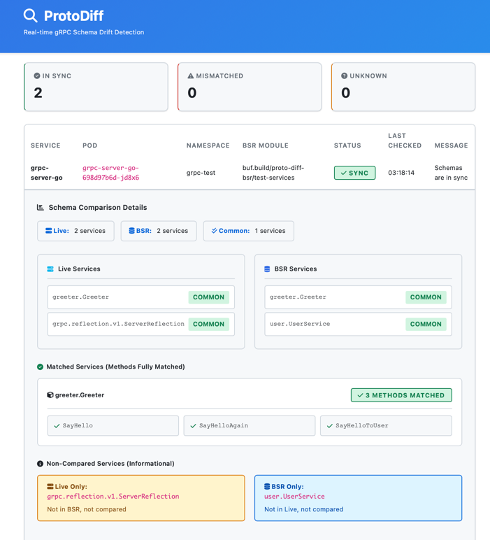

클라이언트가 갑자기 런타임 에러를 뱉습니다. 클라이언트 코드는 아무도 안 건드렸습니다. 수 시간을 뒤진 끝에 나오는 원인은 늘 비슷했습니다. 누군가 proto를 고쳐서 Kubernetes에 배포했는데, BSR(Buf Schema Registry)은 업데이트하지 않은 겁니다. 클라이언트는 BSR을 보고 개발했고, 서버는 다른 스키마로 떠 있었습니다.

BSR로 proto를 중앙 관리하면 이런 일이 없을 줄 알았습니다. 그런데 레지스트리는 "이래야 한다"는 약속일 뿐, 클러스터에 지금 실제로 떠 있는 스키마가 뭔지는 아무도 보장해주지 않았습니다. single source of truth를 만들었다고 믿었는데, 진실은 두 곳에 있었고 둘은 수시로 어긋났습니다.

이 어긋남에는 이미 이름이 있습니다. drift입니다. Terraform엔 `plan`이 있고 GitOps엔 drift detection이 있어서, 선언과 현실이 벌어지면 도구가 잡아줍니다. gRPC 스키마엔 그게 없었습니다. 그래서 만들었고, Go로 짜서 오픈소스로 공개했습니다.

## 손으로 잡기엔 Kubernetes가 컸습니다

어긋남을 확인하는 방법 자체는 압니다. Pod에 들어가서 스키마를 보고 BSR과 대조하면 됩니다. 문제는 그게 Kubernetes 위에서 벌어진다는 점입니다. Pod은 여러 네임스페이스에 흩어져 있고, 서비스마다 proto 경로가 다르고, rolling update 중이면 한 서비스 안에서도 버전이 섞여 있습니다. 서비스가 늘수록 이 확인 작업은 선형으로 늘어나는데, 하는 일은 매번 똑같습니다. 똑같은 일을 반복하고 있다면 그건 사람이 아니라 프로그램이 할 일입니다.

## 설계: 양쪽의 진실을 뽑아서 맞대본다



구조는 문제 정의에서 그대로 나옵니다. 진실이 두 곳에 있으니, 양쪽에서 각각 뽑아 비교하면 됩니다.

1. Kubernetes API로 gRPC Pod 자동 발견
2. gRPC Reflection으로 라이브 스키마 추출 — **현실 쪽 진실**
3. Buf CLI로 BSR 스키마 다운로드 — **약속 쪽 진실**
4. 양쪽을 비교해 불일치 감지
5. 웹 대시보드로 시각화

클러스터 안에서 도는 단일 Pod입니다. 30분마다 스캔합니다.

```
언어: Go 1.21
핵심 라이브러리: client-go, grpcreflect, protoreflect
아키텍처: Hexagonal Architecture
배포: Kubernetes In-cluster Pod
저장소: In-memory (sync.RWMutex)
설정: ConfigMap + Secret
보안: RBAC, Non-root, Read-only FS
```

## 현실 쪽 진실은 Pod 안에 있습니다

배포된 서비스의 진짜 스키마는 소스 리포지토리가 아니라 실행 중인 바이너리 안에 있습니다. 그래서 proto 파일을 찾아다니지 않고, 떠 있는 프로세스한테 직접 물어봅니다.

먼저 client-go로 Pod을 찾습니다. In-cluster에서 돌기 때문에 ServiceAccount 토큰으로 인증합니다.

```go
// In-cluster config로 Kubernetes client 생성
config, err := rest.InClusterConfig()
clientset, err := kubernetes.NewForConfig(config)

// ConfigMap에서 서비스 매핑 로드
configMap, err := clientset.CoreV1().
    ConfigMaps(namespace).
    Get(ctx, configMapName, metav1.GetOptions{})

// app 레이블로 Pod 검색
labelSelector := fmt.Sprintf("app=%s", serviceName)
pods, err := clientset.CoreV1().Pods("").
    List(ctx, metav1.ListOptions{
        LabelSelector: labelSelector,
    })
```

포트는 `grpc` 이름의 containerPort → TCP 포트 → 기본값 9090 순으로 자동 감지합니다.

Pod을 찾으면 gRPC Reflection으로 스키마를 꺼냅니다. Reflection은 실행 중인 서버가 자기 스키마를 스스로 답해주는 프로토콜이라, proto 파일 없이도 런타임의 진실을 그대로 읽을 수 있습니다.

```go
// Pod IP:포트로 연결
conn, err := grpc.Dial(address, grpc.WithTransportCredentials(insecure.NewCredentials()))

// Reflection client 생성
refClient := grpcreflect.NewClientV1Alpha(ctx, reflectpb.NewServerReflectionClient(conn))

// 서비스 목록 조회
services, err := refClient.ListServices()

// 각 서비스의 메서드 정보 추출
for _, serviceName := range services {
    serviceDesc, _ := refClient.ResolveService(serviceName)
}
```

## 약속 쪽 진실: HTTP API를 버리고 Buf CLI로

BSR 쪽은 처음에 HTTP API로 붙였습니다. 그리고 후회했습니다. API는 FileDescriptorSet만 던져주는데, 타입 참조를 직접 해석해야 해서 파싱 코드가 계속 자랐고, 에러 처리도 불안정했습니다. 복잡한 코드를 계속 고치는 대신 접근을 바꿨습니다.

```go
// buf export로 proto 파일 전체를 내려받음
cmd := exec.CommandContext(ctx, "buf", "export", module, "-o", tmpDir)
output, err := cmd.CombinedOutput()

// protoparse로 파싱
parser := protoparse.Parser{
    ImportPaths: []string{tmpDir},
}
fileDescs, err := parser.ParseFiles(relPaths...)
```

`buf export`는 완전한 proto 파일을 주기 때문에 타입 참조가 자동으로 해석되고, 에러율도 줄었습니다. 컨테이너에 buf 바이너리를 설치해야 하는 트레이드오프가 생기지만, 직접 짠 파서를 유지보수하는 비용보다 훨씬 쌉니다.

## 전부 비교하면, 전부 틀렸다고 나옵니다

첫 버전은 양쪽의 모든 서비스를 비교했습니다. 결과는 새빨간 대시보드였습니다. Live에만 있는 테스트 서비스도 MISMATCH, BSR에만 남은 deprecated 서비스도 MISMATCH. 진짜 문제가 아닌 것들이 화면을 채웠습니다.

여기서 배운 게 하나 있습니다. 모니터링 도구는 놓쳐서 죽는 게 아니라 시끄러워서 죽습니다. 오탐이 쌓이면 사람이 빨간불을 무시하기 시작하고, 그 순간 도구는 없는 것과 같아집니다.

그래서 비교 대상을 교집합으로 좁혔습니다.

```go
// 양쪽에 모두 있는 서비스만 비교
for liveSvcName, liveMethods := range liveServicesMap {
    if truthMethods, exists := truthServicesMap[liveSvcName]; exists {
        if !methodsMatch(liveMethods, truthMethods) {
            match = false
        }
    }
}
// Live에만 있는 서비스 → 정보성 표시, 상태에 영향 X
// BSR에만 있는 서비스 → 정보성 표시, 상태에 영향 X
```

한쪽에만 있는 서비스는 상태 판정에서 빼고 정보로만 보여줍니다. 빨간불은 "양쪽 다 있는데 내용이 다른 것", 즉 클라이언트를 실제로 깨뜨릴 수 있는 불일치에만 켜집니다.

## 동시성: 쓰는 놈 하나, 읽는 놈 하나

goroutine 두 개가 돕니다. Scanner가 30분마다 결과를 쓰고, 웹 서버가 요청마다 읽습니다.

```go
// 1. Scanner goroutine (30분마다)
func (s *Scanner) Start(ctx context.Context) {
    ticker := time.NewTicker(scanInterval)
    for {
        select {
        case <-ticker.C:
            runScan(ctx)  // Store에 쓰기
        }
    }
}

// 2. Web server goroutine (요청마다)
func (s *Server) handleDashboard(w http.ResponseWriter, r *http.Request) {
    results := s.store.GetAll()  // Store에서 읽기
}
```

둘 사이는 `sync.RWMutex`를 쓴 Store가 중재합니다. 쓰기는 드물고 읽기는 잦은 전형적인 패턴이라 RWMutex면 충분합니다.

```go
type Store struct {
    mu      sync.RWMutex
    results map[string]*domain.ScanResult
}

func (s *Store) GetAll() []*ScanResult {
    s.mu.RLock()
    defer s.mu.RUnlock()
    // ...
}

func (s *Store) Set(result *ScanResult) {
    s.mu.Lock()
    defer s.mu.Unlock()
    // ...
}
```

## 아키텍처: 어댑터는 갈아끼울 수 있게

Hexagonal Architecture로 짰습니다. Kubernetes, gRPC, BSR, 웹은 전부 외부 세계라 어댑터로 밀어냈고, 코어는 "두 스키마를 비교한다"는 도메인 로직만 압니다.

```
protodiff/
├── cmd/protodiff/              # 엔트리포인트
├── internal/
│   ├── core/
│   │   ├── domain/             # 비즈니스 모델
│   │   └── store/              # Thread-safe 저장소
│   ├── adapters/
│   │   ├── k8s/                # Kubernetes client
│   │   ├── grpc/               # gRPC reflection client
│   │   ├── bsr/                # BSR client (Buf CLI wrapper)
│   │   └── web/                # HTTP 서버
│   ├── scanner/                # 오케스트레이터
│   └── config/                 # 설정 관리
└── deploy/k8s/                 # Kubernetes manifests
```

경계는 Go interface입니다. BSR 클라이언트를 HTTP API에서 Buf CLI로 갈아탈 때 이 구조 덕을 봤습니다. 어댑터 하나만 새로 짜서 주입하면 코어는 그대로였습니다.

```go
// BSR 클라이언트 인터페이스
type Client interface {
    FetchSchema(ctx context.Context, module string) (*domain.SchemaDescriptor, error)
}

// 의존성 주입
scanner := scanner.NewScanner(
    k8sClient,
    grpcClient,
    bsrClient,  // interface로 주입
    store,
    cfg,
)
```

## 배포: kubectl apply 한 번

단일 Pod로 클러스터 안에 배포합니다. Kubernetes 리소스만 쓰기 때문에 별도 인프라가 필요 없습니다. 서비스 매핑은 ConfigMap으로, BSR 토큰은 Secret으로 넣고, 권한은 Pod과 ConfigMap 읽기만 허용하는 최소 RBAC입니다.

```yaml
# ConfigMap으로 서비스 매핑
apiVersion: v1
kind: ConfigMap
metadata:
  name: protodiff-mapping
  namespace: protodiff-system
data:
  user-service: "buf.build/acme/user"
  payment-service: "buf.build/acme/payment"

---
# RBAC: 최소 권한
apiVersion: rbac.authorization.k8s.io/v1
kind: ClusterRole
metadata:
  name: protodiff
rules:
- apiGroups: [""]
  resources: ["pods"]
  verbs: ["get", "list", "watch"]
- apiGroups: [""]
  resources: ["configmaps"]
  verbs: ["get", "list"]
```

```bash
kubectl apply -f https://raw.githubusercontent.com/uzdada/protodiff/main/deploy/k8s/install.yaml

kubectl port-forward -n protodiff-system svc/protodiff 18080:80
```

클러스터를 감시하는 도구는 그 자체가 공격면이 되기 쉬워서, 보안 기본기는 다 걸었습니다. Non-root 실행, read-only 파일시스템, Linux capability 전부 제거.

관측 도구가 관측 대상보다 무거우면 곤란하기 때문에 발자국도 재봤습니다. CPU 0.1코어 미만(I/O bound라 CPU를 거의 안 씁니다), 메모리 약 10MB에 Pod당 1KB 정도, 네트워크는 Pod당 수 KB입니다. 외부 DB 없이 in-memory로 버틴 것도 같은 이유입니다. 의존성 없는 단일 바이너리 하나가 MVP엔 맞습니다.

## 결과: 불일치의 수명에 상한이 생겼습니다

전에는 스키마 불일치가 누군가의 런타임 에러가 날 때까지 살아 있었습니다. 발견도 사고로 하고, 원인 파악은 서비스별 proto를 손으로 대조해야 해서 수 시간이 걸렸습니다.

지금은 불일치가 생겨도 길어야 30분입니다. 다음 스캔에서 잡히고, 대시보드에 어느 서비스의 어느 메서드가 어긋났는지 바로 뜹니다(SYNC / MISMATCH / UNKNOWN). 사고가 나서 아는 것과, 사고가 나기 전에 아는 것의 차이입니다.

## 남은 트레이드오프

공짜는 아닙니다. 대상 서비스가 gRPC Reflection을 켜야 합니다. 다행히 Go는 `reflection.Register(server)` 한 줄, Java는 `server.addService(ProtoReflectionService.newInstance())` 한 줄이라 도입 부담은 작습니다. In-memory 저장이라 재시작하면 이력이 날아가는 것도 사실입니다. 슬랙 알림, Prometheus 메트릭, PostgreSQL 이력 저장, BSR 캐시, CRD 기반 설정이 다음 후보들입니다.

## 정리

레지스트리에 스키마를 올리는 순간 일이 끝난 것 같지만, 선언과 실행 사이엔 늘 틈이 있습니다. 인프라 세계는 이 틈에 drift라는 이름을 붙이고 도구를 만들어 메꿔왔는데, gRPC 스키마엔 그 자리가 비어 있었습니다. ProtoDiff는 그 틈을 30분마다 재는 자입니다. client-go로 Pod을 찾고, Reflection으로 현실을 뽑고, Buf CLI로 약속을 가져와 맞대봅니다.

Apache 2.0으로 공개했습니다. Kubernetes에서 gRPC 마이크로서비스를 운영하는 팀이면 바로 쓸 수 있습니다.

**GitHub:** [https://github.com/xhae123/protodiff](https://github.com/xhae123/protodiff)
