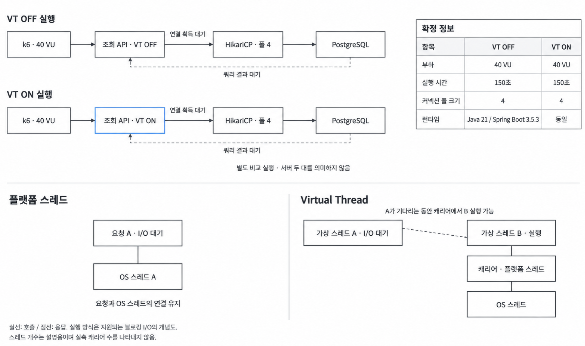
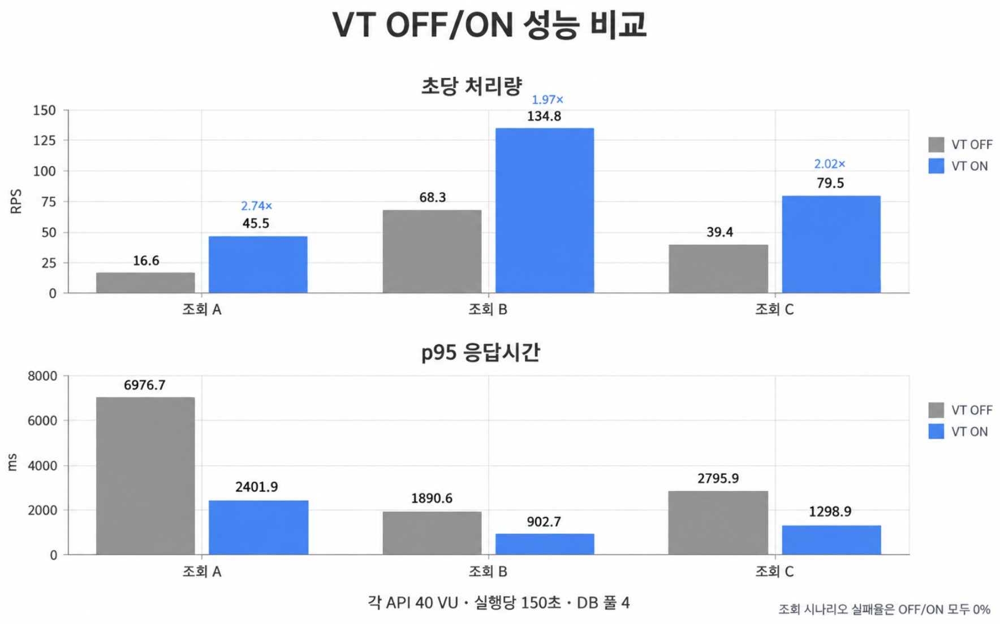
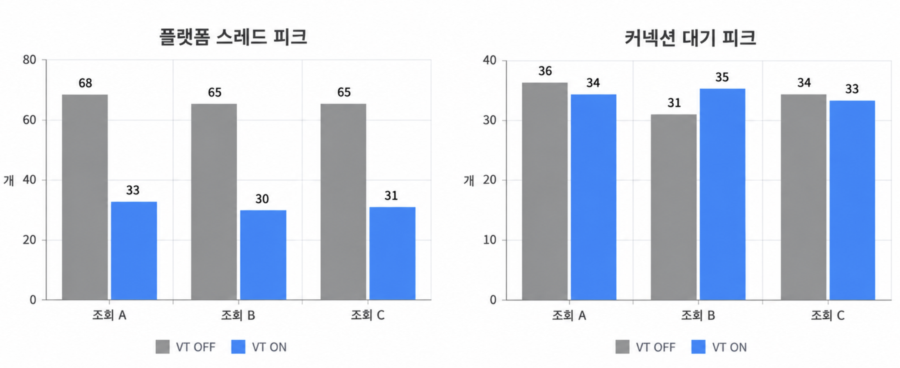
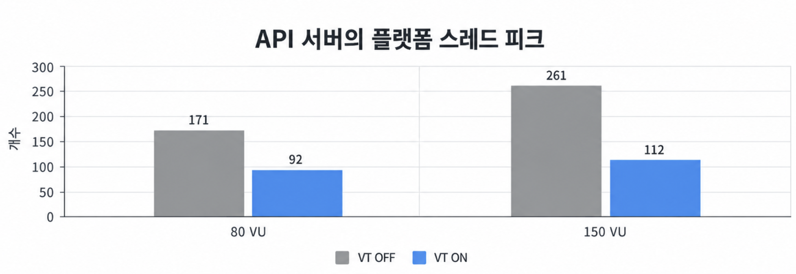
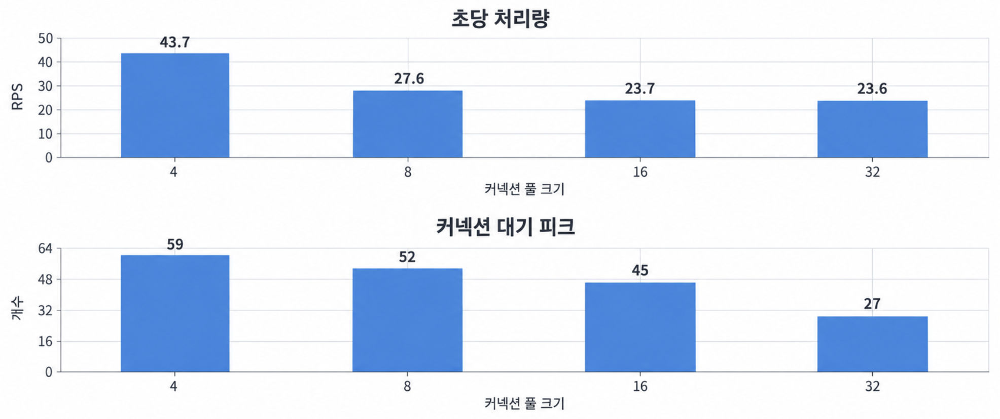

조회 API 하나가 부하 테스트에서 p95 7초를 찍었어요. 요청이 실패한 건 아니었어요. 
그냥 느렸어요. 초당 처리량도 16.6건에서 더 올라가지 않았고요. 7초를 그대로 둘 순 없었어요.

DB를 조회하는 API였으니 DB부터 의심했어요. 정작 DB CPU는 한가했어요. 붐비는 건 애플리케이션 쪽이었고요. DB 연결을 빌리려고 줄 선 요청이 최대 36개까지 쌓였거든요. HikariCP 풀은 4개. 연결 네 개를 두고 서른여섯 개가 기다리는 그림이었어요.

여기까지 보면 진단은 뻔해 보였어요. 연결이 부족하다, DB는 노는데 통로가 좁아서 밀린다. 늘려주면 될 것 같았죠.

그런데 이 진단을 바로 실행에 옮기기 전에 걸리는 게 있었어요. 연결이 병목이라면, 연결을 늘렸을 때 DB가 그만큼 일을 더 끝내야 해요. DB는 이미 놀고 있었고요. 연결을 더 주는 것과 요청을 더 빨리 끝내는 것이 같은 방향이라는 보장이 없었어요. 그래서 풀 크기를 건드리기 전에, 변수 하나를 먼저 바꿔보기로 했어요. 연결을 기다리는 요청들을 어떻게 다루는지부터요.

Java 21의 Virtual Thread였어요.

_가상 스레드 자체를 처음부터 설명하진 않아요. 필요한 만큼만 짚고 갈게요. 꼭 찾아보시길 바랍니다!_

## 커넥션은 그대로 두고, 스레드를 바꿨어요

기존 구조에서는 요청이 연결이나 쿼리 결과를 기다리는 동안에도 플랫폼 스레드 하나를 붙잡고 있었어요. 플랫폼 스레드는 OS 스레드에 1:1로 묶여 있어서, 기다리는 요청이 많아지면 OS 스레드도 그만큼 살아 있어야 해요. 대기 중에 CPU를 태우는 건 아니지만, 요청과 OS 스레드의 결속은 그대로 남죠. 오랫동안 자바가 써온 request-per-thread 모델이에요.

Virtual Thread는 이 대기를 다르게 다뤄요. JVM이 가상 스레드를 플랫폼 스레드 위에 올려 실행하다가, JVM이 가로챌 수 있는 블로킹 지점(소켓, JDBC 같은)에서 멈추면 둘을 떼어내요. 실행을 맡았던 플랫폼 스레드, 그러니까 **캐리어 스레드**는 그동안 다른 가상 스레드를 실행할 수 있어요.

우리 API에는 이미 기다리는 구간이 많았어요. 연결을 잡기 전에 기다렸고, 쿼리를 던지고 결과를 기다렸어요. 이 대기를 가상 스레드로 넘겼을 때, 같은 연결 수로 더 많은 요청을 소화할 수 있을까요.



Java 21, Spring Boot 3.5.3이었으니 설정 한 줄로 켤 수 있었어요.

```properties
spring.threads.virtual.enabled=true
```

테스트는 로컬 Docker에서 돌렸어요. 컨테이너 자원은 운영 태스크와 똑같이 0.5 vCPU, 1GB로 묶었어요. 알고 싶은 건 절대 성능이 아니라 설정 하나의 차이였으니, 제약은 운영과 같게 두고 VT만 켜고 껐어요. 대상은 성격이 다른 조회 API 세 개, 아래에서는 조회 A·B·C로 부를게요. 각각 40 VU로 150초씩 돌렸어요.

> VU는 같은 시나리오를 반복하는 가상 사용자예요. 사용자 수를 고정했으니, 응답이 빨라지면 같은 사용자가 다음 요청을 더 빨리 던져요. 그 조건에서 처리량과 응답시간이 어떻게 갈리는지 봤어요.

## 처리량은 뛰었는데, 기다리는 줄은 그대로였어요



처음 문제였던 조회 A가 16.6 RPS에서 45.5 RPS로 올라갔어요. 2.74배. p95는 7초에서 2.4초로 떨어졌고요. 나머지 둘도 처리량이 두 배 안팎으로 늘고 p95가 절반 가까이 줄었어요. 실패율은 전후 모두 0%.



내부 지표에서는 플랫폼 스레드가 줄었어요. 조회 A 기준 피크가 68개에서 33개로요. B, C도 비슷했어요. 그런데 커넥션 대기는 세 API 모두 30개대에 그대로 머물렀어요. 조회 A는 36에서 34. 사실상 변화가 없었어요.

여기서 처음 세운 진단과 어긋나는 게 하나 있었어요. 풀 크기도 4 그대로, 연결을 기다리는 줄도 그대로인데 처리량만 2.74배가 됐어요. 연결을 빌리는 층에서는 바뀐 게 없는데 처리량이 올랐다면, 이 개선은 연결에서 나온 게 아니에요.

리틀의 법칙으로 보면 상황이 선명해져요. 네 개의 연결이 쉬지 않고 돈다고 하면, 처리량은 연결 하나의 평균 점유시간에 반비례해요. 16.6 RPS면 연결 하나를 240ms쯤 쥔 셈이고, 45.5 RPS면 88ms예요. 우리가 한 건 연결을 더 빌려준 게 아니라, 하나를 덜 오래 쥐게 만든 거였어요.

왜 덜 쥐게 됐을까요. CPU를 봤어요. VT를 켜기 전이나 후나 애플리케이션 CPU는 한계치인 50%, 그러니까 0.5 vCPU를 거의 다 쓰고 있었어요. 둘 다 CPU는 꽉 찼는데, 켠 쪽이 2.74배를 끝냈어요. 요청 하나가 더 싸졌다는 뜻이죠.

직접 스위칭 횟수까지 재보진 않았어요. 다만 스레드가 68개에서 캐리어 몇 개로 준 것과 요청당 CPU가 준 게 나란히 움직였어요. 반 개짜리 코어 위에서 플랫폼 스레드 68개가 실행 순서를 다투는 비용이 만만치 않았다고 보는 게 가장 자연스러웠어요. VT를 켜니 실제로 도는 OS 스레드는 캐리어 몇 개로 줄었고, 아낀 CPU가 요청을 처리하는 쪽으로 돌아갔어요.

그래서 커넥션 대기를 없애는 걸 성공 조건으로 두지 않았어요. 확인하고 싶었던 건 하나였어요. 풀을 그대로 두고 더 적은 스레드로 더 많이 처리할 수 있는가. 답은 그렇다였고, "연결이 병목"이라는 첫 진단은 이 시점부터 흔들리기 시작했어요.

## AI 추론을 기다리는 요청


조회 말고 AI 추론 호출 경로도 봤어요. 사진을 판별하는 건 별도의 모델 서버였고, 우리 Spring API는 그 서버를 HTTP로 부르고 결과를 기다리는 쪽이었어요.

모델 연산을 API 밖으로 뺐다고 우리 요청이 끝나는 건 아니에요. 사용자는 여전히 응답을 기다리고, API도 결과가 돌아와야 다음을 이어가요. 여기서 VT로 다루려는 것도 결국 대기였어요. 모델을 빠르게 만드는 게 아니라, 그 서버가 계산하는 동안 우리 API에 쌓이는 요청을 값싸게 붙잡아 두는 거요. 외부 응답을 기다리는 동안 캐리어를 다른 가상 스레드에 넘길 수 있다는 게 여기서도 통했어요.



그래서 여기서는 모델 성능 대신 호출하는 API의 플랫폼 스레드를 봤어요. 80 VU에서 피크가 171개에서 92개로, 150 VU에서는 261개에서 112개로 줄었어요. 조회에 이어 외부 HTTP 호출 경로에서도 스레드 구성이 같은 방향으로 움직였어요.

다만 이 경로에는 함정이 있었어요. VT는 우리 쪽 대기를 값싸게 만들 뿐, 뒤에 있는 AI 서버의 처리 용량을 늘려주지 않아요. 우리 스레드 천장이 사라지면 더 많은 요청이 동시에 AI 서버로 몰려요. 실제로 VT를 켠 뒤 이 경로의 실패율은 0%에서 15~25%로 올랐는데, 전부 AI 서버가 동시 처리 한도를 넘겨 돌려보낸 503이었어요. 처리량은 늘었지만 그만큼 밀어낸 거예요. 그러니 이 경로는 VT와 별개로, 우리가 AI 서버로 보내는 동시 요청 수를 스스로 조이는 문제가 따라붙어요. 이번 글은 조회에 집중했고, 이건 다음 과제로 남겼어요.

## 그러면 커넥션도 늘리면 더 좋아질까요

VT로 처리량이 오른다는 건 확인했어요. 이제 미뤄둔 질문으로 돌아갈 차례였어요. 커넥션 대기는 여전히 많았고, 연결 네 개로 이만큼 좋아졌다면 더 주면 더 나아질 것 같았거든요.

이번엔 VT는 켠 채로 풀 크기만 4 → 8 → 16 → 32로 바꿨어요. 대상은 조회 A, 부하는 64 VU였어요.



풀을 4에서 32로 늘리자 커넥션 대기는 59에서 27로 줄었는데, 처리량은 오히려 43.7에서 23.6 RPS로 떨어졌어요. 예상과 정반대였어요.

절대값 자체는 흔들렸어요. 반 개짜리 코어라 그래요. 풀 4를 두 번 재는 사이 43.7과 32.3으로 편차가 컸어요. 그래도 풀 32는 두 번 다 그 아래(23.6, 22.6)에 있었고, 늘릴수록 나빠진다는 방향은 흔들리지 않았어요.

커넥션 대기 하나만 봤다면 이걸 개선이라고 읽었을 거예요. 기다리는 줄은 분명히 줄었으니까요. 하지만 API가 요청을 더 잘 처리하게 된 건 아니었어요.

이 결과가 앞에서 흔들리던 진단을 무너뜨렸어요. 연결이 병목이었다면 연결을 늘렸을 때 DB가 일을 더 끝내야 해요. 그런데 DB가 커밋한 트랜잭션은 초당 131건에서 75건으로 줄었어요. 사용 중인 연결은 31개까지 올라갔는데, DB가 그 순간 실제로 실행하고 있던 쿼리는 한 개 남짓이었고요. 연결이 병목이라는 가설이 맞다면 나올 수 없는 숫자였어요.

동시성을 늘리면 처리량이 정점을 지나 오히려 꺾이는 이 모양은 낯선 게 아니에요. Universal Scalability Law가 말하는 retrograde 구간이거든요. 병렬성을 올리면 조율 비용이 함께 커지고, 어느 지점부터는 그 비용이 처리량 증가분을 잡아먹어요. 0.5 vCPU에서는 그 정점이 아주 일찍 와요. 우리 경우엔 4가 이미 그 근처였고요.

### 빌려간 연결 수 옆에 DB의 완료량을 놓고 봤어요

앱 지표만 보고 끝내지 않고 DB가 끝낸 일도 같이 봤어요. 풀을 4·8·16·32로 바꾼 실험에서 모은 값이에요.

| 풀 크기 | 사용 중인 커넥션 피크 | DB 커밋 트랜잭션/초 | DB CPU 평균 |
| ---- | -----------: | -----------: | --------: |
| 4    |            4 |        131.2 |      7.1% |
| 8    |            8 |         84.3 |      5.7% |
| 16   |           16 |         74.7 |      6.8% |
| 32   |           31 |         74.7 |      8.2% |

*커넥션 사용량은 부하 중 피크, DB 커밋 트랜잭션/초는 `xact_commit` 증가량을 관측 시간으로 나눈 값이에요.*

풀 32에서 사용 중인 연결이 31개까지 올랐어요. 설정만 커지고 안 쓰인 게 아니에요. 그런데 커밋된 트랜잭션은 초당 131건에서 75건으로 줄었고, DB CPU는 계속 한 자릿수였어요. 이 구간 내내 애플리케이션 CPU는 여전히 50% 한계에 붙어 있었고요.

여기서 갈라 봐야 할 게 있었어요. 앱이 빌려간 연결 수와 DB가 일을 끝내는 속도는 다른 값이에요. HikariCP가 사용 중으로 세는 건 앱이 빌려가서 아직 반납하지 않은 연결이에요. 그 연결을 쥐고 있는 시간의 대부분은 DB가 쿼리를 도는 시간이 아니라, 앱이 결과를 객체로 빚고 응답을 만드는 CPU 시간이었어요. 그래서 연결을 31개 쥐고 있어도 DB가 동시에 실행하는 쿼리는 한 개였고, 연결을 늘려도 DB의 완료량은 따라오지 않았어요. 커넥션은 DB로 가는 문이라기보다, 앱 CPU 작업장에 들어가는 입장권에 가까웠어요.

### 이걸 보고, VT의 효과를 커넥션 풀까지 늘려서 해석하지 않기로 했어요

두 실험을 나란히 놓으니 결정이 쉬워졌어요. 연결을 그대로 두고 VT를 켰을 때는 처리량이 올랐고, VT를 켠 채 연결을 늘렸을 때는 처리량이 떨어졌어요.

둘 다 동시에 처리하는 요청과 얽힌 설정이라 같이 늘려야 할 것처럼 보여요. 실제로는 반대였고요. VT는 요청 하나에 드는 오버헤드를 줄였어요. 풀을 키운 건 남지도 않은 CPU에 요청만 더 얹었고요. 두 결과가 가리키는 곳은 같았어요. 진짜 제약은 연결이 아니라 애플리케이션 CPU였어요.

그래서 VT의 개선은 가져가고, 풀은 4로 두기로 했어요.

## 결론: 커넥션은 네 개 그대로, 처리량은 최대 2.74배

조회 경로에 최종적으로 선택한 조합은 Virtual Thread ON, HikariCP 풀 크기 4였어요. 판단에 쓴 조회 세 개의 전후를 모으면 이래요.

| API  |        처리량 (RPS) |    처리량 배율 |         p95 (초) |   p95 감소율 |  플랫폼 스레드 피크 |
| ---- | ---------------: | --------: | --------------: | --------: | ----------: |
| 조회 A |  16.6 → **45.5** | **2.74배** | 6.98 → **2.40** | **65.6%** | 68 → **33** |
| 조회 B | 68.3 → **134.8** | **1.97배** | 1.89 → **0.90** | **52.3%** | 65 → **30** |
| 조회 C |  39.4 → **79.5** | **2.02배** | 2.80 → **1.30** | **53.5%** | 65 → **31** |

> *VT OFF → ON 순서, 각 API 40 VU·150초, 동일 자원 제한과 풀 크기 4. 
> p95 감소율은 반올림 전 값으로 계산했어요.*

처음 7초를 찍던 조회 A는 p95가 2.4초로, 플랫폼 스레드 피크는 68개에서 33개로 내려왔어요.

처음엔 연결 네 개가 너무 적어서 밀리는 줄 알았어요. 부족했던 건 연결이 아니라, 반 개짜리 코어를 여러 요청이 나눠 쓰는 방식이었어요. 연결은 한가한 DB로 가는 통로였고, 정작 모자란 건 그 통로가 아니라 요청을 처리할 CPU였어요. 연결 수는 그대로 두고 요청을 다루는 방식만 바꿨을 때, 조회 A가 초당 끝낸 요청은 16.6건에서 45.5건이 됐어요.

동시성 설정을 올리는 건 CPU가 남아 있을 때 처리량을 올려요. CPU가 이미 병목이면, 동시성을 늘리는 건 같은 파이를 더 잘게 써는 일에 가까워요. 커넥션 대기는 이 문제에서 그저 가장 먼저 눈에 띈 숫자일 뿐이였어요.
