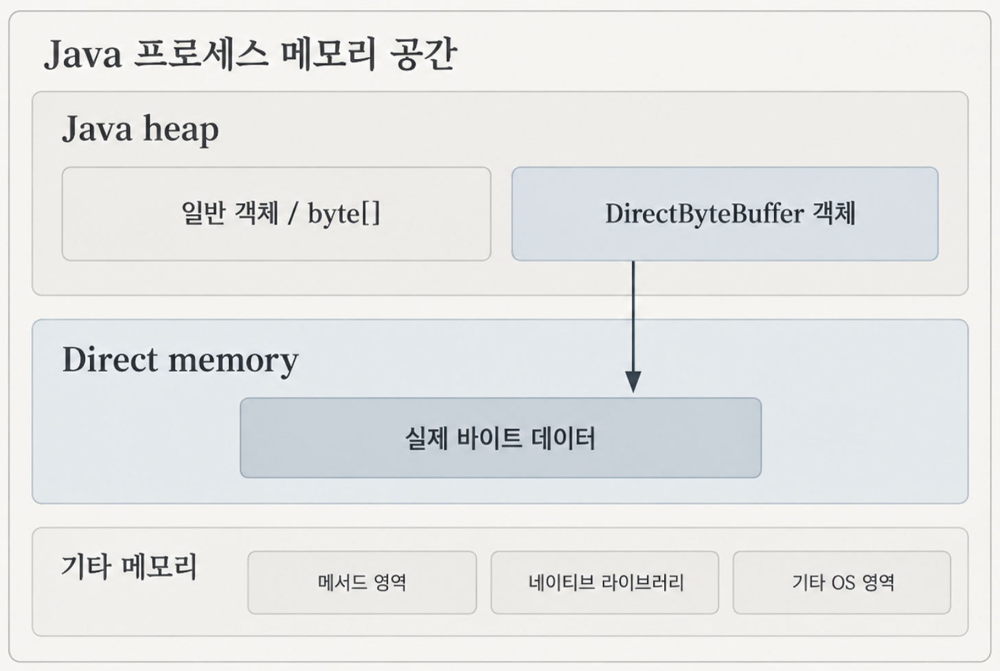
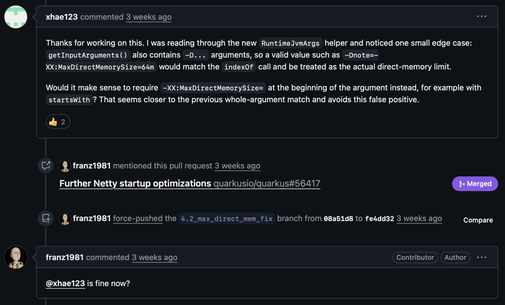

Netty는 자바에서 네트워크 서버와 클라이언트를 만들 때 사용하는 프레임워크입니다. 연결을 받아들이고, 데이터를 읽고, 응답을 보내는 공통 처리를 추상화 해줘서 개발자는 그 위에서 “들어온 데이터로 무엇을 할 것인가”에 집중할 수 있습니다.



direct memory는 Java의 일반적인 객체 저장 공간인 heap 바깥에 할당하는 메모리입니다. 네트워크로 데이터를 읽고 쓸 때, 데이터를 중간 공간으로 옮기는 작업을 줄이는 데 도움이 될 수 있습니다.

네트워크를 다루는 프레임워크와 데이터를 담는 메모리. 둘의 관계는 자연스러워 보입니다. 그런데 Netty의 코드를 읽다 보면 조금 더 깊은 부분을 만나게 됩니다. 

netty는 단지 메모리를 사용하는 데서 그치지 않고, 현재 실행 환경에서 사용할 direct memory의 한도를 알아내고 싶어합니다. 필요하면 JVM 실행 옵션까지 읽어서요.

네트워크 프레임워크가 왜 메모리 설정까지 확인해야 할까요?

이 궁금증에서 출발하여, 이 조회 로직을 건드는 PR을 읽다가, 시스템 프로퍼티에 들어 있는 문자열을 메모리 옵션으로 오인할 수 있는 엣지 케이스를 발견하기도 했습니다. 문제는 문자열을 검사하는 조건문에 있었지만, 그 조건문이 왜 중요한지 이해하려면 먼저 네트워크 데이터가 어디에 머무는지 살펴볼 필요가 있었습니다.

## 연결을 처리한다는 것은 버퍼를 관리한다는 것

서버가 요청을 받으면 데이터를 읽고, 처리하고, 응답을 보냅니다. 애플리케이션 코드에서는 몇 줄로 표현되기도 하지만, 실제 데이터가 이동하는 과정은 그렇게 한 번에 끝나지 않습니다.

TCP 연결을 예로 들면, 클라이언트가 보낸 요청 하나가 서버에서도 한 번의 읽기로 들어온다는 보장은 없습니다. 요청의 일부만 먼저 읽혔다면 나머지가 들어올 때까지 보관해야 합니다. 응답도 마찬가지입니다. 데이터를 만들었다고 해서 소켓에 즉시 전부 쓸 수 있는 것은 아니므로, 아직 쓰지 못한 데이터는 남겨 두어야 합니다. Netty는 이런 데이터를 다루는 데 `ByteBuf`라는 버퍼를 사용합니다.

버퍼는 데이터를 임시로 담아 두는 공간입니다. 다만 서버라는 시스템 속에서는 단순한 임시 공간 이상의 의미를 가집니다. 데이터를 받아들이는 속도, 애플리케이션이 처리하는 속도, 상대방에게 보내는 속도가 서로 다르기 때문입니다. 그 차이를 메우는 동안 데이터가 머무르는 곳이 버퍼입니다.

이 관점에서 보면 네트워크 처리와 메모리 관리는 분리하기 어렵습니다. 연결이 많아질수록, 처리하거나 전송하지 못한 데이터가 쌓일수록, 버퍼를 어떻게 관리하는지가 중요해집니다.

Netty의 `ByteBuf`는 내부 저장 공간으로 heap 메모리와 direct 메모리를 모두 지원합니다. 바이트를 읽고 쓰는 인터페이스 뒤에서, 실제 데이터를 어디에 둘지는 구현에 따라 달라질 수 있는 것입니다.

그렇다면 익숙하고 아주 단순한 heap을 두고 direct memory를 사용하는 이유는 무엇일까요?

## 더 빠른 메모리가 아니라, 덜 복사하는 경로

Java에서 바이트 데이터를 보관하는 가장 익숙한 방법은 `byte[]`입니다. Heap에 배열을 만들고 데이터를 넣으면 됩니다. 하지만 그 데이터를 운영체제의 입출력 기능에 넘기는 과정에서는 추가 작업이 생길 수 있습니다.


예를 들어 jdk의 NIO 구현에는 heap buffer의 내용을 임시 direct buffer에 복사한 뒤, 그 버퍼로 운영체제의 쓰기 함수를 호출하는 경로가 있습니다. 처음부터 direct buffer에 데이터가 있다면 이 중간 복사를 거치지 않을 수 있습니다. 

direct buffer를 사용하면 **전송 전에 데이터를 임시 버퍼로 한 번 더 복사하는 작업을 줄일 수 있습니다.** 대신 메모리를 새로 할당하고 해제하는 비용은 heap buffer보다 클 수 있습니다. 요청마다 새 버퍼를 만들고 버린다면, 복사에서 아낀 비용을 할당과 해제에 다시 쓰게 될 수 있습니다.

그래서 Netty는 **사용이 끝난 메모리 공간을 다음 작업에서 재사용하는 버퍼 풀**을 제공합니다. 매번 공간을 새로 확보하는 대신, 이미 확보한 공간을 다시 쓰는 것입니다. 아직 다른 작업이 사용하는 공간을 덮어쓰면 안 되므로, 참조 수를 관리해 언제 반환할 수 있는지도 구분합니다.

하지만 재사용은 **할당 횟수를 줄이는 방법이지, 필요한 메모리 자체를 없애는 방법은 아닙니다.** 동시에 처리할 데이터가 많아지면 더 많은 공간이 필요하고, 다음 작업을 위해 풀에 보관한 공간도 계속 메모리를 차지합니다.

따라서 버퍼를 재사용하더라도, 전체적으로 얼마의 메모리까지 사용하도록 허용할지는 별도로 정해야 합니다. 이것이 Netty가 direct memory를 단지 가져다 쓰는 것에 그치지 않고, 한도를 확인하는 이유입니다.

## 메모리의 위치를 정했다면, 사용 한도도 필요하다

힙 바깥의 메모리도 결국 프로세스가 사용하는 자원입니다. 힙을 벗어났다고 해서 용량의 제약까지 사라지지는 않습니다.

HotSpot에는 NIO direct buffer의 할당 한도를 지정하는 옵션이 있습니다.

```text
-XX:MaxDirectMemorySize=64m
```

여기서 `64m`은 64 × 1024 × 1024바이트를 뜻합니다. 다만 이 옵션을 “Java 프로세스의 모든 off-heap 메모리를 제한하는 설정”으로 이해해서는 안 됩니다. 대상은 NIO direct buffer만의 할당이며, 다른 방식으로 확보하는 native 메모리까지 한번에 제한하는 것은 아닙니다. 

Netty에도 자체적으로 direct memory 사용량을 집계하고 한도를 적용하는 경로가 있습니다. 설정에 따라서는 JVM이 알아낸 한도를 그 기준으로 사용합니다. 따라서 Netty가 JVM의 메모리 설정을 확인하는 것은 단순히 환경 정보를 로그에 남기기 위한 일이 아니라 **자신이 관리할 메모리의 사용 기준을 정하는 일**입니다.

이때 등장하는 메서드가 `PlatformDependent.estimateMaxDirectMemory()`입니다.

이름에 `estimate`가 붙어 있는 것도 눈여겨볼 만합니다. 이 기능은 os에 남은 메모리를 실시간으로 측정하는 것이 아닙니다. 내부 경로에서 한도 정보를 얻어 보고, 얻지 못하면 조건에 따라 JVM 실행 인자를 해석합니다. 그래도 유효한 값을 얻지 못하면 최대 heap 크기를 대체값으로 사용합니다. 정확한 값을 알아낼 수 없는 환경까지 고려하여 fall-back하는 것입니다.

제가 읽던 코드(풀리퀘스트)는 이 조회 과정을 정리하는 작업이었습니다. 

일부 메모리 할당 방식은 JVM의 direct buffer 한도에 아무런 연관이 없는데도, 그 값을 조회하기 위해 시작 비용을 지불하고 있다는 것이 PR 작성자의 설명이었습니다. 변경안에는 실행 인자 조회를 생략할 수 있는 설정과, 인자 해석 로직을 분리한 `RuntimeJvmArgs` 클래스가 포함돼 있었습니다.

제가 식별한 문제는 이 새 클래스에서 메모리 옵션을 찾는 방식에 있었습니다.

## 옵션처럼 보이는 문자열은 정말 옵션일까?

변경안은 JVM 실행 인자 목록을 뒤에서부터 확인하면서, 각 인자에 다음 문자열이 포함돼 있는지 `indexOf`로 찾고 있었습니다.

```text
"-XX:MaxDirectMemorySize="
```

찾았다면 그 뒤에 붙은 숫자와 단위를 해석해 반환하는 구조였습니다. 
실제 인자가 `-XX:MaxDirectMemorySize=64m`이라면 자연스럽게 동작합니다. `64m`을 추출해서 메모리 크기로 바꾸면 됩니다.

하지만 이 코드가 읽는 것은 옵션 목록들은 메모리 옵션만 모아 놓은 목록이 아닙니다.

`ManagementFactory.getRuntimeMXBean().getInputArguments()`로 가져온 모든 JVM 실행 인자 목록입니다. 여기에는 `-D`로 전달한 시스템 프로퍼티도 들어올 수 있습니다.

시스템 프로퍼티는 프로그램에서 사용할 설정값을 전달하는 방법입니다. 예를 들어 다음 인자는 `note`라는 이름에 문자열 하나를 저장합니다.

```text
-Dnote=-XX:MaxDirectMemorySize=64m
```

이 인자는 메모리 한도를 설정하지 않습니다. 프로퍼티의 값이 우연히 메모리 옵션과 같은 모양일 뿐입니다. 그러나 `indexOf`는 그 차이를 구분하지 못합니다. 

인자 중간에서 `-XX:MaxDirectMemorySize=`를 찾아내고, 뒤의 `64m`을 실제 한도처럼 해석할 수 있습니다. 제가 리뷰에 제시한 반례가 이 입력이었습니다.

이 문제는 숫자 변환 단계에서도 걸러지지 않습니다. `64m` 자체는 올바른 크기 표기이기 때문입니다. 잘못된 곳에서 값을 읽었는데도 결과는 정상적인 숫자로 나옵니다.

여기서 구분해야 하는 것은 **값의 형식이 올바른가**와 **그 값을 이 설정으로 해석해도 되는가**입니다. 변경안은 전자를 잘 처리하고 있었지만, 후자를 충분히 확인하지 못했습니다.

정상적인 메모리 옵션만 넣으면 두 구현은 같은 결과를 냅니다. 차이는 메모리 옵션이 아닌 다른 유효한, 특수한 입력을 넣었을 때 드러납니다.

이것을 단순히 특이한 문자열에 대한 방어라고 보기는 어렵다고 생각합니다. 프로퍼티로서는 정상적인 입력인데, 메모리 설정을 읽는 코드가 그 입력에 다른 의미를 부여했기 때문입니다.

## 잘못 읽은 것은 JVM 설정이 아니라 Netty의 판단이다

이 오인식은 실제 메모리 옵션과 함께 전달되는 경우에도 영향을 줄 수 있습니다. 예를 들어 다음과 같이 실행한다고 가정해 보겠습니다.

```bash
java -XX:MaxDirectMemorySize=256m \
     -Dnote=-XX:MaxDirectMemorySize=64m \
     -jar app.jar
```

실제 메모리 옵션은 `256m`입니다. 하지만 인자가 이 순서로 전달된다면, 뒤에서부터 탐색하는 변경안은 `note` 프로퍼티를 먼저 만나 `64m`을 반환할 수 있습니다. 실제 옵션까지 도달하기 전에 탐색이 끝나는 것입니다.

여기서 JVM의 실제 설정이 `64m`으로 바뀌는 것은 아닙니다. 설정은 그대로인데, 달라지는 것은 **Netty가 써도 된다고 생각하는 한도**입니다.

물론 모든 실행 환경에서 이 문제가 발생하는 것은 아닙니다. 앞선 내부 조회에서 유효한 값을 얻으면 실행 인자 파싱까지 내려오지 않습니다. 문제가 있는 것은 이 파싱 경로에 진입했고, 다른 인자 안에 메모리 옵션 형태의 문자열이 들어 있을 때입니다.



제가 제안하였던 수정 방향은 인자 안에서 문자열을 검색하는 대신, 인자가 해당 옵션으로 **시작하는가?를** 확인하는 것이었습니다.

```java
if (!arg.startsWith(MAX_DIRECT_MEMORY_SIZE_ARG)) {
    continue;
}
```

그래서 PR 작성자는 제안을 반영해 `startsWith`를 사용하도록 수정했고, 수정이 포함된 PR은 이후 Netty 릴리즈에 병합됐습니다.

이 리뷰에서 지켜야 했던 동작은 명확했습니다. **메모리와 관계없는 프로퍼티를 추가했다고 해서, 메모리 한도에 대한 해석이 바뀌어서는 안 됩니다.**

## 버퍼에서 실행 옵션까지

Netty가 direct memory를 확인하는 이유는 데이터를 주고받는 API 아래에서 실제 자원의 사용 기준을 정해야 하기 때문입니다. 데이터를 어디에 둘지, 어떤 비용으로 할당하고 재사용할지, 어느 한도 안에서 관리할지는 모두 네트워크 처리와 연결돼 있습니다.

이번 문제는 그 흐름 속 사소한 부분에 있었습니다. 메모리 한도를 판단하기 위해 실행 인자를 읽었고, 실행 인자를 읽기 위해 문자열을 해석했습니다. 작은 조건문이었지만, 그 결과는 단순한 문자열 처리 결과가 아니라 메모리 관리에 쓰일 수 있는 값이었습니다.

저는 이런 코드의 정확성이 정상적인 값을 잘 계산하는 것만으로 결정되지는 않는다고 생각합니다. 어떤 입력을 설정으로 받아들이고, 어떤 입력은 관계없는 값으로 남겨 둘지도 정확해야 합니다. 구현을 바꿀 때 보존해야 하는 것은 반환값뿐 아니라, 그 값을 만들어 내는 입력의 의미이기도 합니다.

`64m`을 숫자로 바꾸는 일보다 먼저 확인해야 했던 것은, 그 `64m`이 정말 메모리 설정인지였습니다. Netty의 메모리 관리에서 문자열을 검사하는 한 줄이 중요했던 이유입니다.
