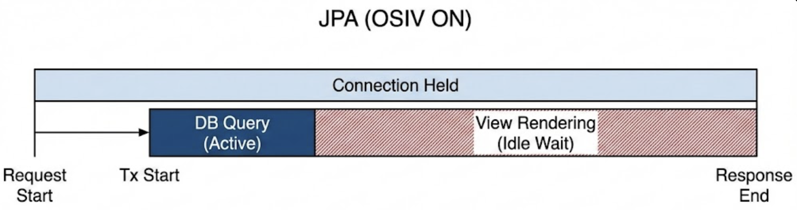

## 0\. 들어가며

AI가 생성한 JPA 코드를 리뷰하다가, "이 쿼리는 언제 나가지?"라는 생각을 여러 번 했습니다.

JPA는 사람이 직접 코드를 짤 때 생산성이 높았습니다. 하지만 AI가 문맥 없이 생성한 코드를 리뷰할 때, 암시적 동작은 검증 비용을 높입니다.

이 글은 **I/O 예측 가능성, 메모리 사용, 타입 시스템** 세 가지 관점에서 Exposed가 합리적인 선택지가 될 수 있는 이유를 정리합니다.

* * *

## 1\. I/O 예측 가능성

대부분의 레이턴시는 I/O에서 갈립니다. CPU가 병목인 경우는 생각보다 많지 않습니다.

### 1.1. JPA의 Lazy Loading

Lazy Loading은 편합니다. 엔티티 그래프를 따라가면 알아서 쿼리가 나가기 때문입니다. 다만 개발자가 연관 관계를 머릿속에 완벽히 그리고 있을 때 이야기입니다.

AI는 문맥을 모릅니다. `List<Order>`를 순회하며 `order.getMember().getName()`을 호출하는 코드는 AI에게 자연스러운 문법입니다. 하지만 실행되는 순간 DB와 수백 번의 핑퐁이 시작됩니다. (N+1)

문제:

-   **RTT 누적:** DB가 빨라도 네트워크 비용은 0이 아님 → 레이턴시 증가



-   **커넥션 풀 고갈:** OSIV 환경에서 트랜잭션이 열려 있는 동안 비즈니스 로직 수행 → 커넥션이 오래 점유됨 → 요청 많아지면 CPU는 놀고 커넥션 풀만 바닥남

`Fetch Join`, `BatchSize`, `EntityGraph`로 해결할 수 있습니다. 하지만 어떤 엔티티에 적용할지 AI가 판단하기 어렵고, AI가 작성한 코드에서 이 암시적 비용을 찾아내는 건 피로도 높은 작업입니다.

### 1.2. Exposed의 명시적 Join

Exposed는 프록시를 통한 암시적 로딩을 지원하지 않습니다. 연관 데이터를 가져오려면 DSL에서 Join을 명시해야 합니다.

```kotlin
// Exposed: 코드만 봐도 I/O 비용이 보임
(Orders innerJoin Members)
    .slice(Orders.id, Members.name)
    .select { Orders.date greaterEq today }
    .map { ... }
```

-   **비용의 시각화:** 코드는 길어집니다. 하지만 `innerJoin` 키워드가 보인다는 건 "여기서 조인 쿼리가 나간다"는 신호입니다.
    
-   **리뷰 효율:** yml 설정이나 엔티티 어노테이션을 뒤질 필요 없습니다. 코드만 보고 "조인이 너무 많으니 분리합시다" 피드백이 가능합니다.
    

* * *

## 2\. 메모리 사용


데이터를 메모리에 어떻게 올리느냐에 따라 서버 리소스 사용량이 달라집니다.

### 2.1. JPA의 Persistence Context

JPA는 1차 캐시를 둡니다. 자바 컬렉션 다루듯 DB를 다룰 수 있습니다. 하지만 비용이 있습니다.

1.  **스냅샷 오버헤드:** Dirty Checking을 위해 데이터 로딩 시 원본 복사본(스냅샷)을 힙에 저장합니다. 1GB 조회하면 실제로 2GB 이상 점유. 대용량 배치에서 `OutOfMemoryError`나 잦은 Full GC의 원인입니다.
    
2.  **플러시 비용:** 트랜잭션 끝날 때 관리 중인 모든 객체의 현재 상태와 스냅샷을 필드 단위로 비교합니다. 데이터 많아지면 이 비교 연산(O(N)) 때문에 CPU 사용량이 올라갑니다.
    

### 2.2. Exposed의 DSL 방식

Exposed도 DAO와 EntityCache를 제공합니다. 하지만 DSL 방식에서는 이 오버헤드가 없습니다.

-   **직접 매핑:** `Table.select { ... }` 결과는 JDBC `ResultSet`에서 바로 DTO나 Data Class로 매핑됩니다. 스냅샷도, 더티 체킹도 없습니다.
    
-   **예측 가능한 리소스:** 조회한 데이터만큼만 메모리를 씁니다. 클라우드 환경에서 메모리 사용량을 정확히 예측하고 통제할 수 있습니다.
    

* * *

## 3\. 타입 시스템

AI가 생성한 코드의 오류를 런타임에 발견하면 늦습니다. 컴파일 타임에 잡을 수 있다면 좋습니다.

### 3.1. JPA의 런타임 검증

JPA(JPQL, QueryDSL 포함)는 코드 문법만 맞다고 되는 게 아닙니다. 엔티티의 상태와 설정까지 맞아야 합니다.

-   AI가 `FetchType.LAZY`로 설정된 연관 관계를 고려하지 않고 트랜잭션 밖에서 접근하는 코드를 짰다고 가정합니다.
-   컴파일 성공, 빌드 성공.
-   배포 후 트래픽 들어오면 `LazyInitializationException`.

이걸 막으려면 JPA의 생명주기를 머릿속으로 시뮬레이션하며 리뷰해야 합니다.

### 3.2. Exposed의 컴파일 타임 검증

Exposed는 코틀린의 타입 시스템을 SQL 생성에 씁니다.

-   **구조적 강제:** `UserTable.name`(String)과 `TeamTable.id`(Long)를 비교하는 조인 조건을 AI가 작성하면 컴파일 에러. 타입이 다르기 때문입니다.
    
-   **1차 필터링:** Exposed 코드가 컴파일되면, SQL 문법, 컬럼 참조, 타입 매칭은 유효합니다. 리뷰어는 "이 쿼리가 문법적으로 맞나?"를 고민할 필요 없이 "비즈니스 로직이 올바른가?"에 집중할 수 있습니다.
    

* * *

## 4\. Trade-off

Exposed가 모든 상황의 정답은 아닙니다.

1.  **Dynamic Query:** JPA 진영에는 QueryDSL이 있습니다. Exposed로 복잡한 동적 쿼리를 짜면 코드가 복잡해집니다. 가독성 확보하려면 확장 함수나 DSL 래퍼를 직접 구현해야 합니다.
    
2.  **테이블 중심 사고:** JPA는 객체 지향적 도메인 모델링(DDD)이 가능합니다. Exposed는 DB 테이블 중심 사고를 강제합니다. 비즈니스 로직이 복잡하고 엔티티 간 협력이 중요한 도메인이면 JPA가 나을 수 있습니다.
    
3.  **jOOQ와 비교:** Type-safe SQL을 원하면 jOOQ도 있습니다. 다만 유료 라이선스 이슈와 Java 기반 코드 제너레이션 설정이 번거롭습니다. 코틀린 환경이면 Exposed가 더 가볍습니다.
    
4.  **AI 학습 데이터 편향:** LLM은 JPA를 잘 압니다. GitHub의 자바 프로젝트 대부분이 JPA를 쓰기 때문입니다. Exposed는 학습 데이터가 적어서 복잡한 윈도우 함수나 GroupConcat 같은 특수 구문 요청하면 AI가 존재하지 않는 DSL 문법을 만들어낼 수 있습니다. 초기에 AI에게 문법을 가르치는 비용이 필요합니다.
    

* * *

## 5\. 결론

JPA는 복잡성을 추상화 뒤로 잘 숨겨왔습니다. 그런데 AI가 코드를 생성하는 환경에서는 그 숨겨진 복잡성이 리스크로 바뀝니다.

Exposed는 이 리스크를 코드 표면으로 끌어올립니다. 쿼리가 언제 나가는지, 메모리와 네트워크 비용이 얼마나 드는지가 코드만 봐도 드러나고, 컴파일러가 정합성을 1차로 검증해줍니다.

AI랑 협업하는 환경이라면 Exposed도 한번 고려해볼 만합니다.
