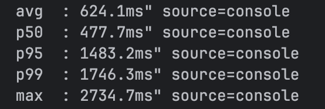
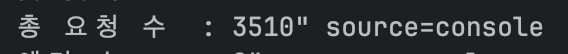
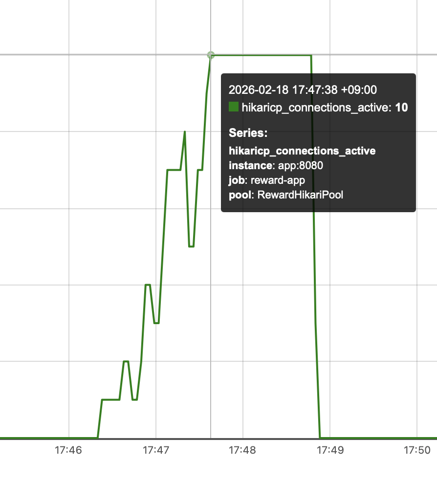
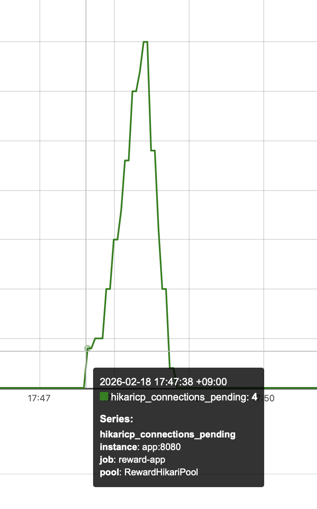
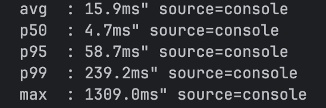
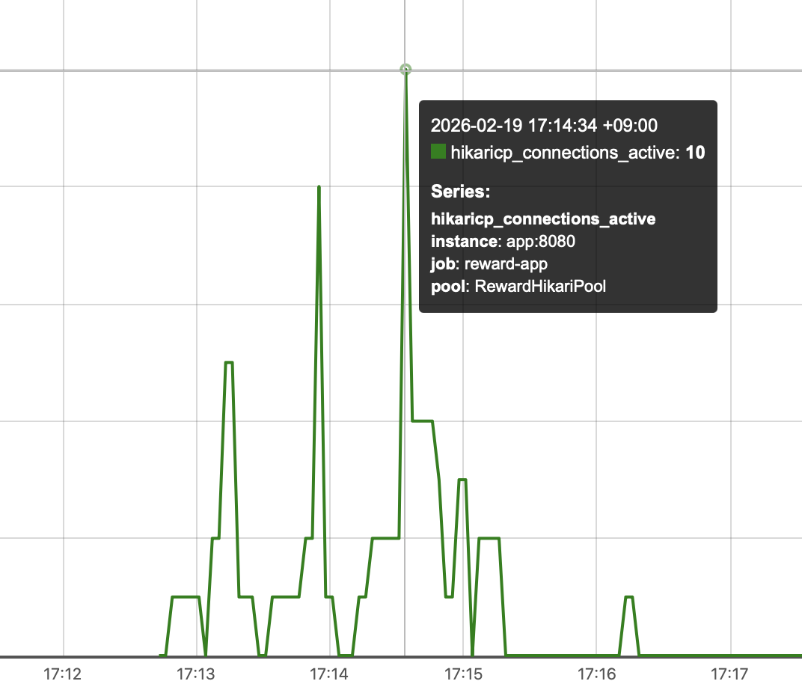
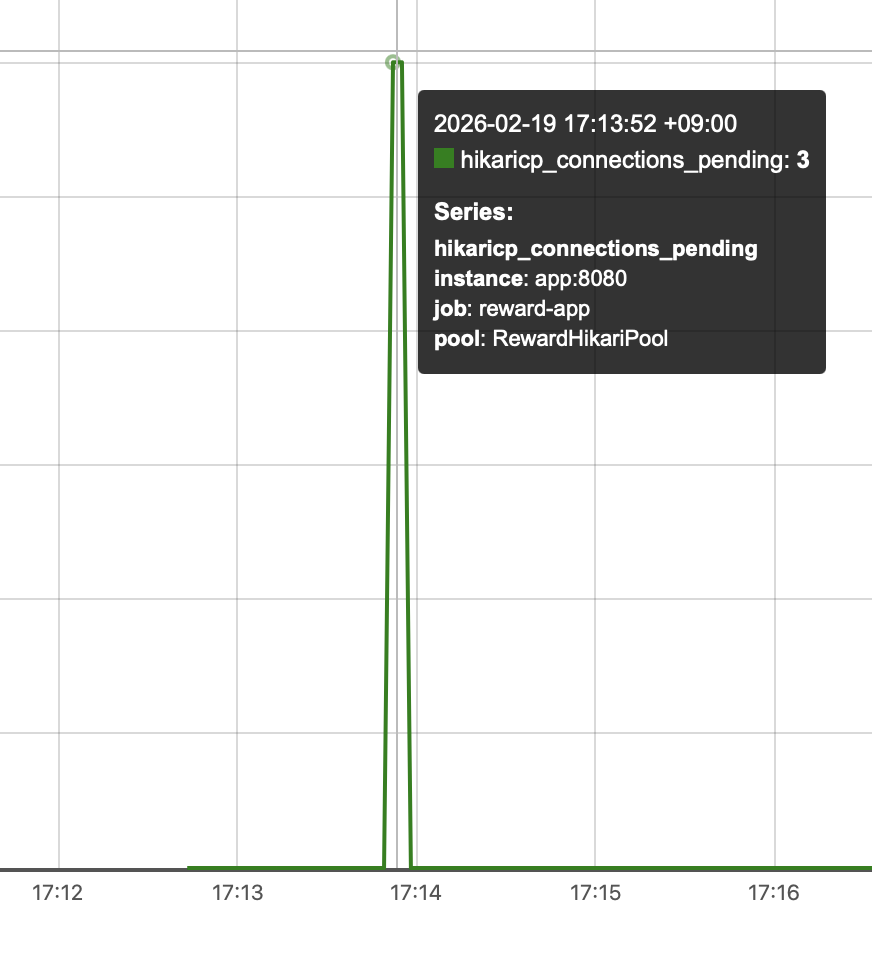

## 0\. 테스트 환경 / 관측 지표

-   부하 도구: k6 (`ramping-vus`)
-   DB: MySQL (InnoDB)
-   ORM: Spring Data JPA
-   커넥션 풀: HikariCP (`maximumPoolSize=10`)
-   관측 지표:
    -   API latency: p50/p95/p99/max
    -   HikariCP: active/pending counts

* * *

## 1\. 문제 상황


리워드 적립 API(`POST /rewards/earn`)는 주문 완료 시 우리 서비스 DB에 기록하고, 로그를 남긴 뒤 파트너사에 API로 동기화하는 흐름입니다.

부하 테스트에서 VU를 50까지 올리자 응답 시간이 급격히 치솟았습니다.

 

평균 약 624ms, 처리한 요청 수는 3,510개였습니다.

 

활성 커넥션이 부하 시작 얼마 안 돼서 10개(최대치)에 도달했고, 그 직후부터 pending이 쌓이기 시작했습니다. pending은 35개까지 치솟았습니다.

"DB가 느리다"가 아니라, 애플리케이션이 커넥션을 오래 물고 있다는 신호입니다.

* * *

## 2\. 왜 처음엔 이렇게 설계했나

지금 보면 "외부 HTTP 호출을 트랜잭션에 넣다니" 싶지만, 당시엔 나름 합리적이었습니다.

-   "적립 성공하면 감사 로그도 남기고, 파트너 동기화도 반드시 성공해야지."
-   "중간에 실패하면 전체 롤백하는 게 안전하잖아."

논리적으로 하나의 업무 흐름처럼 보여서 트랜잭션 하나로 묶었던 것입니다.

그런데 트랜잭션이 '논리적 흐름'을 묶어주는 건 아닙니다. 결국 커넥션과 락을 얼마나 오래 잡느냐의 문제입니다.

* * *

## 3\. 트랜잭션이 너무 오래 산다

커넥션 풀 고갈의 흔한 원인은 두 가지입니다.

1.  쿼리 자체가 느려서 커넥션을 오래 점유
2.  쿼리는 빠른데 트랜잭션 경계가 넓어서 커밋이 늦고, 커넥션 반환도 늦음

이번 건 2번이 99.99% 유력해 보였습니다. pending이 빠르게 쌓였고, "특정 구간에서 요청이 멈춘 느낌"이 있었습니다.

* * *

## 4\. 트랜잭션 안의 외부 I/O

당시 코드입니다.

```kotlin
@Transactional
fun earnReward(request: EarnRewardRequest): EarnRewardResponse {

    // 1) X lock 획득
    val summary = userRewardSummaryRepository
        .findByUserIdAndYearMonthForUpdate(userId, yearMonth)

    // 2) 내부 상태 변경
    summary.totalAmount += request.amount

    // 3) ledger 기록
    val ledger = rewardLedgerRepository.save(
        RewardLedger(...)
    )

    // 4) audit 기록
    auditLogRepository.save(
        AuditLog(...)
    )

    // 5) 파트너사 동기화 (외부 HTTP)
    partnerApiClient.syncRewardPoints(
        userId = request.userId,
        amount = request.amount,
        ledgerId = ledger.id
    )
}
```

파트너 호출은 동기 방식이었습니다.

```kotlin
@Component
class PartnerApiClient(
    private val webClient: WebClient
) {
    fun syncRewardPoints(userId: Long, amount: Long, ledgerId: Long) {
        webClient.post()
            .uri("/api/v1/points/sync")
            .bodyValue(
                SyncRequest(
                    userId = userId,
                    amount = amount,
                    idempotencyKey = ledgerId.toString()
                )
            )
            .retrieve()
            .bodyToMono(Void::class.java)
            .block() // 응답이 올 때까지 대기
    }
}
```

핵심은 `.block()`입니다.

-   네트워크 응답이 올 때까지 스레드 대기
-   트랜잭션은 안 끝남
-   커넥션과 X lock 계속 점유

> 외부 네트워크 지연이 그대로 커넥션 점유 시간, 락 점유 시간이 됩니다.

* * *

## 5\. 상한 계산

풀 사이즈 10, 외부 호출로 트랜잭션이 평균 100ms 늘어난다면:

```
최대 처리량 상한 ≈ poolSize / holdingTime
                = 10 / 0.1
                = 100 tx/s
```

단순한 계산이지만 시사점은 큽니다.

-   요청 몰리면 10개만 실행, 나머지는 커넥션 대기
-   대기열(pending) 쌓이고, p95/p99 급등

* * *

## 6\. 락 대기가 커넥션을 연쇄로 묶는다

더 나쁜 건 `SELECT ... FOR UPDATE`입니다.

-   요청 A가 X lock 잡은 채 파트너 응답 대기
-   요청 B~N은 같은 row의 X lock 풀릴 때까지 대기
-   B~N도 트랜잭션 안에서 대기하니까 자기 커넥션을 물고 기다림

동일 userId가 hot key가 되면:

-   락 대기열이 커넥션 점유열로 바뀜
-   풀 전체가 빠르게 소진
-   관계없는 userId 요청까지 영향

커넥션 부족은 표면적인 결과였습니다.

> 트랜잭션 경계, 락 경합, 외부 I/O가 겹치면서 커넥션 풀이 빠르게 고갈된 것입니다.

* * *

## 7\. 원자성 경계를 잘못 잡았다

각 작업이 정말 "같이 커밋돼야 하는가?"로 분해하면 답이 보입니다.

| 작업 | 내부 정합성에 원자적으로 필요? | 트랜잭션에 묶을 실익 |
| --- | --- | --- |
| summary UPDATE + ledger INSERT | ✅ | 큼 |
| audit INSERT | ❌ | 낮음 |
| 파트너 API 호출 | ❌ (애초에 원자성 불가) | 없음 |

파트너 동기화는 트랜잭션에 넣는다고 원자성이 생기지 않습니다.

-   외부 호출 성공 → 내부 DB 롤백: "외부는 적립, 내부는 미적립"
-   외부 호출 실패 → 내부 DB 커밋: "내부는 적립, 외부는 미반영"

> 외부 시스템과의 정합성은 트랜잭션으로 해결되지 않습니다. 멱등성, 재시도, 비동기 처리로 풀어야 하는 문제입니다.

* * *

## 8\. 왜 `@Async`가 아니라 Outbox인가

외부 호출을 트랜잭션 밖으로 빼는 방법은 여럿 있습니다. 가장 쉬운 건 `@Async`입니다.

### 옵션 A: `@Async`

장점:

-   구현 쉽고 latency 즉각 개선

단점:

-   프로세스 재시작 시 유실
-   실패 재시도/상태 추적/운영 대응을 직접 구현해야 함

### 옵션 B: Transactional Outbox

장점:

-   "DB 커밋"과 "처리 예약"이 같은 트랜잭션 → 예약이 100% 보장되면 이후 수행은 어렵지 않음
-   상태(PENDING/DONE/DEAD\_LETTER)로 운영 가능
-   서버 재시작해도 DB에 PENDING 이벤트가 남아서 재처리 가능

단점:

-   폴링 지연 (유저에게 빠른 결과 못 줌)
-   outbox 테이블 운영 필요 (정리/인덱스/모니터링)
-   기본적으로 at-least-once → 멱등성 구현 필요

이 시스템은 유실을 허용하기 어려웠고, 추적 가능성이 더 중요했습니다. 옵션 B를 선택했습니다.

* * *

## 9\. 트랜잭션 경계 축소 + Outbox

메인 트랜잭션에서는 내부 정합성만 처리합니다.

```kotlin
@Transactional  // 커넥션 점유: 짧아짐
fun earnReward(request: EarnRewardRequest): EarnRewardResponse {

    val summary = userRewardSummaryRepository
        .findByUserIdAndYearMonthForUpdate(userId, yearMonth)

    summary.totalAmount += request.amount

    val ledger = rewardLedgerRepository.save(...)

    // "나중에 처리할 작업"을 같은 트랜잭션에 기록
    outboxEventRepository.save(
        OutboxEvent(
            type = "REWARD_EARNED",
            payload = toJson(ledger),
            status = "PENDING",
            retryCount = 0
        )
    )
}
```

처리는 별도 스케줄러에서 합니다.

```kotlin
@Scheduled(fixedDelay = 500)
fun processOutbox() {
    outboxEventRepository.findPending(MAX_RETRY).forEach { event ->
        try {
            val payload = parse(event.payload)

            partnerApiClient.syncRewardPoints(
                userId = payload.userId,
                amount = payload.amount,
                ledgerId = payload.ledgerId
            )

            auditLogRepository.save(...)
            event.status = "DONE"
        } catch (ex: Exception) {
            event.retryCount++
            if (event.retryCount >= MAX_RETRY) event.status = "DEAD_LETTER"
        }
        outboxEventRepository.save(event)
    }
}
```

* * *

## 10\. 감수한 트레이드오프

### 10.1 즉시성 대신 "최대 지연"을 정의했다

폴링(500ms)을 쓰는 순간, 파트너 반영은 "즉시"가 아니게 됩니다.

-   평균 지연: ~250ms
-   최악 지연: ~500ms + 처리 시간 + 큐잉

즉시성 대신 상한이 있는 지연을 선택한 것입니다. 이는 요구사항을 어떻게 정의하느냐의 문제입니다.

### 10.2 Exactly-once는 자동으로 생기지 않는다

Outbox는 대개 at-least-once 전송입니다. 중복 전송 가능성을 전제로 하므로 파트너 API에 멱등성 키가 필요합니다.

-   `ledgerId`를 idempotency key로 사용
-   동일 key 재요청 시 중복 적립 방지

### 10.3 Outbox는 새로운 운영 대상이다

도입과 동시에 다음이 운영 이슈가 됩니다.

-   PENDING 누적 시 알림/모니터링
-   DONE 데이터 정리 (보관 주기)
-   폴링 쿼리 효율 (인덱스, 배치 크기)
-   DEAD\_LETTER 처리 프로세스 (수동 재처리/원인 분석)

* * *

## 11\. 결과




| 지표 | Before | After | 개선율 |
| --- | --- | --- | --- |
| avg | 624.1ms | 15.9ms | \-97% |
| p50 | 477.7ms | 4.7ms | \-99% |
| p95 | 1,483.2ms | 58.7ms | \-96% |
| p99 | 1,746.3ms | 239.2ms | \-86% |
| max | 2,734.7ms | 1,309.0ms | \-52% |
| 처리량 | 3,510건 | 21,725건 | +6.2배 |

평균 응답 시간이 대폭 줄었고, 시간당 처리량이 6배 늘었습니다.

 

-   활성 커넥션이 최대치에 도달한 시점이 훨씬 늦어지고, 지속 시간도 짧아졌습니다.
-   pending도 기존 대비 10배 이상 줄었습니다.

쿼리 튜닝이나 아키텍처 변경 없이 얻은 결과입니다.

> 네트워크 대기 시간을 트랜잭션 자원(커넥션/락)에서 분리한 덕분입니다.

* * *

## 12\. 핵심 인사이트

-   트랜잭션 경계는 커넥션/락 점유 구간입니다. 단순한 "코드 블록"이 아닙니다. 뭘 묶고 뭘 빼야 하는지, 비즈니스 판단이 먼저입니다.
-   외부 호출을 트랜잭션 안에 두면, 네트워크 지연이 고스란히 DB 자원 점유로 이어집니다.
-   Outbox가 마법처럼 다 해결해주진 않습니다. 유실 없는 비동기 처리를 위한 최소 장치일 뿐입니다.
-   대신 즉시성, 운영 부담, 멱등성 설계 비용을 함께 지불해야 합니다.
