2026년 11월 해커톤 1호선톤에서는 심사의 일부를 가상 투자로 진행했습니다. 참가자와 운영진이 가상의 투자금을 받아 다른 팀의 부스를 둘러보고, 마음에 드는 팀에 휴대폰으로 투자하는 방식입니다. 팀이 모은 투자 총액은 심사에 반영됐고, 팀별 순위는 행사장 대형 화면에 실시간으로 표시됐습니다. 저는 이 투자를 처리하는 시스템을 개발했습니다.

<figure>
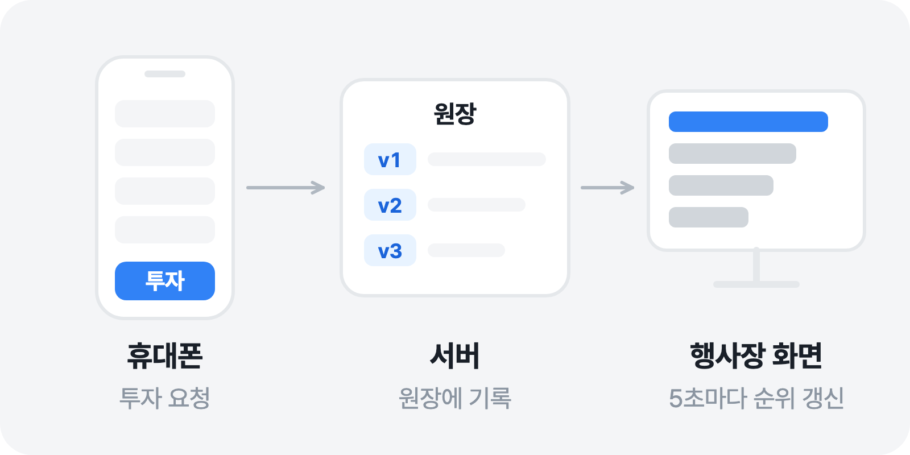
<figcaption>그림 1. 투자 처리 흐름</figcaption>
</figure>

이 방식에는 한 가지 특징이 있습니다. 투자자 대부분이 심사를 받는 팀의 팀원이라는 점입니다. 다른 팀을 평가하는 사람이 동시에 평가를 받는 사람이기도 합니다. 시스템은 이 점에 대해 자기 팀에 투자하는 요청만 막았습니다.

행사가 끝난 뒤 투자 기록 487건으로 두 가지를 확인했습니다. 하나는 실시간 순위판이 투자를 상위 팀으로 몰리게 했는지입니다. 투자 서비스에서 흔히 걱정하는 문제라서, 투자자 점수 규칙도 이런 쏠림에 보상을 주지 않도록 정해 두었습니다. 다른 하나는 자기 팀 투자 금지만으로 충분했는지입니다.

두 질문의 답은 다르게 나왔습니다. 순위판이 투자를 끌어온 효과는 데이터로 구분되지 않았습니다. 반면 팀끼리 투자를 주고받은 흔적은 우연으로 보기 어려울 만큼 많았고, 자기 팀과 순위가 가까운 팀을 덜 고른 흔적도 보였습니다. **자기 팀 투자 금지만으로는 투자자가 곧 경쟁자라는 문제를 막지 못했습니다.**

이 글에서는 시스템의 규칙과 점수 계산 방식, 행사 당시를 원장으로 복원한 방법, 두 질문의 분석 결과, 그리고 다시 만든다면 바꿀 규칙을 차례로 정리합니다.

## 투자 규칙

투자자는 참가자 117명과 운영진 20명이었고, 각자 가상 투자금 100만 원을 받았습니다. 이 중 108명이 약 2시간 동안 20팀에 투자 487건, 총 1억 370만 원을 넣었습니다. 투자에는 네 가지 규칙을 두었습니다.

<figure>
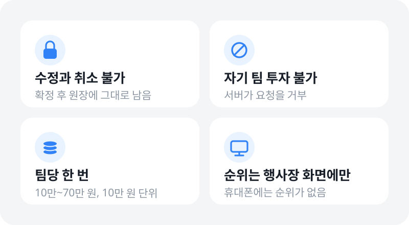
<figcaption>그림 2. 투자 규칙</figcaption>
</figure>

순위는 행사장 대형 화면에만 띄웠습니다. 화면은 약 5초마다 순위를 다시 조회했고, 방금 투자를 받은 팀과 순위 변화를 강조해 보여 줬습니다.

<figure>
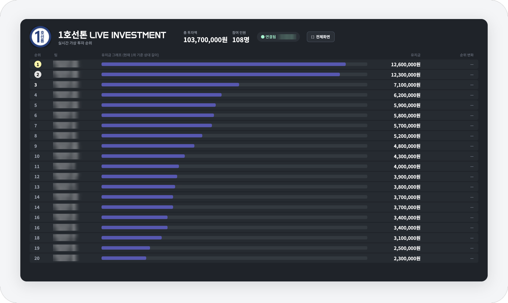
<figcaption>그림 3. 행사장 대형 화면의 순위 대시보드 (팀 번호는 가림)</figcaption>
</figure>

투자자의 휴대폰 화면에는 순위가 없습니다. 팀을 고르고 금액을 선택한 뒤, 확인 창에서 한 번 더 확인하고 투자를 확정합니다.

<figure>
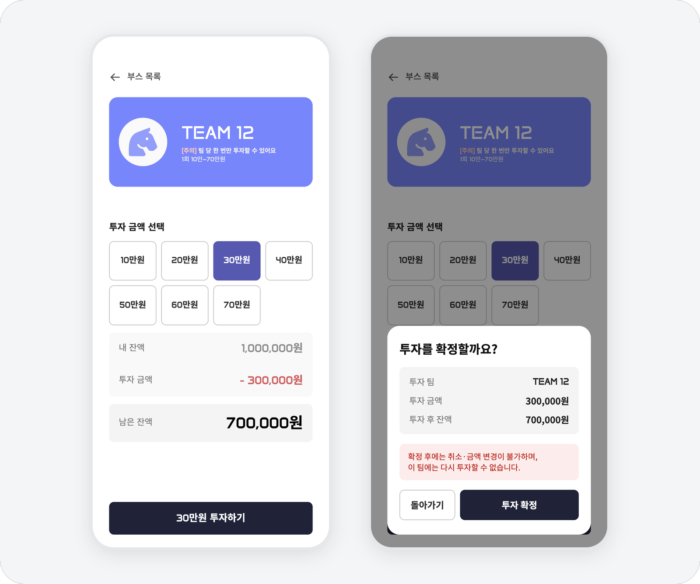
<figcaption>그림 4. 투자자 휴대폰의 금액 선택과 투자 확정 화면</figcaption>
</figure>

## 투자자 성과 점수

팀만 평가한 것은 아닙니다. 좋은 팀을 고른 투자자를 가리기 위해 투자자마다 성과 점수를 계산했고, 점수 규칙은 행사가 끝날 때 공개했습니다.

점수는 투자금 10만 원마다, 투자한 팀의 최종 순위로 정합니다. 1위 팀은 10점, 10위 팀은 1점이고, 11위부터는 1점에서 10점까지 잃습니다. 2위 팀에 60만 원, 15위 팀에 40만 원을 투자했다면 6 × 9 + 4 × (−5) = 34점입니다.

```kotlin
fun points(rank: Int): Int {
    require(rank in 1..20)
    return if (rank <= 10) 11 - rank else 10 - rank
}
```

배점은 두 가지 방식을 놓고 골랐습니다. 투자한 팀의 유치액에 비례해 점수를 주면, 투자가 가장 많이 몰린 팀을 고른 사람이 가장 큰 점수를 받습니다. 순위가 계속 공개되는 행사에서는 상위 팀을 따라 투자한 사람이 보상을 받는 구조가 됩니다. 그래서 설계 문서에 아래 문장을 남기고, 순위마다 정해진 점수를 주는 방식을 골랐습니다.

> 유치액 격차에 비례하는 배점은 인기 팀 집중에 더 큰 보상을 주므로 사용하지 않아요.

<figure>
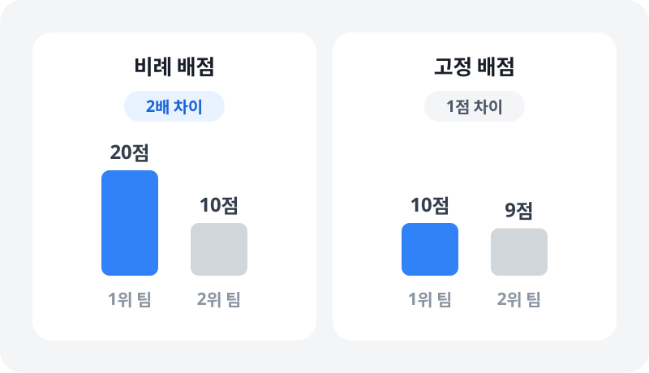
<figcaption>그림 5. 비례 배점과 고정 배점 (가상 예시)</figcaption>
</figure>

점수는 따로 저장하지 않고, 관리자가 조회할 때마다 원장 전체로 다시 계산합니다. 투자자 137명이 100만 원을 10만 원씩 나눠 투자해도 원장은 1,370건을 넘지 않아서, 캐시 없이 매번 계산해도 충분했습니다.

다만 계산 도중에 새 투자가 확정되면, 팀 순위와 개인 투자 내역을 서로 다른 시점에 읽어 어느 시점에도 없던 점수가 나올 수 있습니다. 그래서 팀, 투자자, 원장, 버전을 MySQL REPEATABLE READ 읽기 트랜잭션 하나에서 일괄 조회해 같은 스냅샷으로 계산했습니다. 투자마다 붙는 이 버전 번호는 행사가 끝난 뒤 당시 상황을 복원할 때 다시 쓰입니다.

<figure>
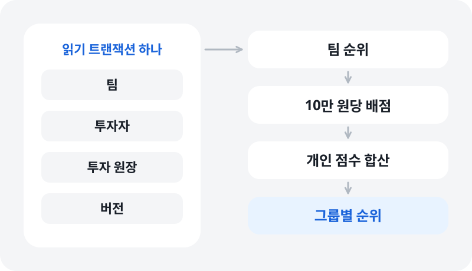
<figcaption>그림 6. 성과 점수 계산 순서</figcaption>
</figure>

## 원장으로 투자 순간의 순위 복원하기

순위판이 투자를 몰리게 했는지 확인하려면, 투자가 확정되는 순간 화면에 어떤 순위가 떠 있었는지 알아야 합니다. 하지만 대시보드가 보여 준 순위는 저장하지 않았습니다. 특정 시점의 순위를 보관하는 기능은 처음부터 범위에서 뺐기 때문입니다.

대신 원장이 있었습니다. 확정된 투자는 수정도 취소도 되지 않고, 투자마다 전역 버전 번호가 붙습니다. 버전 순서대로 투자를 하나씩 다시 더하면 각 투자가 확정되기 직전의 팀별 총액과 순위를 그대로 계산할 수 있습니다. event sourcing에서 이벤트를 처음부터 다시 적용해 과거 상태를 만드는 replay와 같은 방식입니다.

<figure>
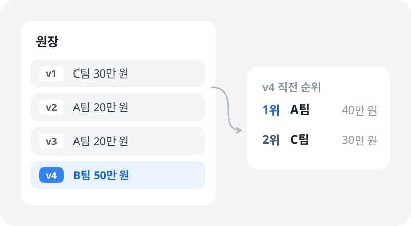
<figcaption>그림 7. 원장을 다시 쌓아 계산한 순위 (가상 예시)</figcaption>
</figure>

화면은 약 5초마다 순위를 다시 조회했으므로, 이렇게 계산한 순위는 실제 화면과 최대 5초 차이입니다. 같은 방법으로 그 순간 투자자가 고를 수 있었던 팀도 복원했습니다. 자기 팀과 이미 투자한 팀은 서버가 거부하므로 선택지에서 뺍니다.

```python
cum = Counter()           # 팀별 누적 유치액
done = defaultdict(set)   # 투자자별로 이미 투자한 팀
for inv in sorted(ledger, key=lambda r: r.version):
    shown = rank(cum)     # 이 투자가 확정되기 직전의 순위
    choices = [t for t in TEAMS
               if t not in done[inv.investor] and t != own_team(inv.investor)]
    situations.append((inv, shown, choices))
    cum[inv.team] += inv.amount
    done[inv.investor].add(inv.team)
```

투자를 수정할 수 있었다면 수정 이력을 따로 남겨야 같은 복원이 가능했을 것입니다. 원장을 수정할 수 없게 만든 이유는 심사에 쓸 합계와 개인 잔액을 맞추기 위해서였는데, 같은 결정이 분석의 기반이 됐습니다. 분석에는 계정을 가명으로 바꾸고 이름과 발급 코드를 지운 데이터만 썼고, 이 글에서도 팀 번호 없이 집계만 다룹니다.

## 같은 팀끼리 비교하면 사라지는 순위판 효과

먼저 투자 순간에 상위 3위였던 팀이 선택된 횟수를 셌습니다. 첫 투자는 아직 순위가 없으므로 빼고 486건을 봤습니다. 이 중 125건이 그 순간의 상위 3팀으로 갔습니다. 고를 수 있던 팀 중에서 무작위로 골랐다면 65.9건 정도였을 테니 1.9배입니다.

하지만 이 숫자로는 원인을 알 수 없습니다. A팀의 아이디어가 처음부터 좋았다고 해 보겠습니다. 사람들은 아이디어가 좋아서 A팀에 투자하고, 그 결과 A팀은 상위로 올라갑니다. 이때도 상위 팀에 투자가 몰린 것처럼 보이지만, 순위판은 아무 역할도 하지 않았습니다.

<figure>
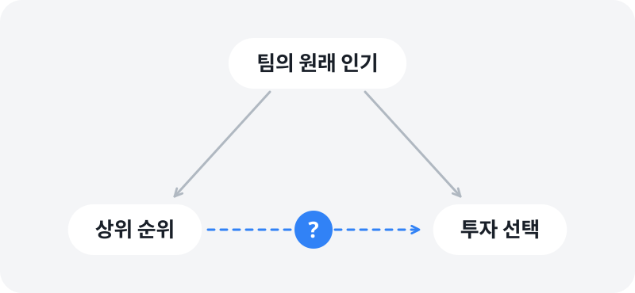
<figcaption>그림 8. 팀 인기와 순위, 선택의 관계</figcaption>
</figure>

두 설명을 나누려면 같은 팀을 기준으로 비교해야 합니다. 행사 중에는 순위가 계속 바뀌므로 한 팀에도 상위 3위 안에 있던 시간과 밖에 있던 시간이 함께 있습니다. A팀이 2시 30분에는 2위였다가 3시에는 5위로 내려갔다고 해 보겠습니다. A팀의 아이디어는 그대로이므로, 2위일 때 A팀을 고른 비율이 5위일 때보다 높다면 그 차이는 순위가 보였기 때문입니다.

<figure>
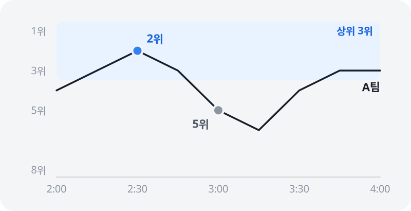
<figcaption>그림 9. 같은 팀, 다른 순위 (가상 예시)</figcaption>
</figure>

이 비교를 20팀과 투자 487건 전체에 대해 한 번에 계산하는 모형이 team fixed effects를 넣은 conditional logit입니다. 투자 한 건을 고를 수 있던 팀 중 하나를 고른 선택으로 보고, 팀마다 원래 인기를 나타내는 값을 따로 둔 채 상위 3위 여부의 효과를 추정합니다. 한 사람의 여러 투자는 서로 독립이 아니므로, 신뢰구간은 투자자 단위로 다시 뽑는 cluster bootstrap으로 구했습니다.

<figure>
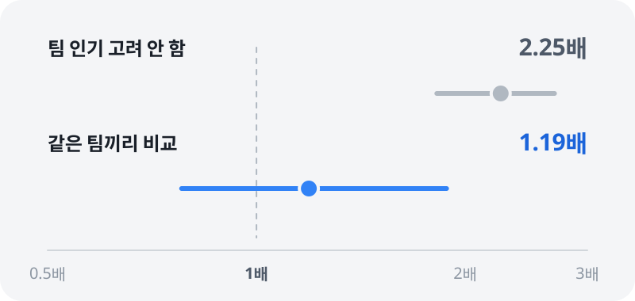
<figcaption>그림 10. 상위 3위 팀을 고를 odds ratio</figcaption>
</figure>

팀의 원래 인기를 고려하지 않으면 상위 3위 팀을 고를 odds ratio는 2.25배입니다. 같은 팀끼리 비교하면 1.19배로 줄고, 95% 신뢰구간이 0.78배에서 1.88배까지라 효과가 없는 경우인 1배와 구분되지 않습니다. 첫 집계의 1.9배는 대부분 원래 인기 있는 팀이 상위에 있었기 때문에 생긴 것입니다.

다만 신뢰구간 위쪽 끝인 1.88배는 작은 효과가 아닙니다. 펀드도 신문의 순위 목록에 간신히 이름을 올렸느냐, 아깝게 빠졌느냐에 따라 들어오는 투자금이 크게 달라지기도 합니다. 그래서 그 정도 효과가 있었다면 결과가 달라졌을지도 확인했습니다. 추정한 모형으로 행사를 1,000번 다시 돌렸더니, 실제 1위 팀이 1위를 한 비율은 순위 효과가 없을 때 83%, 1.88배일 때 84%로 거의 같았습니다.

> 순위판을 행사 내내 띄웠지만, 순위가 투자를 끌어온 효과는 이 데이터로 구분되지 않았습니다. 있었더라도 1위를 바꿀 크기는 아니었습니다.

한계도 있습니다. 휴대폰에는 순위가 없었으므로, 투자자가 투자하는 순간 행사장 화면을 봤는지는 알 수 없습니다.

## 우연보다 많았던 상호 투자

팀 단위로 투자를 묶어 보니 다른 패턴이 보였습니다. A팀 참가자가 B팀에 투자했다면, B팀 참가자도 A팀에 투자한 경우가 많았습니다.

이것도 건수만 세서는 판단할 수 없습니다. 투자를 많이 하는 팀과 많이 받는 팀이 있으면 우연만으로도 서로 투자한 쌍이 생기기 때문입니다. 그래서 A팀이 B팀에 투자한 건수를 A팀이 원래 투자를 많이 하는 정도, B팀이 원래 투자를 많이 받는 정도, 두 팀 사이의 관계로 나눴습니다. 심리학에서 사람들이 서로를 평가한 데이터를 분석할 때 쓰는 Social Relations Model입니다. 두 팀 사이의 관계가 양방향으로 맞물리는 정도를 상호성이라고 부르겠습니다. 상호성은 −1에서 1 사이의 상관계수라서, 0이면 주고받는 경향이 없다는 뜻입니다.

비교 기준으로는 투자 대상만 무작위로 섞은 행사 2,000개를 만들었습니다. A팀 참가자가 C팀에, B팀 참가자가 D팀에 투자했다면 두 투자의 대상을 맞바꿉니다. 이 교환을 계속 반복하면 참가자별 투자 건수와 팀별로 받은 건수는 그대로 두고, 누가 어느 팀에 투자했는지만 무작위인 행사가 만들어집니다. 자기 팀 투자 금지와 한 팀에 한 번만 투자하는 규칙도 지켰습니다. 테스트에서 같은 제약을 만족하는 무작위 입력을 많이 만들어 기준선을 세우는 것과 같은 방식입니다.

<figure>
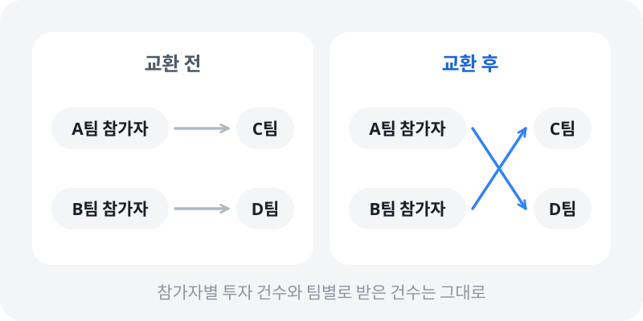
<figcaption>그림 11. 투자 대상 교환</figcaption>
</figure>

<figure>
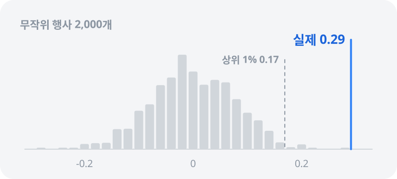
<figcaption>그림 12. 무작위 행사와 실제 행사의 상호성</figcaption>
</figure>

실제 행사의 상호성은 0.29였습니다. 무작위 행사 2,000개는 평균이 0이었고, 가장 높은 1%도 0.17 이하였습니다. 투자 시각에서도 같은 결과가 나왔습니다. 서로 투자한 두 팀이 상대 팀에 처음 투자한 시각의 차이는 중앙값 17.8분으로, 투자 시각을 무작위로 섞었을 때의 26.2분보다 짧았습니다. 부스가 가까워서 생긴 패턴인지도 행사장 배치도로 확인했지만, 거리와는 거의 관계가 없었습니다.

미리 약속하고 주고받았는지, 원래 가까운 팀끼리 투자했는지는 이 데이터로 구분할 수 없습니다. 다만 평가하는 사람이 이해관계자이기도 하면 흔히 생기는 일입니다. 피겨스케이팅도 심판이 자국 선수에게 점수를 더 주고 심판끼리 점수를 주고받는 문제를 겪은 뒤 채점 방식을 바꿨습니다.

## 순위가 가까운 팀을 피한 흔적

참가자들은 자기 팀과 순위가 가까운 팀도 덜 골랐습니다. 우리 팀이 6위이고 B팀이 7위라고 해 보겠습니다. B팀에 30만 원을 투자하면 B팀이 우리 팀을 앞지를 수 있습니다. 투자자 점수 규칙은 행사가 끝날 때 공개했으므로, 행사 중에 참가자가 신경 쓸 수 있던 숫자는 자기 팀의 총액과 순위뿐이었습니다.

같은 팀끼리 비교하는 모형으로 보면, 투자 순간 자기 팀과 순위 차이가 3 이내인 팀을 고를 odds ratio는 0.67배였습니다(95% 신뢰구간 0.52~0.82). 다만 범위를 2 이내나 1 이내로 좁히면 효과가 약해지고, 여러 범위를 시험해 얻은 결과라서 상호 투자보다 약한 근거로 봅니다.

<figure>
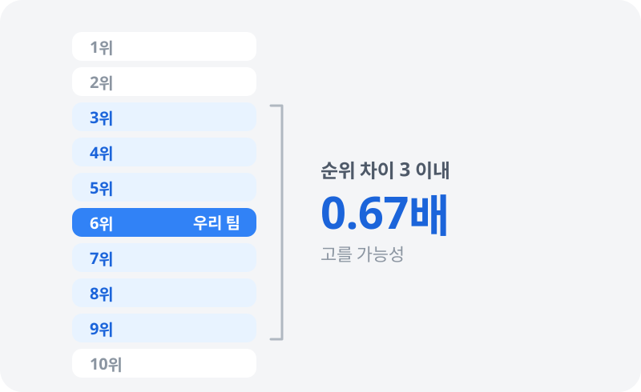
<figcaption>그림 13. 순위가 가까운 팀을 고를 가능성</figcaption>
</figure>

## 자기 팀 투자 금지가 놓친 것

자기 팀 투자 금지는 자기 팀의 총액을 직접 올리는 것을 막습니다. 그런데 투자 총액은 다른 팀과 비교되어 순위가 됩니다. 순위가 가까운 팀에 투자하지 않는 것도, 우호적인 팀과 투자를 주고받는 것도 자기 팀의 순위를 바꿉니다. 다른 팀에 대한 투자도 자기 팀의 이해와 연결되어 있었습니다.

서로를 추천해 수상자를 뽑는 문제에서는 이 조건을 impartiality라고 부릅니다. 내 추천이 내 수상 여부에 영향을 주지 않아야 한다는 조건입니다. 자기 팀 투자 금지는 내 팀에 투자하지 않는지를 검사했을 뿐, 내 투자가 내 팀의 결과에 영향을 주지 않는다는 것까지 보장하지는 않았습니다.

## 다시 만든다면

### 투자 대상을 두 그룹으로 나누기

팀을 두 그룹으로 나누고, 참가자는 상대 그룹의 팀에만 투자하게 합니다. 순위도 그룹 안에서 따로 매깁니다.

<figure>
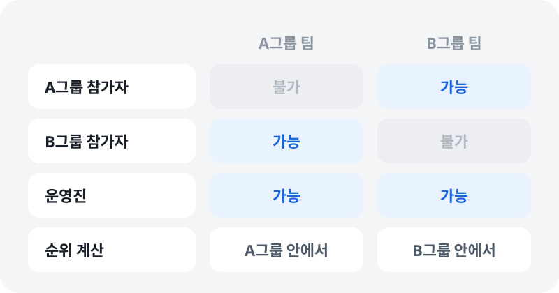
<figcaption>그림 14. 두 그룹으로 나눈 투자 구조</figcaption>
</figure>

이렇게 하면 내 투자는 상대 그룹의 순위만 바꾸므로 내 팀의 순위에는 영향을 주지 않고, 순위가 가까운 팀을 피할 이유도 사라집니다. 서버에서는 투자 요청을 검증할 때 자기 팀인지 보던 조건을 상대 그룹의 팀인지 보는 조건으로 바꾸면 됩니다. 대신 참가자가 고를 수 있는 팀이 절반으로 줄고, 두 그룹 사이에서 투자를 주고받는 것은 여전히 막지 못합니다.

### 주고받은 투자를 운영 중에 보여 주기

상호 투자는 규칙으로 막기 어렵습니다. 친한 팀끼리 투자하는 것까지 막을 수는 없기 때문입니다. 대신 운영 중에 볼 수 있게 하겠습니다. 원장에는 누가 언제 어느 팀에 투자했는지가 모두 남으므로, 짧은 시간 안에 서로 투자를 주고받은 팀 쌍을 관리자 화면에 표시할 수 있습니다. 판단은 운영진의 몫이지만, 패턴이 보이면 행사 중에 안내할 수 있습니다.

### 투자자 점수를 최종 심사 결과로 정산하기

이번에는 점수 규칙을 행사가 끝날 때 공개해서 규칙이 투자에 영향을 주지 않았습니다. 미리 공개한다면 이야기가 달라집니다. 투자 총액 순위로 점수를 주면, 점수를 올리는 방법은 좋은 팀을 고르는 것이 아니라 다른 사람들이 많이 고를 팀을 맞히는 것이 됩니다. 케인스가 말한 미인 대회와 같은 구조입니다. 가장 예쁜 얼굴이 아니라 남들이 많이 고를 얼굴을 맞혀야 이기는 대회입니다.

실제 최종 순위와 비교해 보면 이 구조의 문제가 보입니다. 최종 1위와 2위 팀은 투자 순위도 2위와 1위였지만, 최종 3위 팀은 투자 순위가 13위였습니다. 지금 규칙으로는 이 팀에 투자한 사람이 10만 원마다 3점을 잃습니다. 고정 배점은 쏠림에 주는 보상의 크기를 줄였을 뿐, 순위를 투자 총액으로 정하는 한 이 구조는 남습니다. 정산 기준을 최종 심사 결과로 옮기면 투자자 점수가 투자 총액과 분리됩니다.

### 순위 공개 여부를 feature flag로 실험하기

이번 분석은 관찰 데이터라 신뢰구간이 넓었고, 투자자가 순위를 봤는지도 알 수 없었습니다. 투자자를 무작위로 두 집단으로 나눠 한쪽 휴대폰에만 실시간 순위를 보여 주면 순위의 효과를 직접 잴 수 있습니다. 순위를 보여 준 집단의 투자 요청에는 화면에 표시된 순위의 버전을 함께 보내, 투자자가 어떤 순위를 보고 투자했는지 서버에 남깁니다. 이 실험을 하려면 행사장 화면에는 순위를 띄우지 않아야 합니다. 음악 다운로드 사이트에서 같은 방식으로 실험했을 때는 다운로드 수를 보여 준 쪽에서 인기가 소수의 곡에 더 몰렸다고 합니다.

## 마치며

이 시스템에서 가장 중요한 사실은 투자자 대부분이 경쟁자이기도 하다는 점이었습니다. 저는 그 점에 대해 자기 팀 투자를 막는 규칙 하나를 두었지만, 결과가 상대 순위로 정해지는 한 다른 팀에 대한 투자도 자기 팀의 결과와 이어졌습니다. 평가하는 사람과 평가받는 사람이 겹치는 시스템이라면, 자기 것에 손대지 못하게 하는 규칙보다 내 행동이 내 결과를 바꾸지 못하는 구조를 검증 조건으로 삼아야 합니다.

걱정한 문제가 실제로 일어났는지는 첫 집계만으로 알 수 없었습니다. 1.9배는 대부분 팀의 원래 인기였고, 같은 팀끼리 비교하고 무작위 기준선과 비교한 뒤에야 무엇이 남는지 보였습니다.

분석이 가능했던 것은 수정할 수 없는 원장과 전역 버전 덕분입니다. 정합성 때문에 넣은 설계가 행사 당시를 복원하는 데 쓰였습니다. 다음에는 확인하고 싶은 질문을 먼저 정하고, 투자자가 화면에서 본 상태처럼 나중에 필요한 값을 처음부터 기록하려고 합니다.
